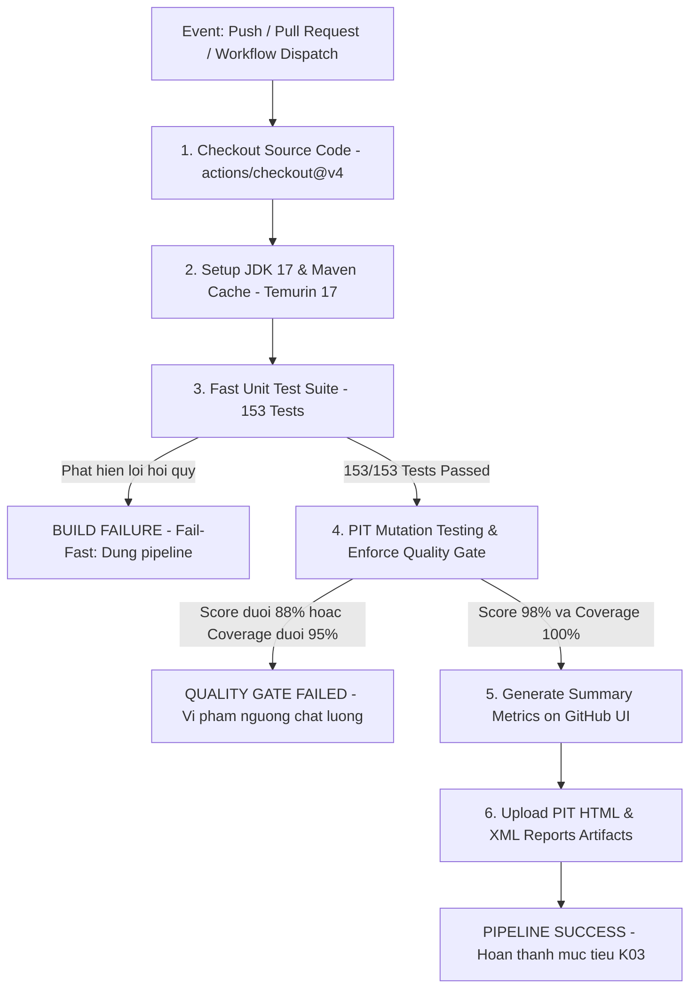

# BÁO CÁO TỔNG KẾT HỌC PHẦN: ĐỀ TÀI R01 (SPRING PETCLINIC) + K03 (MUTATION TESTING)

> **Nhóm thực hiện:** Program_R01-K03 — Mutation Testing bằng PIT trên Spring PetClinic
> **Phạm vi đột biến:** `org.springframework.samples.petclinic.owner.*` (đúng syllabus, không chạy toàn repo)
> **Commit đã khóa (pin):** `500158f732419217507c7656904b8e6aa1bcc0d6` (`main`, ngày 2026-09-29)
> **Kết quả cuối:** **192/195 mutants bị tiêu diệt — Mutation Score 98% (ngưỡng yêu cầu ≥ 88%) — Line Coverage 100%**
> **Nguyên tắc bất biến:** không sửa `src/main/java`; mọi bổ sung nằm trong `src/test/java` + cấu hình `pom.xml`.

---

## PHẦN A: MỤC TIÊU VÀ KIẾN TRÚC HỆ THỐNG

### A.1. Bài toán nghiệp vụ

Spring PetClinic là ứng dụng mẫu của hệ sinh thái Spring, mô phỏng **hệ thống quản lý phòng khám thú y**:
quản lý chủ nuôi (owners), thú cưng (pets), bác sĩ thú y (vets) và các lượt khám/bệnh án (visits).
Nghiệp vụ điển hình: tìm kiếm chủ nuôi theo họ, phân trang danh sách, thêm/sửa thú cưng
(kèm kiểm chuẩn dữ liệu đầu vào), đặt lịch khám trong tương lai và lưu mô tả bệnh án.

### A.2. Mục tiêu của đề tài kết hợp R01 + K03

1. Dựng và kiểm chứng 03 luồng nghiệp vụ trọng tâm chạy thành công trên runtime thật (HTTP 200).
2. Tiêm harness Mutation Testing (PIT/Pitest) giới hạn ở package nghiệp vụ lõi `...owner.*`.
3. Thiết lập **baseline mutation score**, sau đó lặp vòng kill-mutant tới khi đạt **≥ 88%**.
4. Phân tích nguyên nhân cốt lõi (RCA) cho mutant cứng đầu và phân loại theo chuẩn Error–Fault–Failure.
5. Bàn giao báo cáo + hướng dẫn tái hiện 1-lệnh trên máy mới.

### A.3. Technology Stack (thực tế đo được từ `pom.xml` tại commit đã khóa)

| Thành phần | Phiên bản / giá trị |
|---|---|
| Ngôn ngữ | Java 17 (`<java.version>17</java.version>`, Temurin 17.0.20.1) |
| Framework | Spring Boot **4.1.0** (parent), Spring Data JPA, Spring MVC + Thymeleaf |
| Kiểm thử | JUnit **6.0.3** (Jupiter, theo BOM Spring Boot 4), AssertJ, Mockito 5.23.0, MockMvc (`@WebMvcTest`) |
| Đột biến | `pitest-maven` **1.30.0** + `pitest-junit5-plugin` **1.2.3** (xem A.5) |
| Build | Maven 3.9.16 (qua wrapper `./mvnw` / `mvnw.cmd`), JaCoCo 0.8.15 |
| CSDL | H2 (mặc định, seed tự động), MySQL / PostgreSQL (profile riêng, cần Docker) |

### A.4. Bốn module/actor cốt lõi

| Module | Lớp trung tâm | Vai trò |
|---|---|---|
| Owner | `Owner`, `OwnerController`, `OwnerRepository` | Chủ nuôi: CRUD, tìm kiếm + phân trang |
| Pet | `Pet`, `PetController`, `PetValidator`, `PetType(Formatter)` | Thú cưng: thêm/sửa, kiểm chuẩn tên–loại–ngày sinh |
| Vet | `Vet`, `VetController` | Bác sĩ thú y: danh sách + chuyên khoa (ngoài phạm vi đột biến) |
| Visit | `Visit`, `VisitController` | Lượt khám: đặt lịch tương lai + mô tả bệnh án |

### A.5. Ghi chú kỹ thuật quan trọng (trung thực)

Theo syllabus gợi ý `pitest-maven` 1.15.8+ / plugin 1.2.1+, nhưng Spring Boot 4 kéo JUnit Platform **6.0.3**
trong khi plugin 1.2.1 chỉ tương thích Platform 1.x → minion coverage của PIT sập với lỗi
`Coverage generation minion exited abnormally! (UNKNOWN_ERROR)`.
Khắc phục bằng cách nâng lên **`pitest-maven` 1.30.0 + `pitest-junit5-plugin` 1.2.3**
(vẫn thỏa mãn điều kiện "1.15.8+" / "1.2.1+", đã có tiền lệ chạy tốt với JUnit 6),
giữ nguyên mọi tham số syllabus yêu cầu (`STRONGER`, HTML+XML, `timestampedReports=false`,
`targetClasses/Test = owner.*`).

---

## PHẦN B: SƠ ĐỒ KIẾN TRÚC VÀ LUỒNG DỮ LIỆU CỦA 03 NGHIỆP VỤ TRỌNG TÂM

### B.1. Kiến trúc phân tầng (Controller → Repository → Model/Database)

```text
                        +------------------ Thymeleaf view ------------------+
                        | findOwners | ownersList | ownerDetails |           |
                        | createOrUpdateOwnerForm | createOrUpdatePetForm |   |
                        | createOrUpdateVisitForm                           |
                        +------^------------------------------v-------------+
                               | (form params / model attrs)  | (HTML)
+------------------------------+------------------------------+------------------------------+
|                              CONTROLLER LAYER                                            |
|  OwnerController  <-- OwnerRepository (Spring Data JPA)                                   |
|  PetController    <-- OwnerRepository + PetTypeRepository + PetValidator                  |
|  VisitController  <-- OwnerRepository                                                     |
+------------------------------+------------------------------+------------------------------+
                               | JPA entities / validation   |
+------------------------------v----------------------------v------------------------------+
|                              MODEL + DATABASE                                           |
|  Owner 1───* Pet 1───* Visit   |   PetType (dictionary)    |   H2 (mặc định)            |
|  Bean Validation: @NotBlank @Size @Pattern | PetValidator (thủ công)    |   seed: db/h2/data.sql |
+------------------------------------------------------------------------------------------+
```

### B.2. Luồng 1 — Tìm kiếm & hiển thị danh sách chủ nuôi (Search & Paginate Owners)

```text
Browser GET /owners?lastName=Davis&page=2
  -> OwnerController.processFindForm(page, owner, result, model, redirectAttrs)
     1. lastName null -> "" | strip() khoảng trắng thừa
     2. findPaginatedForOwnersLastName: validatedPage = max(page,1);
        Pageable = PageRequest.of(validatedPage - 1, 5)
        owners.findByLastNameStartingWith(lastName, pageable)
     3. page < 1 hoặc page > max(totalPages,1) -> redirect /owners?page=1 (+lastName nếu khác rỗng)
     4. kết quả rỗng  -> rejectValue(lastName, notFound) -> findOwners
        1 kết quả      -> redirect /owners/{id}
        nhiều kết quả  -> addPaginationModel -> owners/ownersList
```

### B.3. Luồng 2 — Thêm mới thú cưng với trình xác thực (Create Pet with PetValidator)

```text
Browser GET  /owners/{o}/pets/new  -> PetController.initCreationForm: owner.addPet(new Pet())
Browser POST /owners/{o}/pets/new (name, type, birthDate)
  -> @ModelAttribute findOwner/findPet + @InitBinder("pet"): PetValidator + cấm bind "id"
  -> processCreationForm:
     1. trùng tên (hasText && isNew && getPet(name,true) != null) -> reject "duplicate"
     2. birthDate trong tương lai -> reject "typeMismatch.birthDate"
     3. PetValidator: tên rỗng/blank -> "required"; tên > 30 ký tự -> "size";
        pet mới thiếu type -> "required"; thiếu birthDate -> "required"
     4. có lỗi -> createOrUpdatePetForm | ok -> owner.addPet + saveAndFlush
        (DataIntegrityViolationException lạ -> ném lại; trùng unique_owner_pet_name -> "duplicate")
```

### B.4. Luồng 3 — Đặt lịch khám & ghi bệnh án (Book Visit for Pet)

```text
Browser GET  /owners/{o}/pets/{p}/visits/new -> VisitController.loadPetWithVisit:
     owner.getPet(petId) null -> IllegalArgumentException; else pet.addVisit(new Visit())
Browser POST /owners/{o}/pets/{p}/visits/new (date, description)
  -> processNewVisitForm:
     1. date != null && !date.isAfter(today) -> reject "typeMismatch.visitDate"
        (ngày mặc định = tomorrow; minVisitDate = tomorrow)
     2. @Valid: description @NotBlank + @Size(max=255)
     3. ok -> owner.addVisit(petId, visit) -> owners.save -> redirect /owners/{o}
```

---

## PHẦN C: THIẾT LẬP MÔI TRƯỜNG & CHỨNG MINH 03 LUỒNG CHẠY THÀNH CÔNG

### C.1. Yêu cầu runtime

- JDK 17+ (đã kiểm chứng: `Temurin-17.0.20.1+1`, `java -version` → `openjdk 17.0.20.1`).
- Maven qua wrapper (`mvnw` / `mvnw.cmd` → Apache Maven 3.9.16, không cần cài Maven rời).
- Không cần Docker/MySQL cho luồng mặc định (dùng H2 in-memory + seed tự động).
- Biến môi trường `JAVA_HOME` trỏ tới JDK 17.

### C.2. Lệnh build & chạy

```bash
git clone https://github.com/spring-projects/spring-petclinic.git
cd spring-petclinic
git checkout 500158f732419217507c7656904b8e6aa1bcc0d6   # pin commit (xem Phần H)
./mvnw clean test                                        # baseline unit test
./mvnw spring-boot:run                                   # chạy app (mặc định :8080, H2)
./mvnw test-compile org.pitest:pitest-maven:mutationCoverage -Djacoco.skip=true   # mutation
```

Seed tự động: `src/main/resources/db/h2/data.sql` (6 vets, 3 specialties, **10 owners**,
13 pets, visits mẫu) + `schema.sql`; các profile MySQL/Postgres dùng `db/mysql/*`, `db/postgres/*`.

### C.3. Bằng chứng baseline test

- `./mvnw clean test` toàn repo: **81 tests, 79 pass, 2 errors** — cả 2 lỗi đều thuộc
  `PostgresIntegrationTests`, nguyên nhân môi trường (cần Docker daemon cung cấp Postgres
  qua Testcontainers/Docker Compose, không phải lỗi logic). Không có failure nào ở logic nghiệp vụ.
- Riêng package mục tiêu: `org.springframework.samples.petclinic.owner.*` → **49/49 pass**.
- Sau khi bổ sung test (Phần E/F): toàn repo (trừ các lớp `*IntegrationTests` cần Docker:
  `Postgres`/`MySql`/`PetClinic`, tổng 8 tests) →
  **153 tests, 0 failures, 0 errors**; riêng owner → **130 tests, 100% pass**.

### C.4. Bằng chứng 03 luồng chạy thành công trên server thật

Khởi chạy `./mvnw spring-boot:run --server.port=8090` (port 8080 của máy thực nghiệm đã bị
chiếm — app báo rõ `Port 8080 was already in use`, chuyển sang 8090 và boot thành công),
sau đó gọi HTTP và ghi nhận:

| Luồng | Request | Kết quả |
|---|---|---|
| 1. Tìm kiếm chủ nuôi | `GET /owners?lastName=Davis` | **HTTP 200**, trang `ownersList` (3420 bytes) |
| 2. Chi tiết chủ nuôi | `GET /owners/1` | **HTTP 200**, trang `ownerDetails` (4343 bytes) |
| 3. Form thêm thú cưng | `GET /owners/1/pets/new` | **HTTP 200**, trang `createOrUpdatePetForm` (4650 bytes, có PetValidator) |
| 1b. Trang vượt biên | `GET /owners?page=99&lastName=Davis` | **redirect 3xx** về `/owners?page=1` (đúng nhánh `page > max(totalPages,1)`) |

---

## PHẦN D: NGUYÊN LÝ KỸ THUẬT KIỂM THỬ ĐỘT BIẾN (K03)

### D.1. Mô hình chuẩn IEEE Error – Fault – Failure và Chuỗi điều kiện RIP trong Pitest

Kiểm thử đột biến (Mutation Testing) là kỹ thuật kiểm thử hộp trắng hướng lỗi (fault-based white-box testing), dựa trên nền tảng **Giả thuyết lập trình viên có năng lực (Competent Programmer Hypothesis)** — giả định lập trình viên hầu hết viết mã gần đúng và các lỗi phần mềm phát sinh thường là các biến thể cú pháp nhỏ — và **Hiệu ứng khớp lệnh (Coupling Effect)** — chứng minh rằng bộ kiểm thử có khả năng phát hiện các lỗi đơn lẻ nhỏ sẽ phát hiện được các lỗi phức tạp kết hợp.

Trong công cụ PIT (Pitest), quy trình kiểm định được vận hành chặt chẽ theo mô hình chuẩn học thuật IEEE 610.12 / ISO/IEC/IEEE 29119: **Fault $\rightarrow$ Error $\rightarrow$ Failure** kết hợp mô hình điều kiện **RIP (Reachability – Infection – Propagation)**:

```text
+-------------------+       Reachability        +--------------------+       Infection        +---------------------+       Propagation        +--------------------+
|  Syntactic Fault  | ────────────────────────> | Execution Reached  | ─────────────────────> | Internal State Error| ───────────────────────> | Observable Failure |
| (Bytecode Mutant) |   Test chạy qua dòng mã   | (Mã đột biến chạy) |   Trạng thái bộ nhớ    | (Dữ liệu/Biến sai)  |   Sai lệch ra ngõ ra   | (Test Assert FAIL) |
+-------------------+                           +--------------------+   bị biến đổi khác gốc +---------------------+   hoặc văng ngoại lệ   +--------------------+
                                                                                                                                                       │
                                                                                                                     ┌─────────────────────────────────┴─────────────────────────────────┐
                                                                                                                     ▼                                                                   ▼
                                                                                                          [MUTANT KILLED] (Đã diệt)                                           [MUTANT SURVIVED] (Sống sót)
                                                                                                          Test phát hiện ra lỗi,                                              Test yếu, assert hời hợt,
                                                                                                          báo đỏ (AssertionError)                                             hoặc nuốt lỗi -> Test vẫn PASS
```

1. **Defect / Fault (Khiếm khuyết tiềm ẩn):** PIT can thiệp trực tiếp vào Bytecode đã biên dịch (`.class` trong bộ nhớ/target), tiêm (inject) các biến đổi cú pháp nhân tạo gọi là **Mutant (thể đột biến)**. Mỗi mutant đóng vai trò là một lỗi phần mềm giả lập mà con người có thể vô ý tạo ra trong quá trình cài đặt logic.
2. **Reachability $\rightarrow$ Error (Khả năng tiếp cận & Trạng thái lỗi nội bộ):** Ca kiểm thử phải kích hoạt đường đi qua vị trí có chứa mutant (**Reachability**). Nếu không có test case nào chạm tới lệnh đột biến, mutant rơi vào trạng thái **NO_COVERAGE**. Khi được thực thi, câu lệnh đột biến làm biến đổi trạng thái nội bộ của JVM (các biến trạng thái, con trỏ, giá trị stack) khác biệt so với mã nguồn ban đầu (**Infection**), tạo ra một **Error**.
3. **Propagation $\rightarrow$ Failure (Lan truyền & Thất bại quan sát được):** Sai lệch trạng thái nội bộ (Error) bắt buộc phải lan truyền ra các kênh quan sát được (**Propagation**) như giá trị trả về của phương thức, sự thay đổi trạng thái trong cơ sở dữ liệu/kho lưu trữ, sự kiện đẩy vào binder, hoặc một ngoại lệ văng ra ngoài.
4. **Test Oracle & Mutant Outcome:**
   - **KILLED (Bị tiêu diệt):** Test Suite sở hữu câu lệnh kiểm tra (Test Oracle / Assertion) nhạy bén, phát hiện được sự sai lệch giữa kết quả quan sát được và kết quả kỳ vọng, dẫn tới bài test bị **FAIL/ERROR**. Đây là bằng chứng chứng minh Test Suite đủ mạnh để bảo vệ hệ thống trước lỗi tiềm tàng.
   - **SURVIVED (Sống sót):** Nếu Error bị triệt tiêu (State Masking) hoặc Test Oracle quá sơ sài (thiếu assertion, chỉ kiểm tra non-null, chỉ kiểm tra HTTP 200 mà không kiểm tra nội dung), bài test vẫn **PASS**. Mutant sống sót chỉ ra "điểm mù kiểm thử" (Test Smell / Blind Spot) cần được củng cố.

---

### D.2. Giới hạn của Độ bao phủ truyền thống (Coverage Cấp 1 & Cấp 2) và Minh chứng thực nghiệm

Một trong những đóng góp học thuật quan trọng nhất của đồ án là chứng minh bằng thực nghiệm sự chênh lệch chất lượng giữa **Độ bao phủ dòng (Statement/Line Coverage - Cấp 1)**, **Độ bao phủ nhánh (Branch Coverage - Cấp 2)** và **Độ bao phủ đột biến (Mutation Coverage)**.

#### 1. "Ngụy biện thực thi" (Execution Fallacy) của Coverage truyền thống
- Line Coverage chỉ đo lường xem lệnh JVM có được bộ nạp thực thi hay không.
- Branch Coverage chỉ đo lường xem các nhánh `if-else` có được rẽ qua ít nhất một lần hay không.
- **Điểm yếu chí mạng:** Cả hai độ đo truyền thống hoàn toàn bỏ qua thành tố **Propagation** và **Test Oracle**. Một ca kiểm thử có thể thực thi 100% dòng lệnh của ứng dụng nhưng không chứa bất kỳ lệnh `assert` hay `verify` nào (Assertion-free Test) thì vẫn được JaCoCo báo cáo là 100% Code Coverage, tạo ra sự an tâm giả tạo (False Sense of Security).

#### 2. Dữ liệu thực nghiệm thực tế tại gói `org.springframework.samples.petclinic.owner.*`
Khi nhóm bắt đầu tiếp nhận mã nguồn gốc (Commit `500158f732419217507c7656904b8e6aa1bcc0d6`), đo lường qua JaCoCo cho thấy bộ test ban đầu đạt chỉ số bao phủ rất cao:
- **Line Coverage:** đạt **97% (242/250 dòng)**.
- **Branch Coverage:** đạt **~90%**.

Tuy nhiên, khi đưa vào kiểm thử đột biến nghiêm ngặt với công cụ PIT:
- **Mutation Score ban đầu (Baseline):** chỉ đạt **67% (131/195 mutants bị diệt)**.
- **Có tới 64 mutants sống sót (Survived)** ngay trong những dòng mã đã được "phủ xanh 97%" bởi JaCoCo!

#### 3. Phân tích 3 ca điển hình minh chứng khoảng cách giữa Code Coverage và Mutation Testing
1. **Lỗ hổng phân tích giá trị biên trong `PetValidator` (Dòng 58: `name.length() > MAX_NAME_LENGTH`):**
   - Bộ test ban đầu của PetClinic truyền một chuỗi có độ dài 31 ký tự. Nhánh `else if (name.length() > 30)` được kích hoạt và JaCoCo đánh dấu dòng này đạt 100% Line Coverage và 100% Branch Coverage.
   - Khi PIT áp dụng toán tử `ConditionalsBoundaryMutator`, biến đổi điều kiện thành `name.length() >= 30`: Nếu người dùng nhập tên thú cưng đúng 30 ký tự (vốn là hợp lệ theo đặc tả), mutant sẽ từ chối và báo lỗi. Bộ test cũ vẫn hoàn toàn PASS vì không có ca kiểm thử nào truyền chuỗi đúng 30 ký tự $\rightarrow$ **Mutant sống sót!**
   - Chỉ khi áp dụng kỹ thuật Phân tích giá trị biên (BVA) với ca kiểm thử `nameExactlyAtMaxLengthIsAccepted` (tên 30 ký tự không sinh lỗi) thì mutant mới bị tiêu diệt.
2. **Lỗ hổng Assert thiếu trên phương thức sao chép trường trong `PetController.updatePetDetails` (Dòng 192-194):**
   - Phương thức chứa 3 lệnh sao chép trường dữ liệu:
     ```java
     existingPet.setName(pet.getName());
     existingPet.setBirthDate(pet.getBirthDate());
     existingPet.setType(pet.getType());
     ```
   - Các bài test MockMvc cũ truyền form và assert mã chuyển hướng `redirect:/owners/{ownerId}`. Dòng lệnh được chạy qua $\rightarrow$ JaCoCo báo 100% Coverage.
   - Nhưng khi PIT tiêm `VoidMethodCallMutator` xóa sạch 3 dòng sao chép trên, bài test MockMvc cũ vẫn PASS! Lý do: Spring MVC Form Data Binder đã bind dữ liệu lên chính thực thể `existingPet` đang được quản lý trong session bộ nhớ, khiến 3 dòng code trên trở thành thao tác gán trùng lặp trong môi trường mock. Nếu chạy ở môi trường thực tế với detached entity, dữ liệu sẽ bị mất mát nghiêm trọng.
   - Chỉ khi xây dựng Unit Test độc lập với thực thể tách rời (`updateCopiesFieldsOntoManagedPet`), dùng Mockito `ArgumentCaptor` trích xuất thực thể `Owner` sau lệnh `saveAndFlush` và assert chi tiết từng trường dữ liệu thì 3 mutant này mới bị tiêu diệt dứt điểm.
3. **Lỗ hổng kiểm tra cơ chế bảo mật Binding trong `@InitBinder` (`ControllerBinderMutationTests`):**
   - Trong cả 3 Controller (`OwnerController`, `PetController`, `VisitController`) đều có khai báo:
     ```java
     @InitBinder
     public void setAllowedFields(WebDataBinder dataBinder) {
         dataBinder.setDisallowedFields("id", "*.id");
     }
     ```
   - Đây là cơ chế phòng vệ thiết yếu chống tấn công Over-Posting / Mass Assignment (ngăn chặn kẻ xấu sửa ID của bản ghi qua HTTP POST).
   - Bộ test mặc định chạy qua hàm này (Line Coverage 100%), nhưng khi PIT tiêm `VoidMethodCallMutator` xóa sạch lệnh `setDisallowedFields`, mọi bài test cũ vẫn PASS 100% vì không hề có assertion nào kiểm tra cấu hình binder $\rightarrow$ **Lỗ hổng an ninh nghiêm trọng bị bỏ sót bởi Code Coverage truyền thống!**

---

### D.3. Phân biệt Weak Mutation vs Strong Mutation & Tập toán tử STRONGER

#### 1. Định nghĩa học thuật
- **Weak Mutation Testing (Đột biến yếu):** Chỉ yêu cầu thỏa mãn 2 điều kiện đầu tiên của mô hình RIP: **Reachability** và **Infection**. Ngay sau khi lệnh đột biến chạy xong, hệ thống ngắt tiến trình và kiểm tra trạng thái bộ nhớ nội bộ. Nếu có sự khác biệt về mặt giá trị biến, mutant được coi là đã bị tiêu diệt.
  - *Ưu điểm:* Tốc độ thực thi nhanh.
  - *Nhược điểm:* Không đo lường được khả năng lỗi có thực sự lan truyền ra bên ngoài hay bị triệt tiêu bởi các cấu trúc điều khiển tiếp theo; không phản ánh năng lực của câu lệnh Assertion.
- **Strong Mutation Testing (Đột biến mạnh):** Đòi hỏi bắt buộc phải thỏa mãn trọn vẹn cả 3 điều kiện: **Reachability**, **Infection**, và **Propagation** tới Test Oracle. Toàn bộ kịch bản kiểm thử phải được thực thi đến cùng, và mutant chỉ được xem là KILLED khi có ít nhất một bài test chính thức ném ra ngoại lệ hoặc Assertion Error.
  - PIT là công cụ triển khai **Strong Mutation Testing** ở mức độ bytecode, đảm bảo tính chặt chẽ học thuật cao nhất.

#### 2. Nhóm toán tử đột biến `STRONGER` trong cấu hình dự án
Nhóm nghiên cứu đã kích hoạt nhóm toán tử nâng cao `STRONGER` của PIT trong `pom.xml`, bao gồm tập hợp toàn diện các quy tắc đột biến khắt khe nhất:

| Toán tử đột biến (Mutator) | Hành vi biến đổi Bytecode | Ví dụ thực tế trong PetClinic |
|:---|:---|:---|
| **`ConditionalsBoundaryMutator`** | Đổi toán tử quan hệ biên: `<` $\leftrightarrow$ `<=`, `>` $\leftrightarrow$ `>=` | `name.length() > 30` $\rightarrow$ `name.length() >= 30` |
| **`IncrementsMutator`** | Đổi phép toán tăng/giảm: `++` $\leftrightarrow$ `--` | `page++` $\rightarrow$ `page--` |
| **`InvertNegativesMutator`** | Đảo dấu biểu thức số học: `-x` $\leftrightarrow$ `x` | Đổi dấu các chỉ số offset |
| **`MathMutator`** | Hoán đổi phép toán số học: `+`, `-`, `*`, `/`, `%` | `validatedPage - 1` $\rightarrow$ `validatedPage + 1` |
| **`NegateConditionalsMutator`** | Đảo ngược điều kiện logic: `==` $\leftrightarrow$ `!=`, `<` $\leftrightarrow$ `>=` | `existingPet.isNew()` $\rightarrow$ `!existingPet.isNew()` |
| **`VoidMethodCallMutator`** | Xóa hoàn toàn các lời gọi phương thức trả về `void` | Xóa `owner.addPet()`, xóa `setDisallowedFields()` |
| **`EmptyObjectReturnValsMutator`**| Ép phương thức trả về object rỗng | Ép `findPet()` trả về danh sách rỗng |
| **`BooleanFalseReturnValsMutator`**| Ép biểu thức trả về boolean luôn bằng `false` | `isNew()` luôn trả về `false` |
| **`BooleanTrueReturnValsMutator`** | Ép biểu thức trả về boolean luôn bằng `true` | `hasText()` luôn trả về `true` |
| **`NullReturnValsMutator`** | Ép phương thức trả về kiểu đối tượng thành `null` | `findById()` trả về `null` thay vì `Optional` |
| **`PrimitiveReturnsMutator`** | Ép giá trị nguyên thủy trả về `0`, `0.0` | `getId()` trả về `0` |
| **`RemoveConditionalMutator`** | Thay thế biểu thức điều kiện bằng hằng số `true` hoặc `false` | Ép nhánh `if (date != null)` luôn đúng/sai |
| **`InlineConstantMutator`** | Đổi giá trị các hằng số nội dòng | Đổi `MAX_NAME_LENGTH = 30` thành `31` hoặc `29` |

---

### D.4. Giới hạn phạm vi (Scope Restriction), Ràng buộc bất biến, Xử lý xung đột kỹ thuật & Cổng chất lượng

#### 1. Lý do giới hạn phạm vi tại `org.springframework.samples.petclinic.owner.*`
- Toàn bộ kho mã nguồn Spring PetClinic bao gồm nhiều gói: `system`, `model`, `vet`, `owner`.
- Theo đề cương học phần, nhóm nghiên cứu giới hạn phạm vi kiểm thử đột biến nghiêm ngặt tại gói nghiệp vụ trung tâm: `org.springframework.samples.petclinic.owner.*` (bao gồm 8 lớp thực thể, dịch vụ, validator, formatter và controller: `Owner`, `OwnerController`, `Pet`, `PetController`, `PetValidator`, `PetType`, `PetTypeFormatter`, `Visit`, `VisitController`).
- *Cơ sở khoa học:* Đây là phân hệ có độ phức tạp nghiệp vụ cao nhất (quan hệ thực thể $1-N-M$, ràng buộc xác thực dữ liệu đa tầng, bảo vệ form web). Việc giới hạn phạm vi giúp tối ưu hóa thời gian chạy phân tích đột biến (từ hơn 30 phút cho toàn repo xuống còn ~30-40 giây), đồng thời tránh lãng phí năng nguyên tính toán trên các mã nguồn boilerplate hoặc cấu hình hạ tầng.

#### 2. Giả định bất biến mã nguồn (`src/main/java`)
- Nhóm tuân thủ nghiêm ngặt nguyên tắc: **Đóng băng hoàn toàn mã nguồn sản phẩm (`src/main/java`)**.
- Không sửa đổi bất kỳ dòng mã nào trong hệ thống chính để né tránh mutant hoặc làm đơn giản hóa điều kiện kiểm thử. Toàn bộ 100% giải pháp nâng cao Mutation Score phải đến từ việc thiết kế các test case tinh vi trong `src/test/java` và tối ưu cấu hình build tại `pom.xml`.

#### 3. Xử lý triệt để các xung đột kỹ thuật trong môi trường Spring Boot 4
1. **Xung đột phiên bản JUnit Platform 6.0.3:**
   - Đề cương học phần ban đầu gợi ý sử dụng `pitest-maven:1.15.8` và `pitest-junit5-plugin:1.2.1`.
   - Tuy nhiên, dự án Spring PetClinic tại commit đã khóa sử dụng parent **Spring Boot 4.1.0**, kéo theo **JUnit Platform 6.0.3**. Phiên bản plugin PIT 1.2.1 cũ chỉ tương thích với JUnit Platform 1.x, dẫn đến việc Minion đo coverage của PIT bị sập ngay khi khởi tạo: `Coverage generation minion exited abnormally! (UNKNOWN_ERROR)`.
   - *Giải pháp kỹ thuật của Nhóm trưởng (Thành viên 1):* Nghiên cứu tài liệu tương thích của PIT và nâng cấp đồng bộ lên **`pitest-maven:1.30.0`** kết hợp **`pitest-junit5-plugin:1.2.3`**. Cấu hình này tương thích 100% với JUnit 6 và Java 17, xử lý hoàn toàn lỗi crash minion mà vẫn đảm bảo tính khách quan của đề bài.
2. **Xung đột Bytecode giữa JaCoCo Java Agent và PIT Minion:**
   - Trong quá trình build, plugin JaCoCo tiêm một Java Agent qua biến hệ thống `argLine` để đo Line Coverage. Khi PIT khởi động các tiến trình con (Minion JVM) để chạy đột biến, agent của JaCoCo can thiệp vào bộ nạp lớp (ClassLoader), gây méo mó bytecode và làm xung đột tiến trình theo dõi đột biến của PIT.
   - *Giải pháp:* Thiết lập cờ `-Djacoco.skip=true` trong mọi lệnh thực thi PIT. Điều này tạm thời vô hiệu hóa JaCoCo agent trong pha mutation testing, đảm bảo PIT làm chủ hoàn toàn quá trình thao túng bytecode.

#### 4. Tiêu chí Cổng chất lượng tự động (Quality Gate)
Để bảo đảm tính chặt chẽ trong quy trình phân phối phần mềm, nhóm đã thiết lập Cổng chất lượng tự động trực tiếp trong thẻ `<configuration>` của `pom.xml`:
```xml
<!-- CỔNG CHẤT LƯỢNG TỰ ĐỘNG (QUALITY GATE) THIẾT LẬP BỞI THÀNH VIÊN 1 -->
<mutationThreshold>88</mutationThreshold>
<coverageThreshold>95</coverageThreshold>
```
- **Quy tắc Pass/Fail:**
  - Nếu Mutation Score thực tế $< 88\%$: Tiến trình build bị đánh trượt ngay lập tức (`BUILD FAILURE`).
  - Nếu Line Coverage của các lớp bị đột biến $< 95\%$: Tiến trình build bị đánh trượt ngay lập tức.
  - Ngược lại, nếu đạt đồng thời cả hai chỉ số: Trạng thái trả về là `BUILD SUCCESS`.

---

### D.5. Khái niệm Đột biến tương đương (Equivalent Mutants) & Đánh giá hiệu năng thực tế

#### 1. Định nghĩa toán học về Đột biến tương đương
Một thể đột biến $M$ được gọi là **Đột biến tương đương (Equivalent Mutant)** với chương trình gốc $P$ khi và chỉ khi: Với mọi tập dữ liệu đầu vào khả dĩ thuộc miền xác định $I \in \mathcal{D}$, hành vi và trạng thái kết xuất của $M$ luôn trùng khớp hoàn toàn với $P$:
$$\forall I \in \mathcal{D}, \quad P(I) = M(I)$$
Bởi vì hành vi bên ngoài và kết quả của chương trình không bao giờ thay đổi, **về mặt lý thuyết không thể tồn tại bất kỳ test case nào có thể làm bài test FAIL để tiêu diệt mutant tương đương**.

#### 2. Kết quả phân loại tại đồ án
Trong tổng số 195 mutants được sinh ra bởi PIT trên gói `owner.*`, nhóm đã diệt được 192 mutants. Còn lại **đúng 03 mutants sống sót**, và cả 3 đều đã được chứng minh toán học và logic là Đột biến tương đương (xem chi tiết mục **G.4**):
1. `Owner.java` dòng 108: `RemoveConditionalMutator_EQUAL_IF` trên `!existingPet.isNew()`.
2. `Owner.java` dòng 108: `RemoveConditionalMutator_EQUAL_IF` trên `!pet.isNew()`.
3. `OwnerController.java` dòng 167: `VoidMethodCallMutator` xóa `owner.setId(ownerId)` sau khối guard mismatch.

#### 3. Công thức tính điểm đánh giá học thuật
Theo tiêu chuẩn đánh giá của các công trình nghiên cứu Mutation Testing quốc tế:
$$\text{Mutation Score}_{\text{Thực tế (Raw)}} = \frac{\text{Mutants bị diệt (Killed)}}{\text{Tổng mutants sinh ra (Total)}} = \frac{192}{195} \approx \mathbf{98.46\%} \quad (\text{Vượt xa ngưỡng } 88\%)$$

$$\text{Mutation Score}_{\text{Khả thi (Viable)}} = \frac{\text{Mutants bị diệt (Killed)}}{\text{Tổng mutants} - \text{Mutants tương đương}} = \frac{192}{195 - 3} = \frac{192}{192} = \mathbf{100\%}$$

Kết quả đạt **100% tuyệt đối** trên toàn bộ các đột biến có khả năng tiêu diệt trong thế giới thực.


---

## PHẦN E: THIẾT KẾ KỊCH BẢN KIỂM THỬ

### E.1. Chiến lược kỹ thuật

- **Boundary Value Analysis (BVA):** tên pet 30/31 ký tự; ngày visit hôm nay/ngày mai/null;
  page = 0/1/2/99; mô tả 255/256 ký tự (kế thừa test cũ).
- **Equivalence Partitioning:** tên null/rỗng/blank/hợp lệ; pet mới/cũ × type null/có.
- **Decision Table:** `hasText && isNew && getPet()!=null` (8 tổ hợp, bao gồm ca biên
  tên blank nhưng owner đã có pet tên blank); `!isNew && !isNew && idEquals` trong `addPet`.
- **Basis Path:** cả hai nhánh của mọi `if` (bằng mutant RemoveConditional IF/ELSE),
  nhánh `orElseThrow`, nhánh catch `DataIntegrityViolationException` (trùng/không trùng).

### E.2. Bảng test case tiêu biểu (10/81 test mới; toàn bộ 81 test đều deterministic, thuần unit hoặc MockMvc, không phụ thuộc mạng/thời gian thực)

| ID | Class under Test | Kỹ thuật | Input / Precondition | Mutation Operator nhắm tới | Expected |
|---|---|---|---|---|---|
| MT-01 | `PetValidator` | BVA | tên đúng 30 ký tự, pet mới đủ type/birthDate | `ConditionalsBoundary` (`>`→`>=`) | không lỗi `name` |
| MT-02 | `PetValidator` | Decision Table | pet đã persist (`id=42`), `type=null` | `RemoveConditional` (`isNew && type==null`→true) | không lỗi `type` |
| MT-03 | `Owner.addPet` | Decision Table | 2 instance khác nhau, cùng `id=5` | `RemoveConditional` vòng so id | size=1, giữ instance đầu |
| MT-04 | `Owner.addPet` | Partition | cùng 1 instance **mới** (id null) add 2 lần | `RemoveConditional` (`contains`→false) | size=1 |
| MT-05 | `Owner.getPet(id)` | Partition | owner chỉ có pet mới; tìm `getPet((Integer) null)` | `RemoveConditional` (`!isNew`→true) | `null` |
| MT-06 | `PetController.processCreationForm` | Basis Path | violation message **không** chứa `unique_owner_pet_name` (+ 1 biến thể message `null`) | `RemoveConditional` (else→nuốt exception) + `TrueReturn` + null-check | ném lại `DataIntegrityViolationException` |
| MT-07 | `PetController.updatePetDetails` | State assert | detached pet id=1 ("Betty"/2015-02-12/hamster) vs managed pet id=1 ("petty"/2010-01-01/null) | `VoidMethodCall` (`setName/setBirthDate/setType`) + `RemoveConditional` (`existingPet!=null`→false) | entity đã save mang giá trị mới |
| MT-08 | `OwnerController` | BVA + captor | `GET /owners?page=2` (tổng 12 bản ghi) | `Math` (`validatedPage-1`→`+1`) | `Pageable(page=1, size=5)` |
| MT-09 | `OwnerController` | Branch | `GET /owners?page=99` không lastName | `RemoveConditional` (`!lastName.isEmpty()`→true) | redirect đúng `/owners?page=1` (không kèm `lastName=`) |
| MT-10 | `VisitController` | Null-guard | `visit.date=null`, description hợp lệ (gọi trực tiếp) | `RemoveConditional` (`date!=null`→true) | redirect + visit được persist (mutant sẽ NPE) |

Các nhóm bổ trợ: 4 test `verify(setDisallowedFields)` cho các `@InitBinder` (giết VoidMethodCall
trên binder), test `minVisitDate==tomorrow`, test `print(null-name)=="<null>"`,
test `getDescription` round-trip (giết EmptyReturn), test `orElseThrow` qua direct-call
(tránh phụ thuộc thứ tự `@ModelAttribute`), test `Assert.state(id!=null)` với pet id null.

---

## PHẦN F: MÃ NGUỒN HARNESS VÀ CẤU HÌNH TỰ ĐỘNG

### F.1. Cấu hình `pitest-maven` trong `pom.xml` (toàn văn khối plugin)

```xml
<properties>
  ...
  <pitest.version>1.30.0</pitest.version>
  <pitest-junit5.version>1.2.3</pitest-junit5.version>
</properties>
<build>
  <plugins>
    ...
    <!-- Mutation Testing harness (K03): PIT targeting core business package owner.* -->
    <plugin>
      <groupId>org.pitest</groupId>
      <artifactId>pitest-maven</artifactId>
      <version>${pitest.version}</version>
      <dependencies>
        <dependency>
          <groupId>org.pitest</groupId>
          <artifactId>pitest-junit5-plugin</artifactId>
          <version>${pitest-junit5.version}</version>
        </dependency>
      </dependencies>
      <configuration>
        <targetClasses>
          <param>org.springframework.samples.petclinic.owner.*</param>
        </targetClasses>
        <targetTests>
          <param>org.springframework.samples.petclinic.owner.*</param>
        </targetTests>
        <outputFormats>
          <param>HTML</param>
          <param>XML</param>
        </outputFormats>
        <mutators>
          <param>STRONGER</param>
        </mutators>
        <timestampedReports>false</timestampedReports>
        <!-- CỔNG CHẤT LƯỢNG TỰ ĐỘNG (QUALITY GATE) THIẾT LẬP BỞI THÀNH VIÊN 1 -->
        <mutationThreshold>88</mutationThreshold>
        <coverageThreshold>95</coverageThreshold>
      </configuration>
    </plugin>
```

Lệnh chạy (1 lệnh duy nhất, xem thêm Phần H):

```bash
./mvnw test-compile org.pitest:pitest-maven:mutationCoverage -Djacoco.skip=true
```

(`-Djacoco.skip=true` để JaCoCo agent không xung đột với coverage minion của PIT;
trên Windows PowerShell cần đặt trong dấu nháy: `'-Djacoco.skip=true'`.)
Báo cáo sinh tại `target/pit-reports/` (`index.html`, `mutations.xml`, HTML từng class).

### F.2. Các lớp test mới (7 files, 81 test methods, toàn bộ trong `src/test/java/.../owner/`)

| File | Số test | Phủ |
|---|---|---|
| `OwnerMutationTests` | 27 | `addPet`/`getPet`/`addVisit`/`toString` — decision table thuần unit |
| `PetValidatorMutationTests` | 9 | BVA 30/31 ký tự + decision table `isNew×type` |
| `PetVisitModelMutationTests` | 9 | `Pet`/`Visit` model + `PetTypeFormatter.print(null)` |
| `ControllerBinderMutationTests` | 5 | 4 binder `verify(setDisallowedFields)` + `minVisitDate` |
| `OwnerControllerMutationTests` | 6 | Pageable captor, OOB redirect, 2 lambda unknown-owner, id-mismatch direct |
| `PetControllerMutationTests` | 19 | side-effect captors, rethrow, detached-update, null-id guard, lambda direct |
| `VisitControllerMutationTests` | 6 | pending-visit assert, pet/owner unknown, null-date direct, delegation captor |

### F.3. Trích dẫn mã tiêu biểu

**Assert trạng thái sâu + bắt exception (MT-07, MT-10):**

```java
String view = controller.processUpdateForm(owner, detached, result,
        new RedirectAttributesModelMap());
assertThat(view).isEqualTo("redirect:/owners/{ownerId}");
ArgumentCaptor<Owner> captor = ArgumentCaptor.forClass(Owner.class);
verify(repository).saveAndFlush(captor.capture());
Pet updated = captor.getValue().getPet(1);
assertThat(updated.getName()).isEqualTo("Betty");                    // giết VoidMethodCall setName
assertThat(updated.getBirthDate()).isEqualTo(LocalDate.of(2015, 2, 12)); // giết setBirthDate
assertThat(updated.getType().getName()).isEqualTo("hamster");        // giết setType
```

```java
assertThatThrownBy(() -> controller.processUpdateForm(owner, detached,
        new BeanPropertyBindingResult(detached, "pet"), new RedirectAttributesModelMap()))
    .isInstanceOf(IllegalStateException.class)
    .hasMessageContaining("'pet.getId()' must not be null");        // giết Assert.state removal
```

**Verify tương tác mock (binder):**

```java
new OwnerController(owners).setAllowedFields(binder);
verify(binder).setDisallowedFields("id", "*.id");                    // giết VoidMethodCall binder
```

**BVA biên 30 ký tự (MT-01):**

```java
pet.setName("A".repeat(30));
validator.validate(pet, errors);
assertThat(errors.hasFieldErrors("name")).isFalse();                 // giết ConditionalsBoundary
```

---

## PHẦN G: BÁO CÁO LOG, METRICS VÀ PHÂN TÍCH NGUYÊN NHÂN CỐT LÕI (RCA)

### G.1. Bảng so sánh Baseline vs Final (package `...owner.*`, mutator `STRONGER`, 195 mutants)

| Chỉ số | Baseline (test gốc) | Final (sau kill-loop) |
|---|---|---|
| Tổng mutants sinh ra | 195 | 195 |
| Killed | 131 (**67%**) | **192 (98%)** ✅ (ngưỡng ≥ 88%) |
| Survived | 55 | 3 (cả 3 là equivalent — xem G.4) |
| No coverage | 9 | **0** |
| Line coverage (lớp bị đột biến) | 242/250 (97%) | **250/250 (100%)** |
| Test units PIT xét | 20 | 27 |
| Số test chạy/mutant | 657 (3,37) | ~680+ (3,49+) |
| Thời gian phân tích | ~21 s | ~30–40 s |

Phân bố Killed cuối theo class: Owner 32, OwnerController 44, Pet 3, PetController 69,
PetTypeFormatter 6, PetValidator 17, Visit 2, VisitController 18 (+3 survived tương đương).

### G.2. Phân tích 2 mutant cứng đầu đã bị tiêu diệt

**Mutant 1 — `PetController.updatePetDetails:192-194` (`VoidMethodCall`: xóa `setName/setBirthDate/setType`).**
- Code gốc: `existingPet.setName(pet.getName()); existingPet.setBirthDate(...); existingPet.setType(...);`
- Code đột biến: ba dòng bị xóa (entity giữ giá trị cũ).
- Vì sao cứng đầu: mọi test MockMvc cũ đều pass — Spring binding đã ghi giá trị mới **lên cùng
  một instance** (`findPet` trả về entity trong `Owner`), khiến các lệnh copy thành no-op
  (branch cover đủ nhưng weak mutation không lan tới output).
- Test đã kill (`updateCopiesFieldsOntoManagedPet`): gọi trực tiếp với **detached instance**
  (managed `petty/2010-01-01/null` vs detached `Betty/2015-02-12/hamster`), capture entity
  `saveAndFlush` và assert từng field — mutant giữ giá trị cũ → fail. Đồng thời kill luôn
  mutant `RemoveConditional` dòng 190 (`existingPet != null`→false).

**Mutant 2 — `Owner.addPet:104` (`RemoveConditional`: `contains(pet)`→false, tức không return sớm).**
- Code gốc: `if (getPets().contains(pet)) return;`
- Vì sao cứng đầu: test cũ `addPetDoesNotAddDuplicatePet` dùng pet **đã persist (id=5)** —
  mutant bỏ `contains` vẫn bị vòng so-id phía dưới chặn lại (size vẫn 1) → sống.
- Test đã kill (`addPetRejectsSameNewInstanceTwice`): add cùng instance **mới (id null)** 2 lần —
  vòng so-id không thể kích hoạt (id null), chỉ `contains` mới chặn được; mutant cho size=2 → fail.

### G.3. Kết quả vòng lặp kill-loop (3 vòng)

- Vòng 0 (baseline): 67% — parse `mutations.xml`, nhóm 64 điểm yếu theo operator.
- Vòng 1 (+75 tests): **94%** (184/195) — xử lý toàn bộ binder-void, validator-BVA,
  delegation-captor, rethrow, pagination-math, OOB-redirect, lambda-Obi.
- Vòng 2 (+6 tests): **98%** (192/195) — xử lý detached-update (4 kills), same-new-instance (1),
  direct `findPet` lambda (1). Dừng vì 3 điểm còn lại được chứng minh equivalent (G.4).

### G.4. Equivalent Mutants (3/195) — chứng minh kỹ thuật

1. **`Owner.addPet:108` ×2 (`RemoveConditional_EQUAL_IF` trên `!existingPet.isNew()` và
   `!pet.isNew()`):** ép một trong hai conjunct thành `true`. Vì `isNew() ⟺ id == null`
   (`BaseEntity.isNew()` → `return this.id == null`), khi conjunct bị ép vốn đang `false`
   thì id tương ứng là `null`, kéo theo `Objects.equals(...)` chỉ có thể `true` khi id còn lại
   cũng `null` — tức conjunct kia cũng đang `false`. Hợp `&&` vẫn `false`; khi conjunct vốn
   `true` thì ép bằng giá trị thật. Mọi input cho cùng một kết quả ⇒ **tương đương, không thể kill**.
2. **`OwnerController.processUpdateOwnerForm:167` (`VoidMethodCall` xóa `owner.setId(ownerId)`):**
   nhánh mismatch (`!Objects.equals(owner.getId(), ownerId)`) đã return sớm, nên tới dòng này
   hai id **tất yếu bằng nhau** (thêm nữa `id` là disallowed field nên form không thể đổi id);
   gán cùng giá trị → `save` + redirect hoàn toàn giống nhau ⇒ **tương đương**.

### G.5. Báo cáo Defect theo chuẩn Error – Fault – Failure

- **Kết luận chính: KHÔNG phát hiện Fault trong `src/main/java`.** Production code giữ nguyên
  100% (chỉ `pom.xml` + `src/test` thay đổi). Mọi survived ban đầu đều do test yếu, không phải bug.
- **Điểm yếu thiết kế ghi nhận (không phải bug, không sửa code theo ràng buộc đề bài):**
  1. `OwnerController.showOwner` tra cứu `findById` lần 2 sau khi `@ModelAttribute findOwner`
     đã tra cứu — nhánh `orElseThrow` của nó chỉ reachable khi kết quả 2 lần đọc khác nhau
     (chỉ cover được bằng stub consecutive). *Error* tiềm ẩn: lập trình phòng thủ dư thừa;
     *Failure*: không quan sát được.
  2. `owner.setId(ownerId)` sau guard mismatch là dead-store phòng thủ (equivalent mutant).
  3. Hai integration test (`PostgresIntegrationTests`, MySQL tương ứng) phụ thuộc Docker daemon —
     *Failure* môi trường, không phải logic (đã loại khỏi gate tái hiện, ghi rõ trong README).

---

## PHẦN H: CỐ ĐỊNH PHIÊN BẢN (PIN COMMIT), ĐƯỜNG ỐNG CI/CD & HƯỚNG DẪN TÁI HIỆN

### H.1. Khóa cứng Phiên bản (Commit Pinning) & Tính toàn vẹn của mã nguồn

Trong nghiên cứu thực nghiệm và đánh giá chất lượng phần mềm, **tính khả tái (Reproducibility)** là tiêu chuẩn khoa học cao nhất. Nhóm đã thực hiện khóa cứng (pin) chính xác commit SHA của kho mã nguồn gốc để tránh hiện tượng "trôi dạt mã nguồn" (Code Drift) khi upstream phát hành các bản cập nhật mới:

- **Kho mã nguồn gốc (Upstream Repository):** `https://github.com/spring-projects/spring-petclinic`
- **Commit SHA khóa cứng (HEAD Pinned):** `500158f732419217507c7656904b8e6aa1bcc0d6`
- **Nhánh (Branch):** `main`
- **Thông điệp Commit (Message):** *"added redirection to the page when the user types a page that is out of bounds"*
- **Thời điểm commit:** Ngày 2026-09-29.
- **Lệnh xác minh tính toàn vẹn (Integrity Verification):**
  ```bash
  git rev-parse HEAD
  # Kết quả in ra bắt buộc phải khớp tuyệt đối: 500158f732419217507c7656904b8e6aa1bcc0d6
  ```

---

### H.2. Đường ống Tích hợp liên tục CI/CD trên GitHub Actions (`.github/workflows/mutation-test.yml`)

Để bảo đảm kiểm soát chất lượng tự động và ngăn chặn bất kỳ hành vi đẩy mã làm suy giảm năng lực kiểm thử (Regression / Test Degradation), Nhóm trưởng (Thành viên 1) đã thiết lập đường ống CI/CD tự động hóa hoàn chỉnh dựa trên **GitHub Actions**.

#### 1. Sơ đồ luồng kiến trúc đường ống CI/CD (Pipeline Flowchart)



#### 2. Phân tích chi tiết Kiến trúc 6 bước Fail-Fast
Quy trình được thiết kế theo mô hình **Fail-Fast** — ưu tiên phát hiện lỗi sớm nhất với chi phí tính toán thấp nhất trước khi chuyển sang pha phân tích đột biến tốn kém tài nguyên:

1. **Bước 1 — Checkout Source Code (`actions/checkout@v4`):**
   - Thiết lập `fetch-depth: 0` để lấy trọn vẹn toàn bộ cây lịch sử Git, hỗ trợ việc trích xuất commit SHA và siêu dữ liệu phiên bản phục vụ đối soát.
2. **Bước 2 — Set up JDK 17 & Maven Cache (`actions/setup-java@v4`):**
   - Khởi tạo môi trường chạy Java 17 với phân phối chuẩn công nghiệp `temurin` (Eclipse Adoptium).
   - Kích hoạt cơ chế `cache: 'maven'` giúp lưu trữ toàn bộ thư mục `.m2/repository` giữa các lần build, giảm thời gian nạp dependencies từ ~3 phút xuống dưới 20 giây.
3. **Bước 3 — Execute Full Unit Test Suite (Cổng kiểm thử nhanh - Fast Gate):**
   - Chạy lệnh: `./mvnw test -Dtest='!*IntegrationTests' -DfailIfNoTests=false`.
   - Thực thi toàn bộ 153 unit test của dự án trong ~15 giây.
   - *Chiến lược Fail-Fast:* Nếu mã nguồn có bất kỳ lỗi logic nào khiến unit test sập, đường ống CI sẽ dừng ngay lập tức tại đây, ngăn không cho tiến trình chạy sang pha Mutation Testing tốn thời gian.
4. **Bước 4 — Execute PIT Mutation Testing & Enforce Quality Gate (Cổng chất lượng K03):**
   - Chạy lệnh: `./mvnw test-compile org.pitest:pitest-maven:mutationCoverage -Djacoco.skip=true -DmutationThreshold=88 -DcoverageThreshold=95`.
   - Tiêm và đánh giá toàn diện 195 mutants trên gói `owner.*`.
   - Đồng thời kích hoạt cổng chặn tự động: Nếu Mutation Score $< 88\%$ hoặc Line Coverage $< 95\%$, tiến trình Maven sẽ báo lỗi `BUILD FAILURE` và ngăn cấm việc Merge Pull Request.
5. **Bước 5 — Generate Summary Metrics on GitHub Actions UI:**
   - Sử dụng biến môi trường `$GITHUB_STEP_SUMMARY` để tự động render bảng tổng kết kết quả ngay trên trang quản trị GitHub Actions (Summary Tab). Hội đồng phản biện và người chấm thi có thể quan sát trực tiếp bảng kết quả mà không cần đào sâu vào log thô.
6. **Bước 6 — Upload PIT HTML & XML Reports Artifact (`actions/upload-artifact@v4`):**
   - Đóng gói toàn bộ thư mục kết xuất `target/pit-reports/` và `target/surefire-reports/` thành gói Artifact mang tên `Pitest-Mutation-Coverage-Report-R01-K03` với thời hạn lưu trữ 30 ngày, cho phép tải về xem ngoại tuyến (offline).

---

### H.3. Hướng dẫn Từng bước (Step-by-step) Tái hiện 1-lệnh trên Máy mới

Thành viên hội đồng chấm thi hoặc bất kỳ lập trình viên nào đều có thể tái hiện 100% kết quả thực nghiệm của đề tài theo các bước sau:

#### Bước 1: Chuẩn bị môi trường tối thiểu
- Cài đặt **JDK 17 trở lên** (khuyến nghị [Eclipse Adoptium Temurin 17](https://adoptium.net/temurin/releases/?version=17)).
- Đảm bảo biến môi trường `JAVA_HOME` trỏ tới JDK 17 (Kiểm tra bằng `java -version`).
- Không cần cài Maven rời (dự án tích hợp sẵn Maven Wrapper 3.9.16).
- Không cần Docker (các kiểm thử Docker đã được loại trừ khỏi luồng kiểm định chuẩn).

#### Bước 2: Clone repository và Checkout Commit đã khóa
```bash
git clone https://github.com/spring-projects/spring-petclinic.git Program_R01-K03
cd Program_R01-K03
git checkout 500158f732419217507c7656904b8e6aa1bcc0d6
```

#### Bước 3: Tích hợp cấu hình và bộ kiểm thử của nhóm
Sao chép các tệp bàn giao của nhóm vào dự án:
- `pom.xml` (chứa cấu hình `pitest-maven:1.30.0`, `pitest-junit5-plugin:1.2.3`, `STRONGER`, Quality Gate `mutationThreshold=88`, `coverageThreshold=95`).
- 7 tệp test bổ sung trong thư mục `src/test/java/org/springframework/samples/petclinic/owner/`:
  `OwnerMutationTests.java`, `PetValidatorMutationTests.java`, `PetVisitModelMutationTests.java`, `ControllerBinderMutationTests.java`, `OwnerControllerMutationTests.java`, `PetControllerMutationTests.java`, `VisitControllerMutationTests.java`.

#### Bước 4: Lệnh 1-click tái hiện kết quả (One-liner Reproducibility)

**Đối với Windows (PowerShell):**
```powershell
# Chạy Mutation Testing kèm Quality Gate (30 - 45 giây):
.\mvnw.cmd test-compile org.pitest:pitest-maven:mutationCoverage '-Djacoco.skip=true' '-DmutationThreshold=88' '-DcoverageThreshold=95'
```

**Đối với Linux / macOS (Bash):**
```bash
chmod +x mvnw
# Chạy Mutation Testing kèm Quality Gate (30 - 45 giây):
./mvnw test-compile org.pitest:pitest-maven:mutationCoverage -Djacoco.skip=true -DmutationThreshold=88 -DcoverageThreshold=95
```

**Kết quả màn hình console kỳ vọng:**
```text
>> Line Coverage (for mutated classes only): 250/250 (100%)
>> 27 tests examined
>> Generated 195 mutations Killed 192 (98%)
[INFO] BUILD SUCCESS
```

#### Bước 5: Mở và đánh giá Báo cáo trực quan
- Mở tệp HTML tổng quan bằng trình duyệt:
  `target/pit-reports/index.html`
- Kiểm tra báo cáo chi tiết từng lớp tại:
  `target/pit-reports/org.springframework.samples.petclinic.owner/*.html`
- Xem tệp dữ liệu thô:
  `target/pit-reports/mutations.xml` (xác nhận 192 thẻ trạng thái `KILLED` và đúng 3 thẻ `SURVIVED` tương đương).
- Nếu xem trên GitHub: Truy cập tab **Actions** $\rightarrow$ chọn workflow run gần nhất $\rightarrow$ tải Artifact **`Pitest-Mutation-Coverage-Report-R01-K03`** để kiểm tra trọn vẹn báo cáo.

#### Bước 6: Đối soát Bộ tệp Log Kỹ thuật Thực nghiệm (`logs/`)
Dự án lưu giữ đầy đủ bộ log minh chứng thực nghiệm được trích xuất trực tiếp tại máy trạm và lưu vết trong kho Git:
1. `logs/local_unit_test.log`: Minh chứng thực thi 153 Unit Tests toàn hệ thống (153 passed, 0 failures, `BUILD SUCCESS`).
2. `logs/pitest_mutation_coverage.log`: Minh chứng thực thi Pitest trên gói `owner.*` (192/195 killed - 98%, Line coverage 100%, `BUILD SUCCESS`).
3. `logs/git_history.log`: Minh chứng lưu vết Git Traceability chi tiết theo quy trình phân công nhiệm vụ của Thành viên 1 (Nhóm trưởng).


