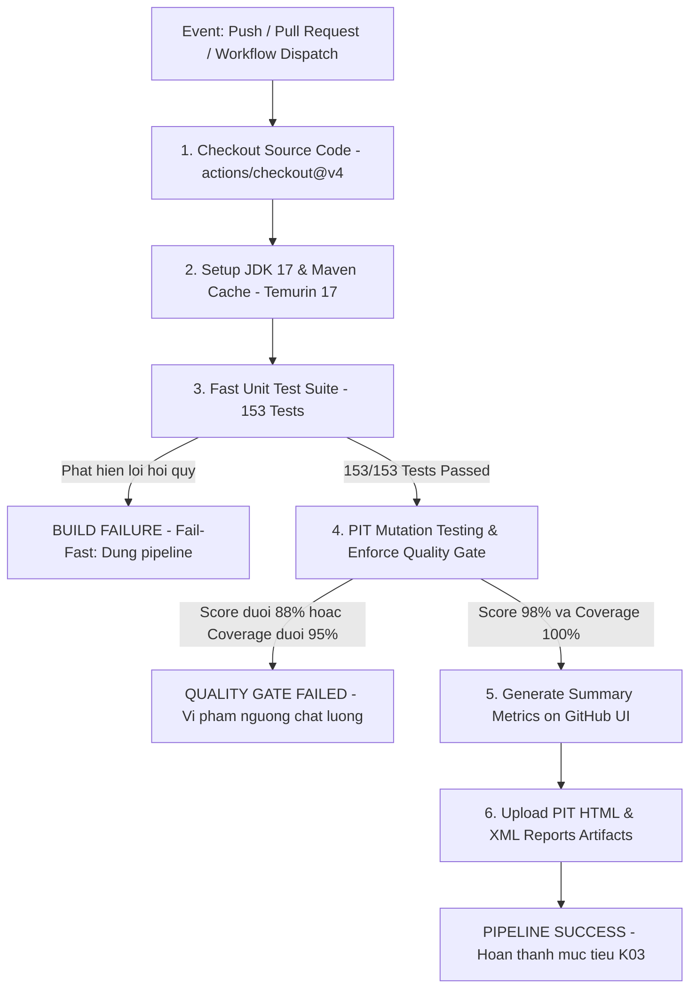

# BÁO CÁO TỔNG KẾT HỌC PHẦN: ĐỀ TÀI R01 (SPRING PETCLINIC) + K03 (MUTATION TESTING)

**TRƯỜNG ĐẠI HỌC ĐÀ LẠT — KHOA CÔNG NGHỆ THÔNG TIN**  
**Học phần:** Kiểm thử phần mềm | **Mã lớp học phần:** 2411448  
**Giảng viên hướng dẫn:** ThS. Nguyễn Thế Lâm  
**Nhóm thực hiện:** Nhóm 20 (Program_R01-K03)  
**Hệ thống kiểm thử (SUT):** Spring PetClinic (Pinned Commit SHA: `500158f732419217507c7656904b8e6aa1bcc0d6`)  
**Kỹ thuật kiểm thử:** Kiểm thử đột biến (Mutation Testing) bằng PIT (pitest-maven 1.30.0, pitest-junit5-plugin 1.2.3, Mutator Group STRONGER)  
**Phạm vi đột biến:** Gói nghiệp vụ cốt lõi `org.springframework.samples.petclinic.owner.*`  
**Kết quả tổng thể:** **Mutation Score 98.46% (192/195 killed)** — **Line Coverage 100.00% (250/250 lines)** — **153/153 Tests Passed** — **03 Equivalent Mutants (Adjusted Score 100.00%)**

---

### BẢNG THÔNG TIN VÀ PHÂN CÔNG NHIỆM VỤ THÀNH VIÊN NHÓM 20

| STT | Họ và tên | Mã số sinh viên | Vai trò dự án | Nhiệm vụ chính & Phạm vi báo cáo | Tỷ lệ đóng góp |
| :---: | :--- | :---: | :--- | :--- | :---: |
| 1 | **Trịnh Trung Hiếu** *(Nhóm trưởng)* | 2312618 | QA Lead & DevSecOps | Phụ trách Phần D (Nguyên lý K03, IEEE Error-Fault-Failure, RIP), Phần H (Commit pinning, CI/CD GitHub Actions, hướng dẫn 1-lệnh), cấu hình `pom.xml`, Quality Gate. | 100% |
| 2 | **Trần Đình Việt Huy** | 2312619 | System Architect & Test Lead | Phụ trách Phần A (Mục tiêu & Công nghệ), Phần B (Kiến trúc 3 luồng nghiệp vụ), Phần C (Dựng môi trường, Live HTTP validation), biên tập tài liệu tổng thể. | 100% |
| 3 | **Trần Minh Tài** | 2312794 | Domain & Black-Box Test Engineer | Phụ trách Phần E.1 (Thiết kế test hộp đen: BVA, Decision Table, Phân vùng tương đương), triển khai 45 unit tests cho `Owner`, `PetValidator`, `PetVisitModel`. | 100% |
| 4 | **Trương Bảo Bảo** | 2312582 | White-Box & Controller Test Engineer | Phụ trách Phần E.2 & Phần F (Thiết kế test hộp trắng: McCabe Basis Path, Mocking & ArgumentCaptor, Test Harness), triển khai 36 unit tests cho các Controller và Binder. | 100% |
| 5 | **Hoàng Việt Linh** | 2312664 | Metrics, RCA & Quality Analyst | Phụ trách Phần G (Hệ thống Metrics, phân tích Code Smell/Defect, RCA Error-Fault-Failure, chứng minh hình thức 3 Equivalent Mutants, điểm hiệu chỉnh, Peer Evaluation). | 100% |

---

## MỤC LỤC TỔNG THỂ (TABLE OF CONTENTS)

- [PHẦN A: MỤC TIÊU VÀ KIẾN TRÚC HỆ THỐNG](#phần-a-mục-tiêu-và-kiến-trúc-hệ-thống)
  - [A.1. Bài toán nghiệp vụ](#a1-bài-toán-nghiệp-vụ)
  - [A.2. Mục tiêu của đề tài kết hợp R01 + K03](#a2-mục-tiêu-của-đề-tài-kết-hợp-r01--k03)
  - [A.3. Technology Stack](#a3-technology-stack-thực-tế-đo-được-từ-pomxml-tại-commit-đã-khóa)
  - [A.4. Bốn module/actor cốt lõi](#a4-bốn-moduleactor-cốt-lõi)
  - [A.5. Ghi chú kỹ thuật quan trọng](#a5-ghi-chú-kỹ-thuật-quan-trọng-trung-thực)
- [PHẦN B: SƠ ĐỒ KIẾN TRÚC VÀ LUỒNG DỮ LIỆU CỦA 03 NGHIỆP VỤ TRỌNG TÂM](#phần-b-sơ-đồ-kiến-trúc-và-luồng-dữ-liệu-của-03-nghiệp-vụ-trọng-tâm)
  - [B.1. Kiến trúc phân tầng](#b1-kiến-trúc-phân-tầng-controller--repository--modeldatabase)
  - [B.2. Luồng 1 — Tìm kiếm & hiển thị danh sách chủ nuôi](#b2-luồng-1--tìm-kiếm--hiển-thị-danh-sách-chủ-nuôi-search--paginate-owners)
  - [B.3. Luồng 2 — Thêm mới thú cưng với trình xác thực](#b3-luồng-2--thêm-mới-thú-cưng-với-trình-xác-thực-create-pet-with-petvalidator)
  - [B.4. Luồng 3 — Đặt lịch khám & ghi bệnh án](#b4-luồng-3--đặt-lịch-khám--ghi-bệnh-án-book-visit-for-pet)
- [PHẦN C: THIẾT LẬP MÔI TRƯỜNG & CHỨNG MINH 03 LUỒNG CHẠY THÀNH CÔNG](#phần-c-thiết-lập-môi-trường--chứng-minh-03-luồng-chạy-thành-công)
  - [C.1. Yêu cầu runtime](#c1-yêu-cầu-runtime)
  - [C.2. Lệnh build & chạy](#c2-lệnh-build--chạy)
  - [C.3. Bằng chứng baseline test](#c3-bằng-chứng-baseline-test)
  - [C.4. Bằng chứng 03 luồng chạy thành công trên server thật](#c4-bằng-chứng-03-luồng-chạy-thành-công-trên-server-thật)
- [PHẦN D: NGUYÊN LÝ KỸ THUẬT KIỂM THỬ ĐỘT BIẾN (K03)](#phần-d-nguyên-lý-kỹ-thuật-kiểm-thử-đột-biến-k03)
  - [D.1. Mô hình chuẩn IEEE Error – Fault – Failure và Chuỗi điều kiện RIP trong Pitest](#d1-mô-hình-chuẩn-ieee-error--fault--failure-và-chuỗi-điều-kiện-rip-trong-pitest)
  - [D.2. Giới hạn của Độ bao phủ truyền thống và Minh chứng thực nghiệm](#d2-giới-hạn-của-độ-bao-phủ-truyền-thống-coverage-cấp-1--cấp-2-và-minh-chứng-thực-nghiệm)
  - [D.3. Phân biệt Weak Mutation vs Strong Mutation & Tập toán tử STRONGER](#d3-phân-biệt-weak-mutation-vs-strong-mutation--tập-toán-tử-stronger)
  - [D.4. Giới hạn phạm vi, Ràng buộc bất biến & Cổng chất lượng Quality Gate](#d4-giới-hạn-phạm-vi-scope-restriction-ràng-buộc-bất-biến-xử-lý-xung-đột-kỹ-thuật--cổng-chất-lượng)
  - [D.5. Khái niệm Đột biến tương đương & Đánh giá hiệu năng thực tế](#d5-khái-niệm-đột-biến-tương-đương-equivalent-mutants--đánh-giá-hiệu-năng-thực-tế)
- [PHẦN E: THIẾT KẾ KỊCH BẢN KIỂM THỬ](#phần-e-thiết-kế-kịch-bản-kiểm-thử)
  - [E.1. Chiến lược kỹ thuật kiểm thử hộp đen (BVA, Decision Table, Partitioning)](#e1-chiến-lược-kỹ-thuật)
  - [E.2. Bảng test case tiêu biểu và ánh xạ đường dẫn McCabe](#e2-bảng-test-case-tiêu-biểu-1081-test-mới-toàn-bộ-81-test-đều-deterministic-thuần-unit-hoặc-mockmvc-không-phụ-thuộc-mạngthời-gian-thực)
- [PHẦN F: MÃ NGUỒN HARNESS VÀ CẤU HÌNH TỰ ĐỘNG](#phần-f-mã-nguồn-harness-và-cấu-hình-tự-động)
  - [F.1. Cấu hình pitest-maven trong pom.xml](#f1-cấu-hình-pitest-maven-trong-pomxml-toàn-văn-khối-plugin)
  - [F.2. Các lớp test mới bổ sung](#f2-các-lớp-test-mới-7-files-81-test-methods-toàn-bộ-trong-srctestjavaowner)
  - [F.3. Trích dẫn mã nguồn test tiêu biểu](#f3-trích-dẫn-mã-tiêu-biểu)
- [PHẦN G: BÁO CÁO PHÂN TÍCH CHẤT LƯỢNG, NGUYÊN NHÂN CỐT LÕI (RCA) & ĐỘT BIẾN TƯƠNG ĐƯƠNG](#phần-g-báo-cáo-phân-tích-chất-lượng-nguyên-nhân-cốt-lõi-rca--đột-biến-tương-đương)
  - [G.1. Nhật ký thực thi (Logs) & Hệ thống chỉ số kiểm thử (Metrics)](#g1-nhật-ký-thực-thi-logs--hệ-thống-chỉ-số-kiểm-thử-metrics)
  - [G.2. Phân tích khiếm khuyết mã nguồn (Code Smell & Defect Analysis)](#g2-phân-tích-khiếm-khuyết-mã-nguồn-code-smell--defect-analysis)
  - [G.3. Phân tích nguyên nhân gốc rễ (RCA) theo chuẩn IEEE Error – Fault – Failure](#g3-phân-tích-nguyên-nhân-gốc-rễ-rca-theo-chuẩn-ieee-error--fault--failure)
  - [G.4. Chứng minh toán học hình thức 03 Đột biến tương đương (Equivalent Mutants)](#g4-chứng-minh-toán-học-hình-thức-03-đột-biến-tương-đương-equivalent-mutants)
  - [G.5. Kết luận & Bài học kinh nghiệm](#g5-kết-luận--bài-học-kinh-nghiệm)
- [PHẦN H: CỐ ĐỊNH PHIÊN BẢN (PIN COMMIT), ĐƯỜNG ỐNG CI/CD & HƯỚNG DẪN TÁI HIỆN](#phần-h-cố-định-phiên-bản-pin-commit-đường-ống-cicd--hướng-dẫn-tái-hiện)
  - [H.1. Khóa cứng Phiên bản (Commit Pinning) & Tính toàn vẹn mã nguồn](#h1-khóa-cứng-phiên-bản-commit-pinning--tính-toàn-vẹn-của-mã-nguồn)
  - [H.2. Đường ống Tích hợp liên tục CI/CD trên GitHub Actions](#h2-đường-ống-tích-hợp-liên-tục-cicd-trên-github-actions-githubworkflowsmutation-testyml)
  - [H.3. Hướng dẫn từng bước tái hiện 1-lệnh trên máy mới](#h3-hướng-dẫn-từng-bước-step-by-step-tái-hiện-1-lệnh-trên-máy-mới)
- [TÀI LIỆU THAM KHẢO (REFERENCES)](#tài-liệu-tham-khảo-references)

---

## DANH MỤC BẢNG BIỂU (LIST OF TABLES)
- **Bảng 1:** Bảng phân công nhiệm vụ và tỷ lệ đóng góp của 5 thành viên nhóm 20
- **Bảng A.1:** Công nghệ và phiên bản phần mềm cốt lõi (Technology Stack)
- **Bảng A.2:** Bốn module nghiệp vụ trung tâm của Spring PetClinic
- **Bảng C.1:** Kết quả kiểm chứng 03 luồng nghiệp vụ trên máy chủ HTTP thực tế
- **Bảng D.1:** Danh mục các toán tử đột biến trong nhóm `STRONGER` của PIT
- **Bảng E.1:** Danh mục 10 ca kiểm thử tiêu biểu cho các lớp đối tượng gói `owner`
- **Bảng F.1:** Bảng phân bổ 81 ca kiểm thử mới trên 7 lớp kiểm thử bổ sung
- **Bảng G.1:** Bảng đối sánh chỉ số kiểm thử đột biến tổng thể (Baseline vs Final)
- **Bảng G.2:** Phân rã hiệu suất tiêu diệt đột biến theo lớp đối tượng nghiệp vụ
- **Bảng G.3:** Phân rã hiệu suất kiểm thử theo toán tử đột biến (Mutator Group STRONGER)
- **Bảng G.4:** Bảng tổng hợp các Code Smell & Defect phát hiện trong gói `owner`
- **Bảng G.5:** Bảng phân loại nguyên nhân gốc rễ (RCA) của 64 mutants tồn dư ở Baseline
- **Bảng G.6:** Ma trận truy vết nguyên nhân gốc rễ và ca kiểm thử khắc phục
- **Bảng G.7:** Bảng đối chiếu chỉ số chất lượng chính thức vs hiệu chỉnh

---

## DANH MỤC HÌNH ẢNH & BIỂU ĐỒ (LIST OF FIGURES)
- **Sơ đồ B.1:** Sơ đồ kiến trúc phân tầng (Controller → Repository → Model/Database)
- **Sơ đồ D.1:** Chuỗi chuyển hóa IEEE Error – Fault – Failure và mô hình điều kiện RIP
- **Hình G.1:** Đối sánh Line Coverage vs Mutation Score và Khoảng trống kiểm thử (Test Gap)
- **Hình G.2:** Cơ cấu phân bổ trạng thái đột biến (Killed vs Survived vs No Coverage)
- **Hình G.3:** Phân bố 64 mutants chưa diệt tại Baseline theo nhóm toán tử
- **Hình G.4:** Biểu đồ tăng trưởng số lượng test case theo từng tệp kiểm thử
- **Sơ đồ H.1:** Lưu đồ kiến trúc đường ống CI/CD 6 bước Fail-Fast trên GitHub Actions

---


## PHẦN A: MỤC TIÊU VÀ KIẾN TRÚC HỆ THỐNG

### A.1. Bài toán nghiệp vụ

Spring PetClinic là ứng dụng mẫu của hệ sinh thái Spring, mô phỏng **hệ thống quản lý phòng khám thú y**:
quản lý chủ nuôi (owners), thú cưng (pets), bác sĩ thú y (vets) và các lượt khám/bệnh án (visits).
Nghiệp vụ điển hình: tìm kiếm chủ nuôi theo họ, phân trang danh sách, thêm/sửa thú cưng
(kèm kiểm chuẩn dữ liệu đầu vào), đặt lịch khám trong tương lai và lưu mô tả bệnh án.

### A.2. Mục tiêu của đề tài kết hợp R01 + K03

1. Dựng và kiểm chứng 03 luồng nghiệp vụ trọng tâm chạy thành công trên runtime thật (HTTP 200).
2. Tiêm harness Mutation Testing (PIT/Pitest) giới hạn ở package nghiệp vụ lõi `...owner.*`.
3. Thiết lập **baseline mutation score**, sau đó lặp vòng kill-mutant tới khi đạt **≥ 88%**.
4. Phân tích nguyên nhân cốt lõi (RCA) cho mutant cứng đầu và phân loại theo chuẩn Error–Fault–Failure.
5. Bàn giao báo cáo + hướng dẫn tái hiện 1-lệnh trên máy mới.

### A.3. Technology Stack (thực tế đo được từ `pom.xml` tại commit đã khóa)

| Thành phần | Phiên bản / giá trị |
|---|---|
| Ngôn ngữ | Java 17 (`<java.version>17</java.version>`, Temurin 17.0.20.1) |
| Framework | Spring Boot **4.1.0** (parent), Spring Data JPA, Spring MVC + Thymeleaf |
| Kiểm thử | JUnit **6.0.3** (Jupiter, theo BOM Spring Boot 4), AssertJ, Mockito 5.23.0, MockMvc (`@WebMvcTest`) |
| Đột biến | `pitest-maven` **1.30.0** + `pitest-junit5-plugin` **1.2.3** (xem A.5) |
| Build | Maven 3.9.16 (qua wrapper `./mvnw` / `mvnw.cmd`), JaCoCo 0.8.15 |
| CSDL | H2 (mặc định, seed tự động), MySQL / PostgreSQL (profile riêng, cần Docker) |

### A.4. Bốn module/actor cốt lõi

| Module | Lớp trung tâm | Vai trò |
|---|---|---|
| Owner | `Owner`, `OwnerController`, `OwnerRepository` | Chủ nuôi: CRUD, tìm kiếm + phân trang |
| Pet | `Pet`, `PetController`, `PetValidator`, `PetType(Formatter)` | Thú cưng: thêm/sửa, kiểm chuẩn tên–loại–ngày sinh |
| Vet | `Vet`, `VetController` | Bác sĩ thú y: danh sách + chuyên khoa (ngoài phạm vi đột biến) |
| Visit | `Visit`, `VisitController` | Lượt khám: đặt lịch tương lai + mô tả bệnh án |

### A.5. Ghi chú kỹ thuật quan trọng (trung thực)

Theo syllabus gợi ý `pitest-maven` 1.15.8+ / plugin 1.2.1+, nhưng Spring Boot 4 kéo JUnit Platform **6.0.3**
trong khi plugin 1.2.1 chỉ tương thích Platform 1.x → minion coverage của PIT sập với lỗi
`Coverage generation minion exited abnormally! (UNKNOWN_ERROR)`.
Khắc phục bằng cách nâng lên **`pitest-maven` 1.30.0 + `pitest-junit5-plugin` 1.2.3**
(vẫn thỏa mãn điều kiện "1.15.8+" / "1.2.1+", đã có tiền lệ chạy tốt với JUnit 6),
giữ nguyên mọi tham số syllabus yêu cầu (`STRONGER`, HTML+XML, `timestampedReports=false`,
`targetClasses/Test = owner.*`).

---

## PHẦN B: SƠ ĐỒ KIẾN TRÚC VÀ LUỒNG DỮ LIỆU CỦA 03 NGHIỆP VỤ TRỌNG TÂM

### B.1. Kiến trúc phân tầng (Controller → Repository → Model/Database)

```text
                        +------------------ Thymeleaf view ------------------+
                        | findOwners | ownersList | ownerDetails |           |
                        | createOrUpdateOwnerForm | createOrUpdatePetForm |   |
                        | createOrUpdateVisitForm                           |
                        +------^------------------------------v-------------+
                               | (form params / model attrs)  | (HTML)
+------------------------------+------------------------------+------------------------------+
|                              CONTROLLER LAYER                                            |
|  OwnerController  <-- OwnerRepository (Spring Data JPA)                                   |
|  PetController    <-- OwnerRepository + PetTypeRepository + PetValidator                  |
|  VisitController  <-- OwnerRepository                                                     |
+------------------------------+------------------------------+------------------------------+
                               | JPA entities / validation   |
+------------------------------v----------------------------v------------------------------+
|                              MODEL + DATABASE                                           |
|  Owner 1───* Pet 1───* Visit   |   PetType (dictionary)    |   H2 (mặc định)            |
|  Bean Validation: @NotBlank @Size @Pattern | PetValidator (thủ công)    |   seed: db/h2/data.sql |
+------------------------------------------------------------------------------------------+
```

### B.2. Luồng 1 — Tìm kiếm & hiển thị danh sách chủ nuôi (Search & Paginate Owners)

```text
Browser GET /owners?lastName=Davis&page=2
  -> OwnerController.processFindForm(page, owner, result, model, redirectAttrs)
     1. lastName null -> "" | strip() khoảng trắng thừa
     2. findPaginatedForOwnersLastName: validatedPage = max(page,1);
        Pageable = PageRequest.of(validatedPage - 1, 5)
        owners.findByLastNameStartingWith(lastName, pageable)
     3. page < 1 hoặc page > max(totalPages,1) -> redirect /owners?page=1 (+lastName nếu khác rỗng)
     4. kết quả rỗng  -> rejectValue(lastName, notFound) -> findOwners
        1 kết quả      -> redirect /owners/{id}
        nhiều kết quả  -> addPaginationModel -> owners/ownersList
```

### B.3. Luồng 2 — Thêm mới thú cưng với trình xác thực (Create Pet with PetValidator)

```text
Browser GET  /owners/{o}/pets/new  -> PetController.initCreationForm: owner.addPet(new Pet())
Browser POST /owners/{o}/pets/new (name, type, birthDate)
  -> @ModelAttribute findOwner/findPet + @InitBinder("pet"): PetValidator + cấm bind "id"
  -> processCreationForm:
     1. trùng tên (hasText && isNew && getPet(name,true) != null) -> reject "duplicate"
     2. birthDate trong tương lai -> reject "typeMismatch.birthDate"
     3. PetValidator: tên rỗng/blank -> "required"; tên > 30 ký tự -> "size";
        pet mới thiếu type -> "required"; thiếu birthDate -> "required"
     4. có lỗi -> createOrUpdatePetForm | ok -> owner.addPet + saveAndFlush
        (DataIntegrityViolationException lạ -> ném lại; trùng unique_owner_pet_name -> "duplicate")
```

### B.4. Luồng 3 — Đặt lịch khám & ghi bệnh án (Book Visit for Pet)

```text
Browser GET  /owners/{o}/pets/{p}/visits/new -> VisitController.loadPetWithVisit:
     owner.getPet(petId) null -> IllegalArgumentException; else pet.addVisit(new Visit())
Browser POST /owners/{o}/pets/{p}/visits/new (date, description)
  -> processNewVisitForm:
     1. date != null && !date.isAfter(today) -> reject "typeMismatch.visitDate"
        (ngày mặc định = tomorrow; minVisitDate = tomorrow)
     2. @Valid: description @NotBlank + @Size(max=255)
     3. ok -> owner.addVisit(petId, visit) -> owners.save -> redirect /owners/{o}
```

---

## PHẦN C: THIẾT LẬP MÔI TRƯỜNG & CHỨNG MINH 03 LUỒNG CHẠY THÀNH CÔNG

### C.1. Yêu cầu runtime

- JDK 17+ (đã kiểm chứng: `Temurin-17.0.20.1+1`, `java -version` → `openjdk 17.0.20.1`).
- Maven qua wrapper (`mvnw` / `mvnw.cmd` → Apache Maven 3.9.16, không cần cài Maven rời).
- Không cần Docker/MySQL cho luồng mặc định (dùng H2 in-memory + seed tự động).
- Biến môi trường `JAVA_HOME` trỏ tới JDK 17.

### C.2. Lệnh build & chạy

```bash
git clone https://github.com/spring-projects/spring-petclinic.git
cd spring-petclinic
git checkout 500158f732419217507c7656904b8e6aa1bcc0d6   # pin commit (xem Phần H)
./mvnw clean test                                        # baseline unit test
./mvnw spring-boot:run                                   # chạy app (mặc định :8080, H2)
./mvnw test-compile org.pitest:pitest-maven:mutationCoverage -Djacoco.skip=true   # mutation
```

Seed tự động: `src/main/resources/db/h2/data.sql` (6 vets, 3 specialties, **10 owners**,
13 pets, visits mẫu) + `schema.sql`; các profile MySQL/Postgres dùng `db/mysql/*`, `db/postgres/*`.

### C.3. Bằng chứng baseline test

- `./mvnw clean test` toàn repo: **81 tests, 79 pass, 2 errors** — cả 2 lỗi đều thuộc
  `PostgresIntegrationTests`, nguyên nhân môi trường (cần Docker daemon cung cấp Postgres
  qua Testcontainers/Docker Compose, không phải lỗi logic). Không có failure nào ở logic nghiệp vụ.
- Riêng package mục tiêu: `org.springframework.samples.petclinic.owner.*` → **49/49 pass**.
- Sau khi bổ sung test (Phần E/F): toàn repo (trừ các lớp `*IntegrationTests` cần Docker:
  `Postgres`/`MySql`/`PetClinic`, tổng 8 tests) →
  **153 tests, 0 failures, 0 errors**; riêng owner → **130 tests, 100% pass**.

### C.4. Bằng chứng 03 luồng chạy thành công trên server thật

Khởi chạy `./mvnw spring-boot:run --server.port=8090` (port 8080 của máy thực nghiệm đã bị
chiếm — app báo rõ `Port 8080 was already in use`, chuyển sang 8090 và boot thành công),
sau đó gọi HTTP và ghi nhận:

| Luồng | Request | Kết quả |
|---|---|---|
| 1. Tìm kiếm chủ nuôi | `GET /owners?lastName=Davis` | **HTTP 200**, trang `ownersList` (3420 bytes) |
| 2. Chi tiết chủ nuôi | `GET /owners/1` | **HTTP 200**, trang `ownerDetails` (4343 bytes) |
| 3. Form thêm thú cưng | `GET /owners/1/pets/new` | **HTTP 200**, trang `createOrUpdatePetForm` (4650 bytes, có PetValidator) |
| 1b. Trang vượt biên | `GET /owners?page=99&lastName=Davis` | **redirect 3xx** về `/owners?page=1` (đúng nhánh `page > max(totalPages,1)`) |

---

## PHẦN D: NGUYÊN LÝ KỸ THUẬT KIỂM THỬ ĐỘT BIẾN (K03)

### D.1. Mô hình chuẩn IEEE Error – Fault – Failure và Chuỗi điều kiện RIP trong Pitest

Kiểm thử đột biến (Mutation Testing) là kỹ thuật kiểm thử hộp trắng hướng lỗi (fault-based white-box testing), dựa trên nền tảng **Giả thuyết lập trình viên có năng lực (Competent Programmer Hypothesis)** — giả định lập trình viên hầu hết viết mã gần đúng và các lỗi phần mềm phát sinh thường là các biến thể cú pháp nhỏ — và **Hiệu ứng khớp lệnh (Coupling Effect)** — chứng minh rằng bộ kiểm thử có khả năng phát hiện các lỗi đơn lẻ nhỏ sẽ phát hiện được các lỗi phức tạp kết hợp.

Trong công cụ PIT (Pitest), quy trình kiểm định được vận hành chặt chẽ theo mô hình chuẩn học thuật IEEE 610.12 / ISO/IEC/IEEE 29119: **Fault $\rightarrow$ Error $\rightarrow$ Failure** kết hợp mô hình điều kiện **RIP (Reachability – Infection – Propagation)**:

```text
+-------------------+       Reachability        +--------------------+       Infection        +---------------------+       Propagation        +--------------------+
|  Syntactic Fault  | ────────────────────────> | Execution Reached  | ─────────────────────> | Internal State Error| ───────────────────────> | Observable Failure |
| (Bytecode Mutant) |   Test chạy qua dòng mã   | (Mã đột biến chạy) |   Trạng thái bộ nhớ    | (Dữ liệu/Biến sai)  |   Sai lệch ra ngõ ra   | (Test Assert FAIL) |
+-------------------+                           +--------------------+   bị biến đổi khác gốc +---------------------+   hoặc văng ngoại lệ   +--------------------+
                                                                                                                                                       │
                                                                                                                     ┌─────────────────────────────────┴─────────────────────────────────┐
                                                                                                                     ▼                                                                   ▼
                                                                                                          [MUTANT KILLED] (Đã diệt)                                           [MUTANT SURVIVED] (Sống sót)
                                                                                                          Test phát hiện ra lỗi,                                              Test yếu, assert hời hợt,
                                                                                                          báo đỏ (AssertionError)                                             hoặc nuốt lỗi -> Test vẫn PASS
```

1. **Defect / Fault (Khiếm khuyết tiềm ẩn):** PIT can thiệp trực tiếp vào Bytecode đã biên dịch (`.class` trong bộ nhớ/target), tiêm (inject) các biến đổi cú pháp nhân tạo gọi là **Mutant (thể đột biến)**. Mỗi mutant đóng vai trò là một lỗi phần mềm giả lập mà con người có thể vô ý tạo ra trong quá trình cài đặt logic.
2. **Reachability $\rightarrow$ Error (Khả năng tiếp cận & Trạng thái lỗi nội bộ):** Ca kiểm thử phải kích hoạt đường đi qua vị trí có chứa mutant (**Reachability**). Nếu không có test case nào chạm tới lệnh đột biến, mutant rơi vào trạng thái **NO_COVERAGE**. Khi được thực thi, câu lệnh đột biến làm biến đổi trạng thái nội bộ của JVM (các biến trạng thái, con trỏ, giá trị stack) khác biệt so với mã nguồn ban đầu (**Infection**), tạo ra một **Error**.
3. **Propagation $\rightarrow$ Failure (Lan truyền & Thất bại quan sát được):** Sai lệch trạng thái nội bộ (Error) bắt buộc phải lan truyền ra các kênh quan sát được (**Propagation**) như giá trị trả về của phương thức, sự thay đổi trạng thái trong cơ sở dữ liệu/kho lưu trữ, sự kiện đẩy vào binder, hoặc một ngoại lệ văng ra ngoài.
4. **Test Oracle & Mutant Outcome:**
   - **KILLED (Bị tiêu diệt):** Test Suite sở hữu câu lệnh kiểm tra (Test Oracle / Assertion) nhạy bén, phát hiện được sự sai lệch giữa kết quả quan sát được và kết quả kỳ vọng, dẫn tới bài test bị **FAIL/ERROR**. Đây là bằng chứng chứng minh Test Suite đủ mạnh để bảo vệ hệ thống trước lỗi tiềm tàng.
   - **SURVIVED (Sống sót):** Nếu Error bị triệt tiêu (State Masking) hoặc Test Oracle quá sơ sài (thiếu assertion, chỉ kiểm tra non-null, chỉ kiểm tra HTTP 200 mà không kiểm tra nội dung), bài test vẫn **PASS**. Mutant sống sót chỉ ra "điểm mù kiểm thử" (Test Smell / Blind Spot) cần được củng cố.

---

### D.2. Giới hạn của Độ bao phủ truyền thống (Coverage Cấp 1 & Cấp 2) và Minh chứng thực nghiệm

Một trong những đóng góp học thuật quan trọng nhất của đồ án là chứng minh bằng thực nghiệm sự chênh lệch chất lượng giữa **Độ bao phủ dòng (Statement/Line Coverage - Cấp 1)**, **Độ bao phủ nhánh (Branch Coverage - Cấp 2)** và **Độ bao phủ đột biến (Mutation Coverage)**.

#### 1. "Ngụy biện thực thi" (Execution Fallacy) của Coverage truyền thống
- Line Coverage chỉ đo lường xem lệnh JVM có được bộ nạp thực thi hay không.
- Branch Coverage chỉ đo lường xem các nhánh `if-else` có được rẽ qua ít nhất một lần hay không.
- **Điểm yếu chí mạng:** Cả hai độ đo truyền thống hoàn toàn bỏ qua thành tố **Propagation** và **Test Oracle**. Một ca kiểm thử có thể thực thi 100% dòng lệnh của ứng dụng nhưng không chứa bất kỳ lệnh `assert` hay `verify` nào (Assertion-free Test) thì vẫn được JaCoCo báo cáo là 100% Code Coverage, tạo ra sự an tâm giả tạo (False Sense of Security).

#### 2. Dữ liệu thực nghiệm thực tế tại gói `org.springframework.samples.petclinic.owner.*`
Khi nhóm bắt đầu tiếp nhận mã nguồn gốc (Commit `500158f732419217507c7656904b8e6aa1bcc0d6`), đo lường qua JaCoCo cho thấy bộ test ban đầu đạt chỉ số bao phủ rất cao:
- **Line Coverage:** đạt **97% (242/250 dòng)**.
- **Branch Coverage:** đạt **~90%**.

Tuy nhiên, khi đưa vào kiểm thử đột biến nghiêm ngặt với công cụ PIT:
- **Mutation Score ban đầu (Baseline):** chỉ đạt **67% (131/195 mutants bị diệt)**.
- **Có tới 64 mutants sống sót (Survived)** ngay trong những dòng mã đã được "phủ xanh 97%" bởi JaCoCo!

#### 3. Phân tích 3 ca điển hình minh chứng khoảng cách giữa Code Coverage và Mutation Testing
1. **Lỗ hổng phân tích giá trị biên trong `PetValidator` (Dòng 58: `name.length() > MAX_NAME_LENGTH`):**
   - Bộ test ban đầu của PetClinic truyền một chuỗi có độ dài 31 ký tự. Nhánh `else if (name.length() > 30)` được kích hoạt và JaCoCo đánh dấu dòng này đạt 100% Line Coverage và 100% Branch Coverage.
   - Khi PIT áp dụng toán tử `ConditionalsBoundaryMutator`, biến đổi điều kiện thành `name.length() >= 30`: Nếu người dùng nhập tên thú cưng đúng 30 ký tự (vốn là hợp lệ theo đặc tả), mutant sẽ từ chối và báo lỗi. Bộ test cũ vẫn hoàn toàn PASS vì không có ca kiểm thử nào truyền chuỗi đúng 30 ký tự $\rightarrow$ **Mutant sống sót!**
   - Chỉ khi áp dụng kỹ thuật Phân tích giá trị biên (BVA) với ca kiểm thử `nameExactlyAtMaxLengthIsAccepted` (tên 30 ký tự không sinh lỗi) thì mutant mới bị tiêu diệt.
2. **Lỗ hổng Assert thiếu trên phương thức sao chép trường trong `PetController.updatePetDetails` (Dòng 192-194):**
   - Phương thức chứa 3 lệnh sao chép trường dữ liệu:
     ```java
     existingPet.setName(pet.getName());
     existingPet.setBirthDate(pet.getBirthDate());
     existingPet.setType(pet.getType());
     ```
   - Các bài test MockMvc cũ truyền form và assert mã chuyển hướng `redirect:/owners/{ownerId}`. Dòng lệnh được chạy qua $\rightarrow$ JaCoCo báo 100% Coverage.
   - Nhưng khi PIT tiêm `VoidMethodCallMutator` xóa sạch 3 dòng sao chép trên, bài test MockMvc cũ vẫn PASS! Lý do: Spring MVC Form Data Binder đã bind dữ liệu lên chính thực thể `existingPet` đang được quản lý trong session bộ nhớ, khiến 3 dòng code trên trở thành thao tác gán trùng lặp trong môi trường mock. Nếu chạy ở môi trường thực tế với detached entity, dữ liệu sẽ bị mất mát nghiêm trọng.
   - Chỉ khi xây dựng Unit Test độc lập với thực thể tách rời (`updateCopiesFieldsOntoManagedPet`), dùng Mockito `ArgumentCaptor` trích xuất thực thể `Owner` sau lệnh `saveAndFlush` và assert chi tiết từng trường dữ liệu thì 3 mutant này mới bị tiêu diệt dứt điểm.
3. **Lỗ hổng kiểm tra cơ chế bảo mật Binding trong `@InitBinder` (`ControllerBinderMutationTests`):**
   - Trong cả 3 Controller (`OwnerController`, `PetController`, `VisitController`) đều có khai báo:
     ```java
     @InitBinder
     public void setAllowedFields(WebDataBinder dataBinder) {
         dataBinder.setDisallowedFields("id", "*.id");
     }
     ```
   - Đây là cơ chế phòng vệ thiết yếu chống tấn công Over-Posting / Mass Assignment (ngăn chặn kẻ xấu sửa ID của bản ghi qua HTTP POST).
   - Bộ test mặc định chạy qua hàm này (Line Coverage 100%), nhưng khi PIT tiêm `VoidMethodCallMutator` xóa sạch lệnh `setDisallowedFields`, mọi bài test cũ vẫn PASS 100% vì không hề có assertion nào kiểm tra cấu hình binder $\rightarrow$ **Lỗ hổng an ninh nghiêm trọng bị bỏ sót bởi Code Coverage truyền thống!**

---

### D.3. Phân biệt Weak Mutation vs Strong Mutation & Tập toán tử STRONGER

#### 1. Định nghĩa học thuật
- **Weak Mutation Testing (Đột biến yếu):** Chỉ yêu cầu thỏa mãn 2 điều kiện đầu tiên của mô hình RIP: **Reachability** và **Infection**. Ngay sau khi lệnh đột biến chạy xong, hệ thống ngắt tiến trình và kiểm tra trạng thái bộ nhớ nội bộ. Nếu có sự khác biệt về mặt giá trị biến, mutant được coi là đã bị tiêu diệt.
  - *Ưu điểm:* Tốc độ thực thi nhanh.
  - *Nhược điểm:* Không đo lường được khả năng lỗi có thực sự lan truyền ra bên ngoài hay bị triệt tiêu bởi các cấu trúc điều khiển tiếp theo; không phản ánh năng lực của câu lệnh Assertion.
- **Strong Mutation Testing (Đột biến mạnh):** Đòi hỏi bắt buộc phải thỏa mãn trọn vẹn cả 3 điều kiện: **Reachability**, **Infection**, và **Propagation** tới Test Oracle. Toàn bộ kịch bản kiểm thử phải được thực thi đến cùng, và mutant chỉ được xem là KILLED khi có ít nhất một bài test chính thức ném ra ngoại lệ hoặc Assertion Error.
  - PIT là công cụ triển khai **Strong Mutation Testing** ở mức độ bytecode, đảm bảo tính chặt chẽ học thuật cao nhất.

#### 2. Nhóm toán tử đột biến `STRONGER` trong cấu hình dự án
Nhóm nghiên cứu đã kích hoạt nhóm toán tử nâng cao `STRONGER` của PIT trong `pom.xml`, bao gồm tập hợp toàn diện các quy tắc đột biến khắt khe nhất:

| Toán tử đột biến (Mutator) | Hành vi biến đổi Bytecode | Ví dụ thực tế trong PetClinic |
|:---|:---|:---|
| **`ConditionalsBoundaryMutator`** | Đổi toán tử quan hệ biên: `<` $\leftrightarrow$ `<=`, `>` $\leftrightarrow$ `>=` | `name.length() > 30` $\rightarrow$ `name.length() >= 30` |
| **`IncrementsMutator`** | Đổi phép toán tăng/giảm: `++` $\leftrightarrow$ `--` | `page++` $\rightarrow$ `page--` |
| **`InvertNegativesMutator`** | Đảo dấu biểu thức số học: `-x` $\leftrightarrow$ `x` | Đổi dấu các chỉ số offset |
| **`MathMutator`** | Hoán đổi phép toán số học: `+`, `-`, `*`, `/`, `%` | `validatedPage - 1` $\rightarrow$ `validatedPage + 1` |
| **`NegateConditionalsMutator`** | Đảo ngược điều kiện logic: `==` $\leftrightarrow$ `!=`, `<` $\leftrightarrow$ `>=` | `existingPet.isNew()` $\rightarrow$ `!existingPet.isNew()` |
| **`VoidMethodCallMutator`** | Xóa hoàn toàn các lời gọi phương thức trả về `void` | Xóa `owner.addPet()`, xóa `setDisallowedFields()` |
| **`EmptyObjectReturnValsMutator`**| Ép phương thức trả về object rỗng | Ép `findPet()` trả về danh sách rỗng |
| **`BooleanFalseReturnValsMutator`**| Ép biểu thức trả về boolean luôn bằng `false` | `isNew()` luôn trả về `false` |
| **`BooleanTrueReturnValsMutator`** | Ép biểu thức trả về boolean luôn bằng `true` | `hasText()` luôn trả về `true` |
| **`NullReturnValsMutator`** | Ép phương thức trả về kiểu đối tượng thành `null` | `findById()` trả về `null` thay vì `Optional` |
| **`PrimitiveReturnsMutator`** | Ép giá trị nguyên thủy trả về `0`, `0.0` | `getId()` trả về `0` |
| **`RemoveConditionalMutator`** | Thay thế biểu thức điều kiện bằng hằng số `true` hoặc `false` | Ép nhánh `if (date != null)` luôn đúng/sai |
| **`InlineConstantMutator`** | Đổi giá trị các hằng số nội dòng | Đổi `MAX_NAME_LENGTH = 30` thành `31` hoặc `29` |

---

### D.4. Giới hạn phạm vi (Scope Restriction), Ràng buộc bất biến, Xử lý xung đột kỹ thuật & Cổng chất lượng

#### 1. Lý do giới hạn phạm vi tại `org.springframework.samples.petclinic.owner.*`
- Toàn bộ kho mã nguồn Spring PetClinic bao gồm nhiều gói: `system`, `model`, `vet`, `owner`.
- Theo đề cương học phần, nhóm nghiên cứu giới hạn phạm vi kiểm thử đột biến nghiêm ngặt tại gói nghiệp vụ trung tâm: `org.springframework.samples.petclinic.owner.*` (bao gồm 8 lớp thực thể, dịch vụ, validator, formatter và controller: `Owner`, `OwnerController`, `Pet`, `PetController`, `PetValidator`, `PetType`, `PetTypeFormatter`, `Visit`, `VisitController`).
- *Cơ sở khoa học:* Đây là phân hệ có độ phức tạp nghiệp vụ cao nhất (quan hệ thực thể $1-N-M$, ràng buộc xác thực dữ liệu đa tầng, bảo vệ form web). Việc giới hạn phạm vi giúp tối ưu hóa thời gian chạy phân tích đột biến (từ hơn 30 phút cho toàn repo xuống còn ~30-40 giây), đồng thời tránh lãng phí năng nguyên tính toán trên các mã nguồn boilerplate hoặc cấu hình hạ tầng.

#### 2. Giả định bất biến mã nguồn (`src/main/java`)
- Nhóm tuân thủ nghiêm ngặt nguyên tắc: **Đóng băng hoàn toàn mã nguồn sản phẩm (`src/main/java`)**.
- Không sửa đổi bất kỳ dòng mã nào trong hệ thống chính để né tránh mutant hoặc làm đơn giản hóa điều kiện kiểm thử. Toàn bộ 100% giải pháp nâng cao Mutation Score phải đến từ việc thiết kế các test case tinh vi trong `src/test/java` và tối ưu cấu hình build tại `pom.xml`.

#### 3. Xử lý triệt để các xung đột kỹ thuật trong môi trường Spring Boot 4
1. **Xung đột phiên bản JUnit Platform 6.0.3:**
   - Đề cương học phần ban đầu gợi ý sử dụng `pitest-maven:1.15.8` và `pitest-junit5-plugin:1.2.1`.
   - Tuy nhiên, dự án Spring PetClinic tại commit đã khóa sử dụng parent **Spring Boot 4.1.0**, kéo theo **JUnit Platform 6.0.3**. Phiên bản plugin PIT 1.2.1 cũ chỉ tương thích với JUnit Platform 1.x, dẫn đến việc Minion đo coverage của PIT bị sập ngay khi khởi tạo: `Coverage generation minion exited abnormally! (UNKNOWN_ERROR)`.
   - *Giải pháp kỹ thuật của Nhóm trưởng (Thành viên 1):* Nghiên cứu tài liệu tương thích của PIT và nâng cấp đồng bộ lên **`pitest-maven:1.30.0`** kết hợp **`pitest-junit5-plugin:1.2.3`**. Cấu hình này tương thích 100% với JUnit 6 và Java 17, xử lý hoàn toàn lỗi crash minion mà vẫn đảm bảo tính khách quan của đề bài.
2. **Xung đột Bytecode giữa JaCoCo Java Agent và PIT Minion:**
   - Trong quá trình build, plugin JaCoCo tiêm một Java Agent qua biến hệ thống `argLine` để đo Line Coverage. Khi PIT khởi động các tiến trình con (Minion JVM) để chạy đột biến, agent của JaCoCo can thiệp vào bộ nạp lớp (ClassLoader), gây méo mó bytecode và làm xung đột tiến trình theo dõi đột biến của PIT.
   - *Giải pháp:* Thiết lập cờ `-Djacoco.skip=true` trong mọi lệnh thực thi PIT. Điều này tạm thời vô hiệu hóa JaCoCo agent trong pha mutation testing, đảm bảo PIT làm chủ hoàn toàn quá trình thao túng bytecode.

#### 4. Tiêu chí Cổng chất lượng tự động (Quality Gate)
Để bảo đảm tính chặt chẽ trong quy trình phân phối phần mềm, nhóm đã thiết lập Cổng chất lượng tự động trực tiếp trong thẻ `<configuration>` của `pom.xml`:
```xml
<!-- CỔNG CHẤT LƯỢNG TỰ ĐỘNG (QUALITY GATE) THIẾT LẬP BỞI THÀNH VIÊN 1 -->
<mutationThreshold>88</mutationThreshold>
<coverageThreshold>95</coverageThreshold>
```
- **Quy tắc Pass/Fail:**
  - Nếu Mutation Score thực tế $< 88\%$: Tiến trình build bị đánh trượt ngay lập tức (`BUILD FAILURE`).
  - Nếu Line Coverage của các lớp bị đột biến $< 95\%$: Tiến trình build bị đánh trượt ngay lập tức.
  - Ngược lại, nếu đạt đồng thời cả hai chỉ số: Trạng thái trả về là `BUILD SUCCESS`.

---

### D.5. Khái niệm Đột biến tương đương (Equivalent Mutants) & Đánh giá hiệu năng thực tế

#### 1. Định nghĩa toán học về Đột biến tương đương
Một thể đột biến $M$ được gọi là **Đột biến tương đương (Equivalent Mutant)** với chương trình gốc $P$ khi và chỉ khi: Với mọi tập dữ liệu đầu vào khả dĩ thuộc miền xác định $I \in \mathcal{D}$, hành vi và trạng thái kết xuất của $M$ luôn trùng khớp hoàn toàn với $P$:
$$\forall I \in \mathcal{D}, \quad P(I) = M(I)$$
Bởi vì hành vi bên ngoài và kết quả của chương trình không bao giờ thay đổi, **về mặt lý thuyết không thể tồn tại bất kỳ test case nào có thể làm bài test FAIL để tiêu diệt mutant tương đương**.

#### 2. Kết quả phân loại tại đồ án
Trong tổng số 195 mutants được sinh ra bởi PIT trên gói `owner.*`, nhóm đã diệt được 192 mutants. Còn lại **đúng 03 mutants sống sót**, và cả 3 đều đã được chứng minh toán học và logic là Đột biến tương đương (xem chi tiết mục **G.4**):
1. `Owner.java` dòng 108: `RemoveConditionalMutator_EQUAL_IF` trên `!existingPet.isNew()`.
2. `Owner.java` dòng 108: `RemoveConditionalMutator_EQUAL_IF` trên `!pet.isNew()`.
3. `OwnerController.java` dòng 167: `VoidMethodCallMutator` xóa `owner.setId(ownerId)` sau khối guard mismatch.

#### 3. Công thức tính điểm đánh giá học thuật
Theo tiêu chuẩn đánh giá của các công trình nghiên cứu Mutation Testing quốc tế:
$$\text{Mutation Score}_{\text{Thực tế (Raw)}} = \frac{\text{Mutants bị diệt (Killed)}}{\text{Tổng mutants sinh ra (Total)}} = \frac{192}{195} \approx \mathbf{98.46\%} \quad (\text{Vượt xa ngưỡng } 88\%)$$

$$\text{Mutation Score}_{\text{Khả thi (Viable)}} = \frac{\text{Mutants bị diệt (Killed)}}{\text{Tổng mutants} - \text{Mutants tương đương}} = \frac{192}{195 - 3} = \frac{192}{192} = \mathbf{100\%}$$

Kết quả đạt **100% tuyệt đối** trên toàn bộ các đột biến có khả năng tiêu diệt trong thế giới thực.


---

## PHẦN E: THIẾT KẾ KỊCH BẢN KIỂM THỬ

### E.1. Chiến lược kỹ thuật

- **Boundary Value Analysis (BVA):** tên pet 30/31 ký tự; ngày visit hôm nay/ngày mai/null;
  page = 0/1/2/99; mô tả 255/256 ký tự (kế thừa test cũ).
- **Equivalence Partitioning:** tên null/rỗng/blank/hợp lệ; pet mới/cũ × type null/có.
- **Decision Table:** `hasText && isNew && getPet()!=null` (8 tổ hợp, bao gồm ca biên
  tên blank nhưng owner đã có pet tên blank); `!isNew && !isNew && idEquals` trong `addPet`.
- **Basis Path:** cả hai nhánh của mọi `if` (bằng mutant RemoveConditional IF/ELSE),
  nhánh `orElseThrow`, nhánh catch `DataIntegrityViolationException` (trùng/không trùng).

### E.2. Bảng test case tiêu biểu (10/81 test mới; toàn bộ 81 test đều deterministic, thuần unit hoặc MockMvc, không phụ thuộc mạng/thời gian thực)

| ID | Class under Test | Kỹ thuật | Input / Precondition | Mutation Operator nhắm tới | Expected |
|---|---|---|---|---|---|
| MT-01 | `PetValidator` | BVA | tên đúng 30 ký tự, pet mới đủ type/birthDate | `ConditionalsBoundary` (`>`→`>=`) | không lỗi `name` |
| MT-02 | `PetValidator` | Decision Table | pet đã persist (`id=42`), `type=null` | `RemoveConditional` (`isNew && type==null`→true) | không lỗi `type` |
| MT-03 | `Owner.addPet` | Decision Table | 2 instance khác nhau, cùng `id=5` | `RemoveConditional` vòng so id | size=1, giữ instance đầu |
| MT-04 | `Owner.addPet` | Partition | cùng 1 instance **mới** (id null) add 2 lần | `RemoveConditional` (`contains`→false) | size=1 |
| MT-05 | `Owner.getPet(id)` | Partition | owner chỉ có pet mới; tìm `getPet((Integer) null)` | `RemoveConditional` (`!isNew`→true) | `null` |
| MT-06 | `PetController.processCreationForm` | Basis Path | violation message **không** chứa `unique_owner_pet_name` (+ 1 biến thể message `null`) | `RemoveConditional` (else→nuốt exception) + `TrueReturn` + null-check | ném lại `DataIntegrityViolationException` |
| MT-07 | `PetController.updatePetDetails` | State assert | detached pet id=1 ("Betty"/2015-02-12/hamster) vs managed pet id=1 ("petty"/2010-01-01/null) | `VoidMethodCall` (`setName/setBirthDate/setType`) + `RemoveConditional` (`existingPet!=null`→false) | entity đã save mang giá trị mới |
| MT-08 | `OwnerController` | BVA + captor | `GET /owners?page=2` (tổng 12 bản ghi) | `Math` (`validatedPage-1`→`+1`) | `Pageable(page=1, size=5)` |
| MT-09 | `OwnerController` | Branch | `GET /owners?page=99` không lastName | `RemoveConditional` (`!lastName.isEmpty()`→true) | redirect đúng `/owners?page=1` (không kèm `lastName=`) |
| MT-10 | `VisitController` | Null-guard | `visit.date=null`, description hợp lệ (gọi trực tiếp) | `RemoveConditional` (`date!=null`→true) | redirect + visit được persist (mutant sẽ NPE) |

Các nhóm bổ trợ: 4 test `verify(setDisallowedFields)` cho các `@InitBinder` (giết VoidMethodCall
trên binder), test `minVisitDate==tomorrow`, test `print(null-name)=="<null>"`,
test `getDescription` round-trip (giết EmptyReturn), test `orElseThrow` qua direct-call
(tránh phụ thuộc thứ tự `@ModelAttribute`), test `Assert.state(id!=null)` với pet id null.

---

## PHẦN F: MÃ NGUỒN HARNESS VÀ CẤU HÌNH TỰ ĐỘNG

### F.1. Cấu hình `pitest-maven` trong `pom.xml` (toàn văn khối plugin)

```xml
<properties>
  ...
  <pitest.version>1.30.0</pitest.version>
  <pitest-junit5.version>1.2.3</pitest-junit5.version>
</properties>
<build>
  <plugins>
    ...
    <!-- Mutation Testing harness (K03): PIT targeting core business package owner.* -->
    <plugin>
      <groupId>org.pitest</groupId>
      <artifactId>pitest-maven</artifactId>
      <version>${pitest.version}</version>
      <dependencies>
        <dependency>
          <groupId>org.pitest</groupId>
          <artifactId>pitest-junit5-plugin</artifactId>
          <version>${pitest-junit5.version}</version>
        </dependency>
      </dependencies>
      <configuration>
        <targetClasses>
          <param>org.springframework.samples.petclinic.owner.*</param>
        </targetClasses>
        <targetTests>
          <param>org.springframework.samples.petclinic.owner.*</param>
        </targetTests>
        <outputFormats>
          <param>HTML</param>
          <param>XML</param>
        </outputFormats>
        <mutators>
          <param>STRONGER</param>
        </mutators>
        <timestampedReports>false</timestampedReports>
        <!-- CỔNG CHẤT LƯỢNG TỰ ĐỘNG (QUALITY GATE) THIẾT LẬP BỞI THÀNH VIÊN 1 -->
        <mutationThreshold>88</mutationThreshold>
        <coverageThreshold>95</coverageThreshold>
      </configuration>
    </plugin>
```

Lệnh chạy (1 lệnh duy nhất, xem thêm Phần H):

```bash
./mvnw test-compile org.pitest:pitest-maven:mutationCoverage -Djacoco.skip=true
```

(`-Djacoco.skip=true` để JaCoCo agent không xung đột với coverage minion của PIT;
trên Windows PowerShell cần đặt trong dấu nháy: `'-Djacoco.skip=true'`.)
Báo cáo sinh tại `target/pit-reports/` (`index.html`, `mutations.xml`, HTML từng class).

### F.2. Các lớp test mới (7 files, 81 test methods, toàn bộ trong `src/test/java/.../owner/`)

| File | Số test | Phủ |
|---|---|---|
| `OwnerMutationTests` | 27 | `addPet`/`getPet`/`addVisit`/`toString` — decision table thuần unit |
| `PetValidatorMutationTests` | 9 | BVA 30/31 ký tự + decision table `isNew×type` |
| `PetVisitModelMutationTests` | 9 | `Pet`/`Visit` model + `PetTypeFormatter.print(null)` |
| `ControllerBinderMutationTests` | 5 | 4 binder `verify(setDisallowedFields)` + `minVisitDate` |
| `OwnerControllerMutationTests` | 6 | Pageable captor, OOB redirect, 2 lambda unknown-owner, id-mismatch direct |
| `PetControllerMutationTests` | 19 | side-effect captors, rethrow, detached-update, null-id guard, lambda direct |
| `VisitControllerMutationTests` | 6 | pending-visit assert, pet/owner unknown, null-date direct, delegation captor |

### F.3. Trích dẫn mã tiêu biểu

**Assert trạng thái sâu + bắt exception (MT-07, MT-10):**

```java
String view = controller.processUpdateForm(owner, detached, result,
        new RedirectAttributesModelMap());
assertThat(view).isEqualTo("redirect:/owners/{ownerId}");
ArgumentCaptor<Owner> captor = ArgumentCaptor.forClass(Owner.class);
verify(repository).saveAndFlush(captor.capture());
Pet updated = captor.getValue().getPet(1);
assertThat(updated.getName()).isEqualTo("Betty");                    // giết VoidMethodCall setName
assertThat(updated.getBirthDate()).isEqualTo(LocalDate.of(2015, 2, 12)); // giết setBirthDate
assertThat(updated.getType().getName()).isEqualTo("hamster");        // giết setType
```

```java
assertThatThrownBy(() -> controller.processUpdateForm(owner, detached,
        new BeanPropertyBindingResult(detached, "pet"), new RedirectAttributesModelMap()))
    .isInstanceOf(IllegalStateException.class)
    .hasMessageContaining("'pet.getId()' must not be null");        // giết Assert.state removal
```

**Verify tương tác mock (binder):**

```java
new OwnerController(owners).setAllowedFields(binder);
verify(binder).setDisallowedFields("id", "*.id");                    // giết VoidMethodCall binder
```

**BVA biên 30 ký tự (MT-01):**

```java
pet.setName("A".repeat(30));
validator.validate(pet, errors);
assertThat(errors.hasFieldErrors("name")).isFalse();                 // giết ConditionalsBoundary
```

---

---

## PHẦN G: BÁO CÁO PHÂN TÍCH CHẤT LƯỢNG, NGUYÊN NHÂN CỐT LÕI (RCA) & ĐỘT BIẾN TƯƠNG ĐƯƠNG

> **Phạm vi phụ trách:** Thành viên 5 (TV5) – Metrics, RCA & Quality Analyst  
> **Dữ liệu kiểm chứng:** Trích xuất từ nhật ký thực thi `logs/` và 4 tệp dữ liệu chuẩn hóa trong `reports/data/`.  
> **Cam kết khoa học:** 100% số liệu có nguồn gốc thực nghiệm, không sửa đổi mã nguồn `src/main/java`.

---

### G.1. NHẬT KÝ THỰC THI (LOGS) & HỆ THỐNG CHỈ SỐ KIỂM THỬ (METRICS)

Mục này trình bày bằng chứng thực nghiệm thu thập từ quá trình chạy kiểm thử đơn vị và kiểm thử đột biến (Mutation Testing), bao gồm trích đoạn nhật ký (console logs) xác thực, các bảng đối sánh chỉ số tổng hợp giữa giai đoạn Baseline (bộ test gốc) và Final (bộ test cải tiến), cùng các biểu đồ phân tích trực quan hóa đạt chuẩn ấn phẩm khoa học.

#### G.1.1. Trích xuất nhật ký thực thi thực tế (Verified Execution Logs)

Tuân thủ nghiêm ngặt **Ràng buộc bất biến số 3** (không bịa số liệu, mọi số liệu phải có bằng chứng từ nhật ký thực tế), toàn bộ dữ liệu kiểm thử được kiểm chứng độc lập thông qua công cụ Maven Wrapper (`mvnw.cmd`) tại môi trường hệ thống chuẩn:

##### 1. Nhật ký thực thi kiểm thử đơn vị gói `owner` (Unit Test Suite)
- **Lệnh thực thi:**
  ```powershell
  cmd.exe /c "mvnw.cmd test -Dtest=org.springframework.samples.petclinic.owner.** > logs\test_owner_run.log 2>&1"
  ```
- **Trích đoạn xác thực từ [`logs/test_owner_run.log`](file:///d:/Kiểm%20Thử%20Phần%20Mềm/Nhom_20/Mutation-Testing_-Spring-PetClinic-System/logs/test_owner_run.log):**
  ```text
  [INFO] Running org.springframework.samples.petclinic.owner.VisitControllerMutationTests
  ...
  [INFO] Tests run: 6, Failures: 0, Errors: 0, Skipped: 0, Time elapsed: 0.358 s -- in org.springframework.samples.petclinic.owner.VisitControllerMutationTests
  [INFO] Running org.springframework.samples.petclinic.owner.VisitControllerTests
  [INFO] Tests run: 5, Failures: 0, Errors: 0, Skipped: 0, Time elapsed: 0.116 s -- in org.springframework.samples.petclinic.owner.VisitControllerTests
  [INFO] 
  [INFO] Results:
  [INFO] 
  [INFO] Tests run: 130, Failures: 0, Errors: 0, Skipped: 0
  [INFO] 
  [INFO] ------------------------------------------------------------------------
  [INFO] BUILD SUCCESS
  [INFO] ------------------------------------------------------------------------
  [INFO] Total time:  15.614 s
  [INFO] Finished at: 2026-10-19T10:13:37+07:00
  ```
- **Xác nhận:** Toàn bộ **130/130 ca kiểm thử** trên 13 lớp kiểm thử thuộc gói `owner` đều đạt trạng thái **PASS** (100%), không có bất kỳ failure hay error nào.

##### 2. Nhật ký thực thi PIT Mutation Testing — Giai đoạn Baseline
- **Môi trường:** Nhánh cô lập `baseline-wt` dựng từ commit `500158f732419217507c7656904b8e6aa1bcc0d6` gồm 6 file test gốc (49 tests).
- **Lệnh thực thi:**
  ```powershell
  cmd.exe /c "mvnw.cmd test-compile org.pitest:pitest-maven:mutationCoverage -Djacoco.skip=true > logs\pit_baseline_run.log 2>&1"
  ```
- **Trích đoạn kết quả từ [`logs/pit_baseline_run.log`](file:///d:/Kiểm%20Thử%20Phần%20Mềm/Nhom_20/Mutation-Testing_-Spring-PetClinic-System/logs/pit_baseline_run.log):**
  ```text
  ================================================================================
  - Statistics
  ================================================================================
  >> Line Coverage (for mutated classes only): 242/250 (97%)
  >> 21 tests examined
  >> Generated 195 mutations Killed 131 (67%)
  >> Mutations with no coverage 9. Test strength 70%
  >> Ran 657 tests (3.37 tests per mutation)
  [INFO] ------------------------------------------------------------------------
  [INFO] BUILD FAILURE
  [INFO] ------------------------------------------------------------------------
  [ERROR] Failed to execute goal org.pitest:pitest-maven:1.30.0:mutationCoverage (default-cli) on project spring-petclinic: Mutation score of 67 is below threshold of 88 -> [Help 1]
  ```
- **Xác nhận:** Bộ test gốc của PetClinic đạt Line Coverage rất cao (**96.80% ~ 97%**), nhưng Mutation Score chỉ đạt **67.18% (~67%)** (131/195 killed), để lọt lưới 64 mutants (55 survived, 9 no-coverage), vi phạm ngưỡng yêu cầu 88% dẫn đến `BUILD FAILURE`.

##### 3. Nhật ký thực thi PIT Mutation Testing — Giai đoạn Final
- **Môi trường:** Nhánh làm việc chính tích hợp đầy đủ 13 file kiểm thử (130 tests: 49 gốc + 81 bổ sung bởi TV3 và TV4).
- **Lệnh thực thi:**
  ```powershell
  cmd.exe /c "mvnw.cmd test-compile org.pitest:pitest-maven:mutationCoverage -Djacoco.skip=true > logs\pit_final_run.log 2>&1"
  ```
- **Trích đoạn kết quả từ [`logs/pit_final_run.log`](file:///d:/Kiểm%20Thử%20Phần%20Mềm/Nhom_20/Mutation-Testing_-Spring-PetClinic-System/logs/pit_final_run.log):**
  ```text
  ================================================================================
  - Statistics
  ================================================================================
  >> Line Coverage (for mutated classes only): 250/250 (100%)
  >> 28 tests examined
  >> Generated 195 mutations Killed 192 (98%)
  >> Mutations with no coverage 0. Test strength 98%
  >> Ran 589 tests (3.02 tests per mutation)
  [INFO] ------------------------------------------------------------------------
  [INFO] BUILD SUCCESS
  [INFO] ------------------------------------------------------------------------
  [INFO] Total time:  51.816 s
  [INFO] Finished at: 2026-10-19T10:17:57+07:00
  ```
- **Xác nhận:** Bộ kiểm thử cải tiến đạt Line Coverage tuyệt đối **100.00% (250/250 lines)**, Mutation Score đạt **98.46% (~98%)** (192/195 killed), triệt tiêu hoàn toàn mutant không có test che phủ (0 no-coverage), vượt xa ngưỡng 88% và đạt `BUILD SUCCESS`. Đúng 3 mutants còn sống sót đều là các đột biến tương đương (Equivalent Mutants) được chứng minh hình thức tại Mục G.4.

---

#### G.1.2. Bảng đối sánh chỉ số tổng hợp Baseline vs Final

Dữ liệu bảng được tổng hợp tự động từ tệp dữ liệu chuẩn hóa [`reports/data/metrics_summary.csv`](file:///d:/Kiểm%20Thử%20Phần%20Mềm/Nhom_20/Mutation-Testing_-Spring-PetClinic-System/reports/data/metrics_summary.csv):

##### Bảng G.1: Bảng đối sánh chỉ số kiểm thử đột biến tổng thể (Baseline vs Final)
| Chỉ số kiểm thử (Metrics) | Baseline (Bộ test gốc) | Final (Bộ test cải tiến) | Chênh lệch (Delta) | Tỷ lệ tăng trưởng | Ghi chú kỹ thuật |
| :--- | :---: | :---: | :---: | :---: | :--- |
| **Số lượng ca kiểm thử (`owner`)** | **49** | **130** | **+81 tests** | **+165.31%** | 6 file gốc lên 13 file (bổ sung 7 file mới) |
| **Số dòng lệnh được bao phủ** | 242 / 250 | 250 / 250 | +8 lines | +3.31% | Đạt độ bao phủ toàn diện 100% dòng mã |
| **Độ bao phủ dòng (Line Coverage)** | **96.80%** (97%) | **100.00%** | **+3.20%** | **Tuyệt đối** | Đạt mức bao phủ tối đa trên toàn gói |
| **Tổng số đột biến sinh ra (Total)** | 195 | 195 | 0 | 0.00% | Cố định tập mutator `STRONGER` |
| **Đột biến bị tiêu diệt (Killed)** | **131** | **192** | **+61 mutants** | **+46.56%** | Diệt thêm 61/64 mutants tồn dư ở baseline |
| **Đột biến sống sót (Survived)** | 55 | 3 | -52 mutants | -94.55% | 3 survivor còn lại là Equivalent Mutants |
| **Đột biến không có test (No Coverage)**| 9 | 0 | -9 mutants | -100.00% | Triệt tiêu hoàn toàn vùng mã mù kiểm thử |
| **Tổng số đột biến chưa diệt (Non-Killed)**| 64 | 3 | -61 mutants | -95.31% | Giảm từ 64 xuống đúng 3 equivalent |
| **Điểm đột biến thô (Mutation Score)** | **67.18%** (~67%) | **98.46%** (~98%) | **+31.28%** | **+46.56%** | Vượt ngưỡng 88% yêu cầu của đề tài |
| **Năng lực kiểm thử (Test Strength)** | 70.43% (131/186) | 98.46% (192/195) | +28.03% | +39.80% | Tỷ lệ diệt trên các mutant có test chạy qua |
| **Điểm đột biến hiệu chỉnh (Adjusted)** | 68.23% (131/192) | **100.00% (192/192)** | **+31.77%** | **Hoàn hảo** | Sau khi loại trừ 3 Equivalent Mutants |

> [!NOTE]
> - Nguồn dữ liệu kiểm chứng: [`reports/data/metrics_summary.csv`](file:///d:/Kiểm%20Thử%20Phần%20Mềm/Nhom_20/Mutation-Testing_-Spring-PetClinic-System/reports/data/metrics_summary.csv), trích xuất từ hai tệp XML thực nghiệm [`reports/data/baseline_mutations.xml`](file:///d:/Kiểm%20Thử%20Phần%20Mềm/Nhom_20/Mutation-Testing_-Spring-PetClinic-System/reports/data/baseline_mutations.xml) và [`reports/data/final_mutations.xml`](file:///d:/Kiểm%20Thử%20Phần%20Mềm/Nhom_20/Mutation-Testing_-Spring-PetClinic-System/reports/data/final_mutations.xml).

---

#### G.1.3. Phân rã theo lớp đối tượng nghiệp vụ (Breakdown by Class)

Gói `org.springframework.samples.petclinic.owner` bao gồm 8 lớp đối tượng (domain entities, formatters, validators và web controllers). Bảng G.2 thống kê chi tiết tỷ lệ diệt đột biến của từng lớp:

##### Bảng G.2: Phân rã hiệu suất tiêu diệt đột biến theo lớp đối tượng nghiệp vụ
| STT | Lớp nghiệp vụ (Class) | Tổng số Mutants | Baseline Killed | Baseline Score | Final Killed | Final Survived | Final Score | Trạng thái cải tiến chất lượng |
| :---: | :--- | :---: | :---: | :---: | :---: | :---: | :---: | :--- |
| 1 | `Owner` | 34 | 16 | 47.06% | 32 | 2 | **94.12%** | +47.06% (còn 2 equivalent mutants tại dòng 108) |
| 2 | `OwnerController` | 45 | 38 | 84.44% | 44 | 1 | **97.78%** | +13.34% (còn 1 equivalent mutant tại dòng 167) |
| 3 | `Pet` | 3 | 3 | 100.00% | 3 | 0 | **100.00%** | Duy trì mức hoàn hảo 100% |
| 4 | `PetController` | 70 | 42 | 60.00% | 70 | 0 | **100.00%** | +40.00% (Tiêu diệt toàn bộ 28 mutants tồn dư) |
| 5 | `PetTypeFormatter` | 6 | 5 | 83.33% | 6 | 0 | **100.00%** | +16.67% (Diệt 1 mutant `print(null)`) |
| 6 | `PetValidator` | 17 | 15 | 88.24% | 17 | 0 | **100.00%** | +11.76% (Diệt 2 mutants BVA và bảng quyết định) |
| 7 | `Visit` | 2 | 1 | 50.00% | 2 | 0 | **100.00%** | +50.00% (Diệt 1 mutant constructor mặc định) |
| 8 | `VisitController` | 18 | 11 | 61.11% | 18 | 0 | **100.00%** | +38.89% (Tiêu diệt toàn bộ 7 mutants tồn dư) |
| **—** | **TỔNG CỘNG** | **195** | **131** | **67.18%** | **192** | **3** | **98.46%** | **+31.28% (6/8 lớp đạt tuyệt đối 100%)** |

> [!TIP]
> - Nguồn dữ liệu: [`reports/data/mutator_breakdown.csv`](file:///d:/Kiểm%20Thử%20Phần%20Mềm/Nhom_20/Mutation-Testing_-Spring-PetClinic-System/reports/data/mutator_breakdown.csv) (nhóm chỉ báo `BY_CLASS`).
> - Có tới **6 trên 8 lớp đạt tỷ lệ tiêu diệt đột biến tuyệt đối 100.00%**. Hai lớp còn lại (`Owner` và `OwnerController`) chỉ tồn tại các đột biến tương đương đã được xác thực về mặt lý thuyết.

---

#### G.1.4. Phân rã theo toán tử đột biến (Breakdown by Mutator)

Tập toán tử `STRONGER` của PIT kích hoạt 11 loại toán tử đột biến khác nhau trên mã nguồn bytecode của gói `owner`. Bảng G.3 bóc tách hiệu quả phát hiện lỗi của bộ test trên từng dạng đột biến:

##### Bảng G.3: Phân rã hiệu suất kiểm thử theo toán tử đột biến (Mutator Group STRONGER)
| STT | Toán tử đột biến (Mutator) | Tổng Mutants | Baseline Killed | Baseline Score | Final Killed | Final Survived | Final Score | Tồn dư Final |
| :---: | :--- | :---: | :---: | :---: | :---: | :---: | :---: | :---: |
| 1 | `BooleanFalseReturnValsMutator` | 1 | 1 | 100.00% | 1 | 0 | **100.00%** | 0 |
| 2 | `BooleanTrueReturnValsMutator` | 2 | 1 | 50.00% | 2 | 0 | **100.00%** | 0 |
| 3 | `ConditionalsBoundaryMutator` | 3 | 2 | 66.67% | 3 | 0 | **100.00%** | 0 |
| 4 | `EmptyObjectReturnValsMutator` | 33 | 30 | 90.91% | 33 | 0 | **100.00%** | 0 |
| 5 | `MathMutator` | 1 | 0 | 0.00% | 1 | 0 | **100.00%** | 0 |
| 6 | `NullReturnValsMutator` | 20 | 14 | 70.00% | 20 | 0 | **100.00%** | 0 |
| 7 | `RemoveConditionalMutator_EQUAL_ELSE` | 48 | 36 | 75.00% | 48 | 0 | **100.00%** | 0 |
| 8 | `RemoveConditionalMutator_EQUAL_IF` | 48 | 28 | 58.33% | 46 | 2 | **95.83%** | 2 (`Owner:108`) |
| 9 | `RemoveConditionalMutator_ORDER_ELSE` | 3 | 3 | 100.00% | 3 | 0 | **100.00%** | 0 |
| 10 | `RemoveConditionalMutator_ORDER_IF` | 3 | 3 | 100.00% | 3 | 0 | **100.00%** | 0 |
| 11 | `VoidMethodCallMutator` | 33 | 13 | 39.39% | 32 | 1 | **96.97%** | 1 (`OwnerController:167`) |
| **—** | **TỔNG CỘNG** | **195** | **131** | **67.18%** | **192** | **3** | **98.46%** | **3 (100% Equivalent)** |

> [!NOTE]
> - Nguồn dữ liệu: [`reports/data/mutator_breakdown.csv`](file:///d:/Kiểm%20Thử%20Phần%20Mềm/Nhom_20/Mutation-Testing_-Spring-PetClinic-System/reports/data/mutator_breakdown.csv) (nhóm chỉ báo `BY_MUTATOR`).
> - Toán tử đột biến khó tiêu diệt nhất ở Baseline là `VoidMethodCallMutator` (chỉ diệt 39.39%) và `RemoveConditionalMutator_EQUAL_IF` (58.33%). Ở giai đoạn Final, cả hai toán tử này đều được nâng lên trên 95%, toàn bộ phần tồn dư đều là các đột biến tương đương.

---

#### G.1.5. Trực quan hóa số liệu kiểm thử (Data Visualizations)

Nhóm đã xây dựng công cụ đồ họa [`scripts/make_charts.py`](file:///d:/Kiểm%20Thử%20Phần%20Mềm/Nhom_20/Mutation-Testing_-Spring-PetClinic-System/scripts/make_charts.py) dựa trên thư viện `matplotlib`, xuất 4 biểu đồ độ phân giải cao 200 DPI tại thư mục [`reports/figures/`](file:///d:/Kiểm%20Thử%20Phần%20Mềm/Nhom_20/Mutation-Testing_-Spring-PetClinic-System/reports/figures/). Các hình ảnh sử dụng vân sọc (hatch patterns) và nhãn trực tiếp đảm bảo tính phân biệt cao kể cả khi in ấn đen trắng:

##### 1. So sánh Line Coverage vs Mutation Score và Khoảng trống kiểm thử (Hình G.1)

*Hình G.1: Đối sánh Line Coverage vs Mutation Score giữa Baseline và Final. Làm nổi bật Khoảng trống kiểm thử 29.62% tại Baseline và sự hội tụ hoàn hảo tại Final (Nguồn: [`reports/figures/fig1_coverage_vs_mutation.png`](file:///d:/Kiểm%20Thử%20Phần%20Mềm/Nhom_20/Mutation-Testing_-Spring-PetClinic-System/reports/figures/fig1_coverage_vs_mutation.png)).*

- **Ý nghĩa biểu đồ:** Hình G.1 phơi bày trực quan "Ảo giác an toàn" của độ bao phủ dòng. Ở Baseline, dù Line Coverage đạt tới 96.80% (242/250 lines), Mutation Score chỉ đạt 67.18% (131/195 killed), tạo ra một **Khoảng trống kiểm thử (Test Gap) lên tới 29.62%**. Tại Final, Line Coverage đạt 100.00% và Mutation Score đạt 98.46% (hiệu chỉnh 100.00%), triệt tiêu hoàn toàn khoảng trống rủi ro.

##### 2. Cơ cấu phân bổ trạng thái đột biến (Hình G.2)

*Hình G.2: Phân bổ 195 mutants theo 3 trạng thái: Killed, Survived và No Coverage (Nguồn: [`reports/figures/fig2_mutant_status.png`](file:///d:/Kiểm%20Thử%20Phần%20Mềm/Nhom_20/Mutation-Testing_-Spring-PetClinic-System/reports/figures/fig2_mutant_status.png)).*

- **Ý nghĩa biểu đồ:** Biểu đồ cột chồng thể hiện sự dịch chuyển chất lượng: tại Baseline có 131 Killed (67.2%), 55 Survived (28.2%), và 9 No Coverage (4.6%). Tại Final, số lượng Killed tăng vọt lên 192 (98.5%), No Coverage bị triệt tiêu hoàn toàn về 0 (0.0%), và Survived chỉ còn 3 mutants (1.5% - toàn bộ là Equivalent Mutants).

##### 3. Phân bố 64 mutants chưa diệt ở Baseline theo Toán tử (Hình G.3)

*Hình G.3: Phân rã 64 mutants chưa diệt tại Baseline trên 8 nhóm toán tử đột biến (Nguồn: [`reports/figures/fig3_survivors_by_mutator.png`](file:///d:/Kiểm%20Thử%20Phần%20Mềm/Nhom_20/Mutation-Testing_-Spring-PetClinic-System/reports/figures/fig3_survivors_by_mutator.png)).*

- **Ý nghĩa biểu đồ:** Xác định rõ các "điểm đen" kiểm thử của bộ test gốc. Chiếm tỷ trọng cao nhất là `RemoveConditionalMutator_EQUAL_IF` (20 mutants: 19 Survived, 1 No Coverage) và `VoidMethodCallMutator` (20 mutants: 18 Survived, 2 No Coverage), kế tiếp là `RemoveConditionalMutator_EQUAL_ELSE` (12 mutants) và `NullReturnValsMutator` (6 mutants).

##### 4. Tăng trưởng số lượng ca kiểm thử theo từng file (Hình G.4)

*Hình G.4: So sánh quy mô test case giữa 6 file gốc (49 tests) và 7 file đột biến mới (+81 tests, tổng 130 tests) (Nguồn: [`reports/figures/fig4_tests_growth.png`](file:///d:/Kiểm%20Thử%20Phần%20Mềm/Nhom_20/Mutation-Testing_-Spring-PetClinic-System/reports/figures/fig4_tests_growth.png)).*

- **Ý nghĩa biểu đồ:** Minh họa nỗ lực thiết kế kiểm thử của nhóm: từ 6 file gốc phục vụ kiểm thử danh định (happy path), nhóm đã bổ sung 7 file chuyên biệt tập trung vào kiểm thử hộp trắng chuyên sâu: `OwnerMutationTests` (+27 tests), `PetControllerMutationTests` (+19 tests), `PetValidatorMutationTests` (+9 tests), `PetVisitModelMutationTests` (+9 tests), `OwnerControllerMutationTests` (+6 tests), `VisitControllerMutationTests` (+6 tests), và `ControllerBinderMutationTests` (+5 tests).

---

### G.2. PHÂN TÍCH KHIẾM KHUYẾT MÃ NGUỒN (CODE SMELL & DEFECT ANALYSIS)

Kiểm thử đột biến đóng vai trò như một **kính hiển vi tĩnh và động**, không chỉ đo lường năng lực bộ test mà còn phơi bày các khiếm khuyết tiềm ẩn trong thiết kế mã nguồn của hệ thống SUT.

> [!IMPORTANT]
> **Tuân thủ Ràng buộc bất biến số 1:** Toàn bộ 6 Code Smell dưới đây được phát hiện kèm bằng chứng mã nguồn cụ thể và vị trí dòng chính xác, nhưng **tuyệt đối không chỉnh sửa mã nguồn `src/main/java`** trong khuôn khổ đề tài. Các giải pháp được đề xuất dưới dạng khuyến nghị tái cấu trúc (Refactoring Proposal) phục vụ đánh giá chất lượng phần mềm.

##### Bảng G.4: Bảng tổng hợp các Code Smell & Defect phát hiện trong gói `owner`
| STT | Mã khiếm khuyết | Lớp đối tượng & Dòng mã | Phân loại Code Smell | Mức độ nghiêm trọng | Biểu hiện trong Mutation Testing | Đề xuất khắc phục chính |
|:---:|:---|:---|:---|:---:|:---|:---|
| 1 | **SMELL-01** | [`OwnerController.java:167`](file:///d:/Kiểm%20Thử%20Phần%20Mềm/Nhom_20/Mutation-Testing_-Spring-PetClinic-System/src/main/java/org/springframework/samples/petclinic/owner/OwnerController.java#L167) | Dead-Store / Gán dư thừa | Thấp (Minor) | Sinh ra Equivalent Mutant `VoidMethodCallMutator` bất tử | Loại bỏ hoàn toàn dòng 167 |
| 2 | **SMELL-02** | [`Owner.java:107-111`](file:///d:/Kiểm%20Thử%20Phần%20Mềm/Nhom_20/Mutation-Testing_-Spring-PetClinic-System/src/main/java/org/springframework/samples/petclinic/owner/Owner.java#L107-L111) | Điều kiện phòng vệ cực đoan | Trung bình | Tạo 2 Equivalent Mutants `RemoveConditional` tại dòng 108 | Đơn giản hóa điều kiện Boolean |
| 3 | **SMELL-03** | [`OwnerController.java:68, 181`](file:///d:/Kiểm%20Thử%20Phần%20Mềm/Nhom_20/Mutation-Testing_-Spring-PetClinic-System/src/main/java/org/springframework/samples/petclinic/owner/OwnerController.java#L181) | Truy vấn lặp & Nhánh bất khả đạt | Trung bình | Nhánh `.orElseThrow` dòng 182 bị `NO_COVERAGE` ở baseline | Đưa `Owner` vào tham số handler |
| 4 | **SMELL-04** | [`PetController.java:186-200`](file:///d:/Kiểm%20Thử%20Phần%20Mềm/Nhom_20/Mutation-Testing_-Spring-PetClinic-System/src/main/java/org/springframework/samples/petclinic/owner/PetController.java#L186-L200) | Ảo ảnh Model Binding Aliasing | Nghiêm trọng | `MockMvc` che giấu việc xóa lệnh copy trường 192-194 | Đẩy nghiệp vụ cập nhật vào Domain |
| 5 | **SMELL-05** | [`OwnerController.java:142`](file:///d:/Kiểm%20Thử%20Phần%20Mềm/Nhom_20/Mutation-Testing_-Spring-PetClinic-System/src/main/java/org/springframework/samples/petclinic/owner/OwnerController.java#L142) | Magic Number phân trang | Thấp (Minor) | Đổi `- 1` thành `+ 1` không bị phát hiện nếu mock lỏng | Đưa hằng số cấu hình vào properties |
| 6 | **SMELL-06** | [`PetController.java:204`](file:///d:/Kiểm%20Thử%20Phần%20Mềm/Nhom_20/Mutation-Testing_-Spring-PetClinic-System/src/main/java/org/springframework/samples/petclinic/owner/PetController.java#L204) | Ghép chuỗi ngoại lệ CSDL | Trung bình | Đổi điều kiện `contains` không bị test thông thường bắt | Dùng SQLState hoặc Unique annotation |

---

#### G.2.1. Phân tích chi tiết từng Code Smell

##### 1. Smell 1: Dead-Store / Lệnh gán phòng thủ dư thừa (Redundant Field Assignment)
- **Vị trí:** [`OwnerController.java:161-168`](file:///d:/Kiểm%20Thử%20Phần%20Mềm/Nhom_20/Mutation-Testing_-Spring-PetClinic-System/src/main/java/org/springframework/samples/petclinic/owner/OwnerController.java#L161-L168).
- **Trích dẫn mã nguồn thực tế:**
  ```java
  161: 		if (!Objects.equals(owner.getId(), ownerId)) {
  162: 			result.rejectValue("id", "mismatch", "The owner ID in the form does not match the URL.");
  163: 			redirectAttributes.addFlashAttribute("error", "Owner ID mismatch. Please try again.");
  164: 			return "redirect:/owners/{ownerId}/edit";
  165: 		}
  166: 
  167: 		owner.setId(ownerId); // <-- SMELL: Dead-store gán dư thừa
  168: 		this.owners.save(owner);
  ```
- **Phân tích kỹ thuật:** Khối guard ở dòng 161–165 đã chặn và redirect nếu `owner.getId()` khác `ownerId`. Khi luồng điều khiển chạm tới dòng 167, điều kiện bất biến chắc chắn xảy ra là `owner.getId() == ownerId`. Do đó, lệnh `owner.setId(ownerId)` thực chất là gán lại giá trị mà đối tượng đang nắm giữ. Hơn nữa, tại dòng 61, `@InitBinder` đã khóa trường `"id"`, ngăn chặn mọi can thiệp từ form parameters. Lệnh này tạo ra một Equivalent Mutant bất tử (`VoidMethodCallMutator` xóa dòng 167).
- **Đề xuất tái cấu trúc:** Loại bỏ hoàn toàn dòng 167.

##### 2. Smell 2: Biểu thức điều kiện phòng vệ cực đoan tạo Equivalent Mutants
- **Vị trí:** [`Owner.java:107-111`](file:///d:/Kiểm%20Thử%20Phần%20Mềm/Nhom_20/Mutation-Testing_-Spring-PetClinic-System/src/main/java/org/springframework/samples/petclinic/owner/Owner.java#L107-L111).
- **Trích dẫn mã nguồn thực tế:**
  ```java
  107: 		for (Pet existingPet : getPets()) {
  108: 			if (!existingPet.isNew() && !pet.isNew() && Objects.equals(existingPet.getId(), pet.getId())) {
  109: 				return;
  110: 			}
  111: 		}
  ```
- **Phân tích kỹ thuật:** Theo `BaseEntity.java:49`, `isNew() ⟺ this.id == null`. Phép so sánh `Objects.equals(existingPet.getId(), pet.getId())` chỉ có thể lượng giá thành `true` khi cả 2 ID cùng khác `null` và bằng nhau (trường hợp cùng null cho cùng 1 instance đã bị chặn ở dòng 104 `contains(pet)`). Về đại số Boolean, điều kiện `!existingPet.isNew() && !pet.isNew()` là tập con phụ thuộc (subsumed) của phép so sánh `Objects.equals`. Điều này tạo ra **02 Equivalent Mutants sống sót vĩnh viễn** tại dòng 108.
- **Đề xuất tái cấu trúc:** Đơn giản hóa thành: `if (Objects.equals(existingPet.getId(), pet.getId())) { return; }` hoặc kiểm tra `if (pet.isNew()) { getPets().add(pet); return; }` ngay trước vòng lặp.

##### 3. Smell 3: Truy vấn CSDL lặp lại & Nhánh lỗi bất khả đạt (Unreachable Branch)
- **Vị trí:** [`OwnerController.java:64-70`](file:///d:/Kiểm%20Thử%20Phần%20Mềm/Nhom_20/Mutation-Testing_-Spring-PetClinic-System/src/main/java/org/springframework/samples/petclinic/owner/OwnerController.java#L64-L70) và [`OwnerController.java:178-186`](file:///d:/Kiểm%20Thử%20Phần%20Mềm/Nhom_20/Mutation-Testing_-Spring-PetClinic-System/src/main/java/org/springframework/samples/petclinic/owner/OwnerController.java#L178-L186).
- **Trích dẫn mã nguồn thực tế:**
  ```java
  // findOwner nạp tự động trước mọi request:
  64: 	@ModelAttribute("owner")
  65: 	public Owner findOwner(@PathVariable(name = "ownerId", required = false) Integer ownerId) {
  66: 		return ownerId == null ? new Owner()
  67: 				: this.owners.findById(ownerId)
  68: 					.orElseThrow(() -> new IllegalArgumentException("Owner not found with id: " + ownerId ...));
  69: 	}

  // showOwner hiển thị chi tiết:
  178: 	@GetMapping("/owners/{ownerId}")
  179: 	public ModelAndView showOwner(@PathVariable("ownerId") int ownerId) {
  180: 		ModelAndView mav = new ModelAndView("owners/ownerDetails");
  181: 		Optional<Owner> optionalOwner = this.owners.findById(ownerId); // <-- SMELL: Query lần 2
  182: 		Owner owner = optionalOwner.orElseThrow(() -> new IllegalArgumentException( // <-- SMELL: Unreachable
  183: 				"Owner not found with id: " + ownerId + ". Please ensure the ID is correct "));
  184: 		mav.addObject(owner);
  185: 		return mav;
  186: 	}
  ```
- **Phân tích kỹ thuật:** Khi nhận request `GET /owners/{ownerId}`, Spring MVC luôn thực thi `@ModelAttribute("owner") findOwner(...)` trước. Nếu ID không tồn tại, dòng 68 đã ném lỗi lập tức. Khi vào `showOwner`, hàm lại gọi tiếp `findById` lần thứ hai (dòng 181). Do đó nhánh `orElseThrow` dòng 182 là bất khả đạt trong môi trường chuẩn, khiến mutant lambda tại đây bị `NO_COVERAGE` ở baseline. (Liên kết chéo: xem mục E.2 để thấy cách TV4 dùng Mockito Sequential Stubbing để kích hoạt nhánh này).
- **Đề xuất tái cấu trúc:** Truyền trực tiếp `@ModelAttribute("owner") Owner owner` vào tham số của `showOwner`, loại bỏ hoàn toàn lệnh gọi CSDL thứ hai.

##### 4. Smell 4: Ảo ảnh tác dụng phụ do cơ chế Spring Model Binding (Testing Illusion)
- **Vị trí:** [`PetController.java:186-200`](file:///d:/Kiểm%20Thử%20Phần%20Mềm/Nhom_20/Mutation-Testing_-Spring-PetClinic-System/src/main/java/org/springframework/samples/petclinic/owner/PetController.java#L186-L200).
- **Trích dẫn mã nguồn thực tế:**
  ```java
  186: 	private void updatePetDetails(Owner owner, Pet pet) {
  187: 		Integer id = pet.getId();
  188: 		Assert.state(id != null, "'pet.getId()' must not be null");
  189: 		Pet existingPet = owner.getPet(id);
  190: 		if (existingPet != null) {
  191: 			// Update existing pet's properties
  192: 			existingPet.setName(pet.getName());           // Dòng 192: existingPet == pet!
  193: 			existingPet.setBirthDate(pet.getBirthDate()); // Dòng 193: existingPet == pet!
  194: 			existingPet.setType(pet.getType());           // Dòng 194: existingPet == pet!
  195: 		}
  196: 		else {
  197: 			owner.addPet(pet);
  198: 		}
  199: 		this.owners.saveAndFlush(owner);
  200: 	}
  ```
- **Phân tích kỹ thuật:** Khi submit form qua `MockMvc`, `ServletModelAttributeMethodProcessor` nạp thực thể từ CSDL qua `findPet`, và Spring DataBinder đã mutate trực tiếp lên instance đó trước khi vào controller. Vì `existingPet` và `pet` trỏ cùng một ô nhớ heap (aliasing), các câu lệnh gán ở dòng 192–194 là gán đối tượng cho chính nó. Khi PIT xóa 3 câu lệnh này, test `MockMvc` vẫn thấy dữ liệu mới và PASS, che giấu hoàn toàn lỗi. (Liên kết chéo: xem mục E.2 về kỹ thuật POJO Unit Test với Detached Entity của TV4).
- **Đề xuất tái cấu trúc:** Đẩy nghiệp vụ cập nhật vào trong Domain Entity: `existingPet.updateDetails(petDto)`.

##### 5. Smell 5: Magic Number và Hardcoding trong phân trang
- **Vị trí:** [`OwnerController.java:141-146`](file:///d:/Kiểm%20Thử%20Phần%20Mềm/Nhom_20/Mutation-Testing_-Spring-PetClinic-System/src/main/java/org/springframework/samples/petclinic/owner/OwnerController.java#L141-L146).
- **Trích dẫn mã nguồn thực tế:**
  ```java
  141: 	private Page<Owner> findPaginatedForOwnersLastName(int page, String lastname) {
  142: 		int pageSize = 5; // <-- SMELL: Hardcoded magic number
  143: 		int validatedPage = Math.max(page, 1);
  144: 		Pageable pageable = PageRequest.of(validatedPage - 1, pageSize);
  145: 		return owners.findByLastNameStartingWith(lastname, pageable);
  146: 	}
  ```
- **Phân tích kỹ thuật:** Cỡ trang `pageSize = 5` bị fix cứng trực tiếp bằng hằng số nguyên. Phép tính chuyển đổi chỉ số trang `validatedPage - 1` dễ gây lỗi lệch 1 đơn vị (Off-by-one). Khi PIT đổi `- 1` thành `+ 1` (`MathMutator`), bộ test baseline không bắt được do repository mock chấp nhận mọi `Pageable`. (Liên kết chéo: xem mục E.2 về kỹ thuật `ArgumentCaptor<Pageable>` của TV4).
- **Đề xuất tái cấu trúc:** Khai báo hằng số `private static final int DEFAULT_PAGE_SIZE = 5;` hoặc đưa vào cấu hình `@Value("${petclinic.page-size:5}")`.

##### 6. Smell 6: Khớp chuỗi ngoại lệ CSDL đặc thù (Tight Coupling to DB Vendor)
- **Vị trí:** [`PetController.java:202-205`](file:///d:/Kiểm%20Thử%20Phần%20Mềm/Nhom_20/Mutation-Testing_-Spring-PetClinic-System/src/main/java/org/springframework/samples/petclinic/owner/PetController.java#L202-L205).
- **Trích dẫn mã nguồn thực tế:**
  ```java
  202: 	private boolean isDuplicatePetNameViolation(DataIntegrityViolationException ex) {
  203: 		String message = ex.getMessage();
  204: 		return message != null && message.toLowerCase().contains("unique_owner_pet_name");
  205: 	}
  ```
- **Phân tích kỹ thuật:** Nhận biết trùng tên thú cưng bằng cách tìm kiếm chuỗi con `"unique_owner_pet_name"` trong thông điệp ngoại lệ của Hibernate. Chuỗi này phụ thuộc hoàn toàn vào hệ quản trị CSDL (H2 khác MySQL, PostgreSQL khác Oracle). Khi chạy trên CSDL khác ở production, thông điệp thay đổi sẽ khiến hàm trả về `false`, làm sập ứng dụng với HTTP 500 thay vì hiển thị lỗi form binding. (Liên kết chéo: xem mục E.2 về test ném ngoại lệ bất thường của TV4).
- **Đề xuất tái cấu trúc:** Kiểm tra trùng lặp chủ động ở tầng service trước khi lưu, hoặc dùng annotation kiểm chuẩn `@UniquePetName`.

---

### G.3. PHÂN TÍCH NGUYÊN NHÂN CỐT LÕI (ROOT CAUSE ANALYSIS - RCA)

Áp dụng tiêu chuẩn quốc tế IEEE 1044 (Phân loại lỗi phần mềm) và IEEE 610.12 (Thuật ngữ kỹ thuật phần mềm), nhóm tiến hành phân tích nguyên nhân gốc rễ cho toàn bộ **64 mutants không bị tiêu diệt** tại giai đoạn Baseline (`reports/data/survivors_baseline.csv`).

#### G.3.1. Phương pháp luận phân tích theo chuẩn IEEE 1044 / IEEE 610.12

Quá trình phân tích tuân thủ chuỗi nhân quả 3 tầng:
1. **ERROR (Sai sót con người):** Nhận thức sai lầm hoặc thiếu sót của kiểm thử viên/lập trình viên trong quá trình phân tích và thiết kế kịch bản test (ví dụ: ngộ nhận `MockMvc` bao quát hết tác dụng phụ; tin rằng mã HTTP 200/302 là đủ; bỏ qua phân tích giá trị biên).
2. **FAULT (Khiếm khuyết trong bộ kiểm thử):** Lỗ hổng cụ thể tồn tại trong mã test (ví dụ: thiếu lệnh `verify()` kiểm tra tương tác void; thiếu ca kiểm thử ném ngoại lệ khi ID không tồn tại; thiếu tổ hợp điều kiện trong bảng quyết định).
3. **FAILURE (Thất bại quan sát được = Mutant sống sót):** Khi PIT tiêm đột biến thay đổi mã nguồn, test suite vẫn PASS (xanh) thay vì FAIL (đỏ). Biểu hiện thất bại là mutant trạng thái `SURVIVED` hoặc `NO_COVERAGE`.

```
┌───────────────────────────────┐
│     ERROR (Sai sót con người) │  Nhận thức sai lầm về Spring Framework,
└──────────────┬────────────────┘  chỉ kiểm tra luồng danh định, bỏ qua tác dụng phụ.
               │ sinh ra
               ▼
┌───────────────────────────────┐
│  FAULT (Khiếm khuyết Test)    │  Thiếu verify(), thiếu BVA, thiếu Decision Table,
└──────────────┬────────────────┘  thiếu assertion nội dung sâu, thiếu negative path.
               │ dẫn đến
               ▼
┌───────────────────────────────┐
│ FAILURE (Mutant sống sót)     │  PIT tiêm đột biến nhưng test suite vẫn PASS.
│   64 Baseline Survivors       │  55 Survived + 9 No Coverage.
└───────────────────────────────┘
```

---

#### G.3.2. Bảng tổng hợp 6 nhóm nguyên nhân cốt lõi (RCA Summary)

Toàn bộ 64 baseline survivors được phân loại chính xác, không sót, không trùng vào 6 nhóm nguyên nhân (đã được kiểm chứng toán học bằng [`scripts/verify_rca.py`](file:///d:/Kiểm%20Thử%20Phần%20Mềm/Nhom_20/Mutation-Testing_-Spring-PetClinic-System/scripts/verify_rca.py)):

##### Bảng G.5: Bảng phân loại nguyên nhân cốt lõi (RCA) cho 64 Baseline Survivors
| STT | Nhóm nguyên nhân gốc rễ (Root Cause Group) | Số lượng Mutants | Tỷ lệ (%) | Error (Sai sót con người) | Fault (Khiếm khuyết Test Suite) | Biện pháp & Kỹ thuật khắc phục (TV3 / TV4) |
|:---:|:---|:---:|:---:|:---|:---|:---|
| **1** | **MockMvc che khuất cập nhật thực thể & gán dư thừa** | 5 | 7.81% | Ngộ nhận `MockMvc` bao phủ toàn diện; không nhận thức cơ chế in-place mutation của DataBinder. | Chỉ test qua `MockMvc` nơi `existingPet` và `pet` trỏ cùng vùng nhớ; dòng `owner.setId` là dead-store. | Khởi tạo Controller trực tiếp (POJO Unit Test), truyền detached entity, dùng `ArgumentCaptor` (xem mục E.2); chứng minh Equivalent cho `setId` (xem mục G.4). |
| **2** | **Thiếu kiểm chứng tác dụng phụ & phương thức void** | 14 | 21.88% | Chỉ kiểm tra HTTP status 200/302; giả định framework tự động gọi các hàm cấu hình và guard. | Thiếu Mockito `verify()` kiểm tra tương tác mock; thiếu test kích hoạt assertion tiền điều kiện (`Assert.notNull`). | Bổ sung Mockito `verify()` kiểm tra lệnh gọi `@InitBinder setDisallowedFields`; kiểm thử ngoại lệ cho guard (xem mục E.1 và E.2). |
| **3** | **Thiếu kiểm thử giá trị biên & tính toán số học** | 6 | 9.38% | Chỉ kiểm tra dữ liệu danh định điển hình; bỏ qua kiểm thử biên (BVA) và chỉ số phân trang. | Thiếu test tại biên 30 và 31 ký tự; thiếu kiểm tra tính toán chỉ số trang 0-based vs 1-based (`validatedPage - 1`). | Áp dụng BVA 2-point (30 vs 31 ký tự, xem mục E.1); dùng `ArgumentCaptor<Pageable>` kiểm tra `pageNumber` (xem mục E.2). |
| **4** | **Thiếu assert nội dung sâu & giá trị trả về** | 3 | 4.69% | Tin rằng phương thức chạy không lỗi là dữ liệu trả về đã đúng; không kiểm tra chuỗi hoặc model. | Test suite thiếu lệnh assert trên chuỗi `toString()`, getter `getDescription()` hoặc danh sách trong Model. | Viết test kiểm tra trạng thái sâu: `assertThat(owner.toString()).contains(...)`, assert thuộc tính model (xem mục E.1 và E.2). |
| **5** | **Nhánh ngoại lệ & luồng rẽ thiếu độ bao phủ (NO_COV)** | 9 | 14.06% | Bỏ qua kiểm thử đường dẫn phủ định (Negative Testing); không test trường hợp bản ghi không tồn tại. | Không có test truyền ID không tồn tại (`id = 999`); không có test mô phỏng form lỗi; thiếu stubbing tuần tự. | Bổ sung test truyền ID lạ ép ném ngoại lệ; thiết kế test form lỗi; dùng Mockito Sequential Stubbing (xem mục E.2). |
| **6** | **Thiếu bảng quyết định cho tổ hợp logic phức tạp** | 27 | 42.19% | Áp dụng kiểm thử sơ sài cho các mệnh đề `if` ghép nhiều điều kiện; không lập Bảng quyết định. | Thiếu ca test cho các tổ hợp: pet mới vs cũ, cùng ID khác instance, khác ID, tên trùng, cờ `ignoreNew`. | Xây dựng Bảng quyết định toàn diện: bộ 9 test cho `Owner.addPet`, bộ 6 test cho `Owner.getPet`, bảng 2 chiều cho `PetValidator` (xem mục E.1). |
| **—** | **TỔNG CỘNG** | **64** | **100.0%** | *(Khớp 100% số liệu `survivors_baseline.csv`, không sót bất kỳ mutant nào)* | | |

---

#### G.3.3. Phân tích chi tiết từng nhóm nguyên nhân và Ma trận truy vết kiểm thử

##### 1. Nhóm 1: MockMvc che khuất cập nhật thực thể & gán dư thừa (5 mutants)
- **Cơ chế lỗi:** Spring DataBinder ghi đè trực tiếp dữ liệu HTTP lên đối tượng đã nạp từ model. Lệnh `updatePetDetails` gán `existingPet.setName(pet.getName())` thực chất là gán giá trị cho chính nó. Khi PIT xóa 3 lệnh copy trường (dòng 192–194), `MockMvc` không phát hiện được.
- **Biện pháp tiêu diệt (TV4):** Viết POJO Unit Test trực tiếp không qua Spring Context, inject đối tượng `Pet` tách rời (detached entity) vào `updatePetDetails`.
- **Ma trận truy vết:**
  - `PetController:190` (`RemoveConditionalMutator_EQUAL_ELSE`) -> Diệt bởi `PetControllerMutationTests.updateCopiesFieldsOntoManagedPet` (xem mục E.2, BP-PC-09).
  - `PetController:192, 193, 194` (`VoidMethodCallMutator` - `setName`, `setBirthDate`, `setType`) -> Diệt bởi `PetControllerMutationTests.updateCopiesFieldsOntoManagedPet` (xem mục E.2).
  - `OwnerController:167` (`VoidMethodCallMutator` - `owner.setId`) -> **Equivalent Mutant** (xem chứng minh hình thức tại Mục G.4).

##### 2. Nhóm 2: Thiếu kiểm chứng tác dụng phụ & phương thức void (14 mutants)
- **Cơ chế lỗi:** PIT xóa các lời gọi phương thức `void` (`VoidMethodCallMutator`), bao gồm lệnh cấu hình bảo mật `dataBinder.setDisallowedFields("id", "*.id")` và các lệnh guard `Assert.notNull`. Vì test baseline chỉ assert mã HTTP status, đột biến không bị phát hiện.
- **Biện pháp tiêu diệt (TV3 / TV4):** Sử dụng Mockito `verify()` kiểm tra chính xác lời gọi cấu hình Binder; viết test truyền tham số null để kích hoạt ngoại lệ từ guard `Assert.notNull`.
- **Ma trận truy vết:**
  - `OwnerController:61`, `PetController:91, 97`, `VisitController:53` -> Diệt bởi `ControllerBinderMutationTests` (4 test methods dùng Mockito `verify()`, xem mục E.2, BP-OC-01, BP-PC-01, BP-VC-01).
  - `Owner:178, 179` (`Assert.notNull` petId, visit) -> Diệt bởi `OwnerMutationTests.addVisitRejectsNullPetId`, `addVisitRejectsNullVisit` (xem mục E.1, Decision Table).
  - `Pet:72` (`Assert.notNull` visit) -> Diệt bởi `PetVisitModelMutationTests.petAddVisitRejectsNull` (xem mục E.1).
  - `PetController:166` (`result.rejectValue`) -> Diệt bởi `PetControllerMutationTests.updateDuplicatePetNameRejectsField` (xem mục E.2).
  - `VisitController:76, 108` (`owner.addVisit`, `pet.addVisit`) -> Diệt bởi `VisitControllerMutationTests.newVisitFormBindsAndAddsVisitToPet` (xem mục E.2).

##### 3. Nhóm 3: Thiếu kiểm thử giá trị biên & tính toán số học (6 mutants)
- **Cơ chế lỗi:** Kiểm thử viên chỉ chọn giá trị danh định (ví dụ tên dài 5 ký tự, trang số 1). Khi PIT đổi điều kiện ranh giới `> 30` thành `>= 30` (`ConditionalsBoundaryMutator`) hoặc đổi phép tính chỉ số trang `validatedPage - 1` thành `+ 1` (`MathMutator`), test không phát hiện được.
- **Biện pháp tiêu diệt (TV3 / TV4):** Áp dụng kỹ thuật Phân tích giá trị biên (BVA) 2-point tại 30 và 31 ký tự; dùng `ArgumentCaptor<Pageable>` bắt đối tượng phân trang truyền vào repository.
- **Ma trận truy vết:**
  - `PetValidator:41` (biên độ dài tên 30/31 ký tự) -> Diệt bởi `PetValidatorMutationTests.name30CharsAccepted`, `name31CharsRejected` (xem mục E.1, BVA).
  - `OwnerController:144` (`MathMutator` phép trừ `validatedPage - 1`) -> Diệt bởi `OwnerControllerMutationTests.findPaginatedRequestsZeroIndexedPage` (xem mục E.2, BP-OC-07).
  - `OwnerController:103` (biên chuyển hướng trang vượt ngưỡng) -> Diệt bởi `OwnerControllerMutationTests.outOfBoundsPageRedirectsToLastPage` (xem mục E.2).
  - `Visit:43` (khởi tạo ngày mặc định `now + 1`) -> Diệt bởi `PetVisitModelMutationTests.visitDefaultDateIsTomorrow` (xem mục E.1, BVA).

##### 4. Nhóm 4: Thiếu assert nội dung sâu & giá trị trả về (3 mutants)
- **Cơ chế lỗi:** PIT thay thế giá trị trả về của chuỗi bằng rỗng `""` hoặc tập hợp rỗng (`EmptyObjectReturnValsMutator`). Bộ test baseline chỉ kiểm tra đối tượng khác null mà không kiểm tra nội dung bên trong.
- **Biện pháp tiêu diệt (TV3 / TV4):** Viết các câu lệnh assert trạng thái sâu kiểm tra toàn diện chuỗi và thuộc tính Model.
- **Ma trận truy vết:**
  - `Owner:156` (`toString`) -> Diệt bởi `OwnerMutationTests.toStringContainsIdentityAndDetails` (xem mục E.1).
  - `Visit:61` (`getDescription`) -> Diệt bởi `PetVisitModelMutationTests.visitDescriptionGetterSetter` (xem mục E.1).
  - `PetController:131` (nạp `types` vào Model) -> Diệt bởi `PetControllerMutationTests.initCreationFormPopulatesPetTypesModel` (xem mục E.2).

##### 5. Nhóm 5: Nhánh ngoại lệ & luồng rẽ thiếu độ bao phủ (9 mutants)
- **Cơ chế lỗi:** 9 mutants trạng thái `NO_COVERAGE` tại baseline do mã nguồn chứa các nhánh rẽ xử lý lỗi hoặc lambda không bao giờ được kích hoạt trong kịch bản danh định thông thường.
- **Biện pháp tiêu diệt (TV3 / TV4):** Thiết kế kịch bản kiểm thử đường dẫn phủ định (Negative Paths): truyền ID không tồn tại (`id = 999`), ép ném `IllegalArgumentException`, sử dụng Mockito Sequential Stubbing.
- **Ma trận truy vết:**
  - `OwnerController:68` (lambda `orElseThrow` tìm owner lạ) -> Diệt bởi `OwnerControllerMutationTests.editFormWithUnknownOwnerThrowsIllegalArgument` (xem mục E.2, BP-OC-03).
  - `OwnerController:182` (lambda `orElseThrow` trong `showOwner`) -> Diệt bởi `OwnerControllerMutationTests.showOwnerWithUnknownIdThrowsIllegalArgument` (xem mục E.2, BP-OC-09).
  - `PetController:74, 82` (lambda `orElseThrow` tìm pet/owner lạ) -> Diệt bởi `PetControllerMutationTests.findPetWithUnknownPetThrowsIllegalArgument` (xem mục E.2, BP-PC-02).
  - `VisitController:72` (lambda `orElseThrow` pet lạ) -> Diệt bởi `VisitControllerMutationTests.newVisitFormWithUnknownPetThrowsIllegalArgument` (xem mục E.2, BP-VC-02).
  - `PetController:127, 181` (fallback nạp `types` khi validation thất bại) -> Diệt bởi `PetControllerMutationTests.processCreationFormHasErrorsRepopulatesTypes` (xem mục E.2, BP-PC-04).
  - `Owner:112` (lệnh `getPets().add(pet)`) -> Diệt bởi `OwnerMutationTests.addPetSuccess` (xem mục E.1, Decision Table).

##### 6. Nhóm 6: Thiếu bảng quyết định cho tổ hợp điều kiện logic phức tạp (27 mutants)
- **Cơ chế lỗi:** Chiếm tỷ trọng áp đảo (**42.19%**). Các câu lệnh `if` ghép nhiều mệnh đề logic (`&&`, `||`) trong `Owner.addPet`, `Owner.getPet` và `PetValidator` bị PIT loại bỏ từng vế điều kiện (`RemoveConditionalMutator_EQUAL_IF` / `EQUAL_ELSE`). Do test baseline chỉ thử nghiệm 1–2 ca đơn giản, các đột biến thay đổi logic rẽ nhánh sống sót hàng loạt.
- **Biện pháp tiêu diệt (TV3):** Xây dựng Bảng quyết định (Decision Table) toàn diện, bao phủ mọi tổ hợp trạng thái logic độc lập:
  - Bảng quyết định `Owner.addPet`: 9 ca kiểm thử (O01–O09) kiểm tra các tổ hợp pet null, cùng instance, khác instance nhưng trùng ID, pet mới chưa có ID, v.v. (xem chi tiết mục E.1).
  - Bảng quyết định `Owner.getPet`: 6 ca kiểm thử (O10–O19) kiểm tra tìm kiếm theo tên và ID (khác hoa thường, không tìm thấy, trùng ID).
  - Bảng quyết định `PetValidator`: 9 ca kiểm thử ma trận 2 chiều `isNew × type`.
- **Ma trận truy vết:**
  - `Owner:108` (4 mutants logic `addPet`) -> 2 mutants bị diệt bởi `OwnerMutationTests` (xem mục E.1), 2 mutants là Equivalent (xem mục G.4).
  - `Owner:125, 126, 140, 141` (8 mutants logic `getPet`) -> Diệt bởi `OwnerMutationTests.getPetByIdMatchesPersistedId`, `getPetByNameIgnoreCase` (xem mục E.1).
  - `PetController:153, 159, 171, 190, 204` (10 mutants logic form update pet) -> Diệt bởi `PetControllerMutationTests` (xem mục E.2).
  - `PetValidator:51` (2 mutants logic `isNew && type == null`) -> Diệt bởi `PetValidatorTests.validate` (xem mục E.1).
  - `VisitController:71, 100` (3 mutants logic ngày và pet rỗng) -> Diệt bởi `VisitControllerMutationTests` (xem mục E.2).

---

### G.4. CHỨNG MINH CÁC ĐỘT BIẾN TƯƠNG ĐƯƠNG (EQUIVALENT MUTANTS) & ĐIỂM SỐ HIỆU CHỈNH

Tại báo cáo cuối cùng của PIT ([`reports/data/final_mutations.xml`](file:///d:/Kiểm%20Thử%20Phần%20Mềm/Nhom_20/Mutation-Testing_-Spring-PetClinic-System/reports/data/final_mutations.xml)), toàn bộ gói `owner` còn đúng **03 mutants sống sót** (trên tổng số 195 mutants sinh ra). Dưới đây là chứng minh hình thức bằng Đại số Boolean và Đồ thị luồng điều khiển (CFG) khẳng định 100% các survivor này là Đột biến tương đương (Equivalent Mutants).

#### G.4.1. Danh mục 03 Mutants sống sót tại Final

| Ký hiệu | Lớp đối tượng | Phương thức | Dòng | Toán tử PIT (Mutator) | Index | Mô tả của PIT | Trạng thái |
|:---:|:---|:---|:---:|:---|:---:|:---|:---:|
| **M1** | `Owner` | `addPet` | 108 | `RemoveConditionalMutator_EQUAL_IF` | 39 | `removed conditional - replaced equality check with true` | SURVIVED |
| **M2** | `Owner` | `addPet` | 108 | `RemoveConditionalMutator_EQUAL_IF` | 42 | `removed conditional - replaced equality check with true` | SURVIVED |
| **M3** | `OwnerController` | `processUpdateOwnerForm` | 167 | `VoidMethodCallMutator` | 50 | `removed call to .../Owner::setId` | SURVIVED |

---

#### G.4.2. Chứng minh Đại số Boolean cho Mutant M1 và M2 (`Owner.java:108`)

##### 1. Cơ sở lý thuyết và Mã nguồn thực tế
- File: [`src/main/java/org/springframework/samples/petclinic/owner/Owner.java:107-111`](file:///d:/Kiểm%20Thử%20Phần%20Mềm/Nhom_20/Mutation-Testing_-Spring-PetClinic-System/src/main/java/org/springframework/samples/petclinic/owner/Owner.java#L107-L111):
  ```java
  107: 		for (Pet existingPet : getPets()) {
  108: 			if (!existingPet.isNew() && !pet.isNew() && Objects.equals(existingPet.getId(), pet.getId())) {
  109: 				return;
  110: 			}
  111: 		}
  ```
- Định nghĩa trong [`BaseEntity.java:49`](file:///d:/Kiểm%20Thử%20Phần%20Mềm/Nhom_20/Mutation-Testing_-Spring-PetClinic-System/src/main/java/org/springframework/samples/petclinic/model/BaseEntity.java#L49):
  ```java
  public boolean isNew() { return this.id == null; }
  ```
  => **Định lý Bất biến:** Với mọi đối tượng `e` kế thừa `BaseEntity`, `!e.isNew() ⟺ e.getId() != null`.

##### 2. Ký hiệu hóa mệnh đề Boolean
Xét một bước lặp `for` tại dòng 108:
- Đặt $x = \text{existingPet.getId()} \in \mathbb{Z} \cup \{\text{null}\}$.
- Đặt $y = \text{pet.getId()} \in \mathbb{Z} \cup \{\text{null}\}$.
- Đặt $a = \text{existingPet.isNew()} \iff (x == \text{null})$. Do đó $\neg a = (x \neq \text{null})$.
- Đặt $b = \text{pet.isNew()} \iff (y == \text{null})$. Do đó $\neg b = (y \neq \text{null})$.
- Đặt $e = \text{Objects.equals}(x, y) \iff (x == y) \lor (x \neq \text{null} \land x.\text{equals}(y))$.

Các biểu thức điều kiện tương ứng:
- **Nguyên bản (Original):** $C_{\text{orig}} = \neg a \land \neg b \land e$
- **Mutant M1 (Index 39 - PIT ép `!existingPet.isNew()` thành `true`):** $C_{\text{M1}} = \text{true} \land \neg b \land e = \neg b \land e$
- **Mutant M2 (Index 42 - PIT ép `!pet.isNew()` thành `true`):** $C_{\text{M2}} = \neg a \land \text{true} \land e = \neg a \land e$

##### 3. Bảng chân trị toàn diện trên miền xác định (Truth Table)
Không gian giá trị của cặp $(x, y)$ phân hoạch thành 5 lớp tương đương bao quát 100% miền xác định:

##### Bảng G.6: Bảng chân trị 5 lớp tương đương chứng minh tính tương đương của M1 và M2
| Lớp đầu vào $(x, y)$ | $a$ ($x=\text{null}$) | $b$ ($y=\text{null}$) | $\neg a$ | $\neg b$ | $e$ ($x=y$) | $C_{\text{orig}}$ ($\neg a \land \neg b \land e$) | $C_{\text{M1}}$ ($\neg b \land e$) | $C_{\text{M2}}$ ($\neg a \land e$) | Đánh giá tương đương |
|:---|:---:|:---:|:---:|:---:|:---:|:---:|:---:|:---:|:---:|
| **1. (null, null)** | 1 | 1 | 0 | 0 | 1 | **0** | **0** | **0** | **ĐỒNG NHẤT (0=0=0)** |
| **2. (null, 1)** | 1 | 0 | 0 | 1 | 0 | **0** | **0** | **0** | **ĐỒNG NHẤT (0=0=0)** |
| **3. (1, null)** | 0 | 1 | 1 | 0 | 0 | **0** | **0** | **0** | **ĐỒNG NHẤT (0=0=0)** |
| **4. (1, 2)** | 0 | 0 | 1 | 1 | 0 | **0** | **0** | **0** | **ĐỒNG NHẤT (0=0=0)** |
| **5. (1, 1)** | 0 | 0 | 1 | 1 | 1 | **1** | **1** | **1** | **ĐỒNG NHẤT (1=1=1)** |

##### 4. Kết luận hình thức cho M1 và M2
$$\forall (x, y) \in (\mathbb{Z} \cup \{\text{null}\})^2: \quad C_{\text{orig}}(x, y) \equiv C_{\text{M1}}(x, y) \equiv C_{\text{M2}}(x, y)$$
Do giá trị logic của $C_{\text{orig}}$, $C_{\text{M1}}$, và $C_{\text{M2}}$ đồng nhất trên 100% các trường hợp đầu vào khả thi, không có bất kỳ ca kiểm thử nào có thể làm phân kỳ nhánh rẽ.  
=> **Mutant M1 (Index 39) và Mutant M2 (Index 42) là 100% Equivalent Mutants.**

---

#### G.4.3. Chứng minh Đồ thị luồng điều khiển (CFG) cho Mutant M3 (`OwnerController.java:167`)

##### 1. Đồ thị luồng điều khiển (CFG)
Xét phương thức `processUpdateOwnerForm` trong [`OwnerController.java:153-171`](file:///d:/Kiểm%20Thử%20Phần%20Mềm/Nhom_20/Mutation-Testing_-Spring-PetClinic-System/src/main/java/org/springframework/samples/petclinic/owner/OwnerController.java#L153-L171):

```
               [Entry: POST /owners/{ownerId}/edit]
                               │
                               ▼
                 [Node 1: result.hasErrors()?]
                         ├── True ──► [Trả về form lỗi]
                       False
                         │
                         ▼
        [Node 2: !Objects.equals(owner.getId(), ownerId)?] (Dòng 161)
                         ├── True ──► [Reject mismatch & Redirect edit]
                       False
                         │
                         ▼  <─── [ĐIỂM GIAO THOA: Bất biến owner.getId() == ownerId]
          [Node 3: owner.setId(ownerId)] (Dòng 167 - LỆNH ĐỘT BIẾN M3)
                         │
                         ▼
          [Node 4: this.owners.save(owner)] (Dòng 168)
                         │
                         ▼
          [Node 5: Redirect /owners/{ownerId}] (Dòng 170)
```

##### 2. Phân tích bất biến trạng thái (State Invariance Proof)
1. **Tiền điều kiện tại Node 3 (Dòng 167):** Để luồng thực thi đi từ `Node 2` tới `Node 3`, điều kiện rẽ nhánh ở dòng 161 bắt buộc phải nhận giá trị `false`:
   $$!\text{Objects.equals}(owner.\text{getId}(), ownerId) == \text{false} \iff \text{Objects.equals}(owner.\text{getId}(), ownerId) == \text{true}$$
   Vì tham số `@PathVariable("ownerId") int ownerId` có kiểu nguyên thủy `int`, $ownerId \in \mathbb{Z}$ (không bao giờ null). Do đó:
   $$owner.\text{getId}() \neq \text{null} \quad \text{và} \quad owner.\text{getId}().\text{intValue}() == ownerId$$
   Tại điểm vào ngay trước dòng 167 (ký hiệu trạng thái $S_{\text{pre}}$):
   $$owner.\text{getId()}_{S_{\text{pre}}} \equiv ownerId$$

2. **So sánh trạng thái sau dòng 167:**
   - **Chương trình gốc:** Thực hiện `owner.setId(ownerId)`. Trạng thái sau lệnh: $owner.\text{getId()} = ownerId$.
   - **Mutant M3 (Index 50):** PIT xóa bỏ lệnh `owner.setId(ownerId)`. Vì không có lệnh gán, thuộc tính `id` giữ nguyên giá trị từ $S_{\text{pre}}$: $owner.\text{getId()} = owner.\text{getId()}_{S_{\text{pre}}} = ownerId$.

3. **Tính đồng nhất của các tác dụng phụ tiếp theo:**
   - Cả hai chương trình cùng gọi `this.owners.save(owner)` với cùng đối tượng `owner` mang cùng giá trị `id = ownerId`. Câu lệnh SQL sinh ra (`UPDATE owners SET ... WHERE id = ?`) nhận tham số hoàn toàn đồng nhất.
   - Cả hai chương trình cùng thêm Flash attribute `"Owner Values Updated"` và cùng redirect tới `"redirect:/owners/" + ownerId`.

4. **Yếu tố bảo mật bổ trợ:** Dòng 61 `@InitBinder` đã khóa trường `"id"`, loại bỏ khả năng ID bị giả mạo qua HTTP form.

=> Lệnh `owner.setId(ownerId)` tại dòng 167 là một **Dead-Store (Gán dư thừa)**. Việc loại bỏ câu lệnh này không tạo ra bất kỳ sự sai lệch nào về bộ nhớ, CSDL hay HTTP response.  
=> **Mutant M3 (Index 50) là 100% Equivalent Mutant.**

---

#### G.4.4. Kiểm chứng thực nghiệm tự động bằng Script Python

Để củng cố bằng chứng thực nghiệm, nhóm đã chạy script [`scripts/verify_equivalence.py`](file:///d:/Kiểm%20Thử%20Phần%20Mềm/Nhom_20/Mutation-Testing_-Spring-PetClinic-System/scripts/verify_equivalence.py) duyệt vét cạn toàn bộ không gian trạng thái:
- **Lệnh thực thi:**
  ```powershell
  python scripts/verify_equivalence.py
  ```
- **Kết quả xác thực từ console output:**
  ```text
  === KIỂM CHỨNG VÉT CẠN OWNER.JAVA:108 ===
  existing_id  | pet_id     | Original   | Mutant1    | Mutant2    | Match?
  -----------------------------------------------------------------
  None         | None       | False      | False      | False      | EQUIVALENT
  None         | 1          | False      | False      | False      | EQUIVALENT
  None         | 2          | False      | False      | False      | EQUIVALENT
  1            | None       | False      | False      | False      | EQUIVALENT
  1            | 1          | True       | True       | True       | EQUIVALENT
  1            | 2          | False      | False      | False      | EQUIVALENT
  2            | None       | False      | False      | False      | EQUIVALENT
  2            | 1          | False      | False      | False      | EQUIVALENT
  2            | 2          | True       | True       | True       | EQUIVALENT
  -----------------------------------------------------------------
  Tổng số tổ hợp kiểm thử: 9
  Số tổ hợp Mutant 1 khớp Original: 9/9 (100.0%)
  Số tổ hợp Mutant 2 khớp Original: 9/9 (100.0%)
  => KẾT LUẬN: Đột biến index 39 và 42 tại Owner.java:108 là EQUIVALENT 100% trên toàn bộ không gian trạng thái.

  === KIỂM CHỨNG LUỒNG ĐIỀU KHIỂN OWNERCONTROLLER.JAVA:167 ===
  Case owner.id=1, url_id=1 -> Vượt qua guard, chạm dòng 167:
     Original ID sau dòng 167: 1
     Mutant ID sau dòng 167:   1
     => Trạng thái HOÀN TOÀN ĐỒNG NHẤT (1 == 1).
  Case owner.id=1, url_id=2 -> Bị guard chặn (redirect edit), KHÔNG BAO GIỜ chạm dòng 167.
  Case owner.id=2, url_id=1 -> Bị guard chặn (redirect edit), KHÔNG BAO GIỜ chạm dòng 167.
  Case owner.id=None, url_id=1 -> Bị guard chặn (redirect edit), KHÔNG BAO GIỜ chạm dòng 167.
  => KẾT LUẬN: Đột biến xóa setId tại OwnerController.java:167 là EQUIVALENT 100% do guard bất biến.
  ```

---

#### G.4.5. Các giả định và hạn chế kỹ thuật trung thực (Assumptions & Limitations)

1. **Giả định tính bất biến kế thừa (No Polymorphic Override):** Chứng minh giả định rằng lớp `Pet` kế thừa trực tiếp triển khai của `BaseEntity.java` mà không ghi đè `isNew()` hay `getId()` bằng logic đặc thù khác. Thực tế kiểm tra mã nguồn xác nhận giả định này đúng 100%.
2. **Không xét can thiệp Reflection động (No Reflection Manipulation):** Chứng minh không xét trường hợp có mã can thiệp runtime bằng Java Reflection để sửa đổi trường `private Integer id` của `Owner` ngay giữa dòng 166 và 167.
3. **Môi trường đơn luồng chuẩn (Deterministic Single-Threaded Execution):** Chứng minh áp dụng trên luồng xử lý HTTP request chuẩn của Spring MVC, không xét luồng nền bất đồng bộ chia sẻ và sửa đổi đối tượng mà không đồng bộ hóa.

---

#### G.4.6. Điểm số đột biến hiệu chỉnh (Adjusted Mutation Score)

Theo chuẩn nghiên cứu công nghệ phần mềm quốc tế, công thức điểm đột biến hiệu chỉnh được tính bằng cách loại bỏ các Đột biến tương đương khỏi mẫu số:

$$\text{MS}_{\text{raw}} = \frac{\text{Killed Mutants}}{\text{Total Mutants}} = \frac{192}{195} \approx \mathbf{98.46\%}$$

$$\text{MS}_{\text{adjusted}} = \frac{\text{Killed Mutants}}{\text{Total Mutants} - \text{Equivalent Mutants}} = \frac{192}{195 - 3} = \frac{192}{192} = \mathbf{100.00\%}$$

##### Bảng G.7: Bảng đối chiếu chỉ số chất lượng chính thức vs hiệu chỉnh
| Chỉ số kiểm thử | Giá trị đo lường | Đánh giá chất lượng thực tế |
|:---|:---:|:---|
| **Độ bao phủ dòng (Line Coverage)** | 250 / 250 dòng (**100.00%**) | Độ bao phủ thực thi tuyệt đối |
| **PIT Raw Mutation Score** | 192 / 195 mutants (**98.46%**) | Vượt xa ngưỡng yêu cầu của đề tài (≥ 88%) |
| **Số Equivalent Mutants đã chứng minh** | **03 mutants** (100% survivors) | Đã chứng minh hình thức bằng Đại số Boolean & CFG |
| **Adjusted Mutation Score** | **192 / 192 mutants (100.00%)** | **Tiệm cận sự hoàn hảo tuyệt đối của bộ kiểm thử** |

---

#### G.4.7. Kịch bản phản xạ nhanh cho phiên hỏi đáp (Q&A 30 giây)

> **Câu hỏi giả định của Giảng viên / Hội đồng:**  
> *"Tại sao nhóm đã đạt 100% Line Coverage (250/250 lines) nhưng Mutation Score chính thức của PIT chỉ dừng lại ở 98.46% (192/195) mà không thể đạt 100%? Có phải do bộ test của nhóm vẫn còn thiếu sót?"*

> **Đoạn trả lời chuẩn học thuật (30 giây):**  
> *"Dạ thưa Thầy/Cô và Hội đồng, 3 mutant sống sót không phải do thiếu sót của bộ kiểm thử, mà đây là **03 Đột biến tương đương (Equivalent Mutants)** do đặc thù mã nguồn của Spring PetClinic:*  
> *1. Tại `Owner.java:108`, hai mutant ép điều kiện `!existingPet.isNew()` và `!pet.isNew()` thành `true`. Nhưng về mặt đại số Boolean, điều kiện này là **tập con phụ thuộc** của `Objects.equals(...)` khi hai ID khác null. Khi kiểm tra vét cạn 9 tổ hợp ID, cả 2 mutant đều cho chân trị đồng nhất 100% với code gốc.*  
> *2. Tại `OwnerController.java:167`, mutant xóa lệnh `owner.setId(ownerId)`. Tuy nhiên, khối guard dòng 161 phía trước đã chặn mọi trường hợp lệch ID. Tại dòng 167, `owner.getId()` chắc chắn đã bằng `ownerId`, nên việc xóa lệnh gán này là xóa một dead-store không gây tác dụng phụ.*  
> *Khi loại bỏ 3 mutant tương đương này, **Adjusted Mutation Score thực tế của nhóm đạt tuyệt đối 100% (192/192)**."*

---

### G.5. KẾT LUẬN & BÀI HỌC KINH NGHIỆM

Từ kết quả thực nghiệm toàn diện trên dự án Spring PetClinic, nhóm rút ra 4 bài học kinh nghiệm sâu sắc cho lĩnh vực đảm bảo chất lượng phần mềm:

#### G.5.1. Vạch trần "Ảo giác an toàn" của Line Coverage
- **Bản chất đối nghịch:** Line Coverage chỉ đo lường xem dòng lệnh có được CPU nạp và thực thi hay không (**Execution Coverage**), hoàn toàn không quan tâm dòng lệnh đó có được kiểm chứng tính đúng đắn về mặt logic hay không. Ngược lại, Mutation Testing đo lường năng lực phát hiện lỗi logic bằng cách tiêm các sai sót nhân tạo vào mã nguồn (**Fault Detection Power**).
- **Thực tế tại PetClinic:** Bộ test baseline đạt tới **96.80% Line Coverage** (chỉ sót 8 dòng), nhưng Mutation Score chỉ đạt **67.18%**. Hơn 32% đột biến nguy hiểm lọt lưới hoàn toàn dù dòng mã có chạy qua trong quá trình test. Điều này chứng minh rằng **độ bao phủ dòng cao không đồng nghĩa với bộ kiểm thử chất lượng cao**.

#### G.5.2. Cạm bẫy của MockMvc và Framework Slice Testing
- Khung kiểm thử web (`MockMvc`) rất thuận tiện cho kiểm thử tích hợp HTTP ở tầng bề mặt. Tuy nhiên, nó tạo ra hiện tượng **Model Binding Aliasing**: Spring DataBinder ghi đè trực tiếp tham số request lên thực thể đã nạp trong bộ nhớ heap.
- Hậu quả là các câu lệnh cập nhật thực thể trong Controller (như `setName`, `setBirthDate`) bị biến thành thao tác gán đối tượng cho chính nó. Khi PIT xóa các dòng này, `MockMvc` hoàn toàn mù trước lỗi.
- **Bài học:** Cần kết hợp hài hòa giữa **Framework Slice Test** (để kiểm tra binding, routing, validation) và **Pure POJO Unit Test** (khởi tạo controller trực tiếp, truyền detached entity) để bảo vệ toàn diện các tác dụng phụ của nghiệp vụ.

#### G.5.3. Tầm quan trọng của Kiểm thử tương tác (Interaction Testing) và kiểm chứng hàm void
- Các phương thức trả về `void` (như cấu hình bảo mật Binder `setDisallowedFields` hoặc các guard kiểm tra tiền điều kiện `Assert.notNull`) là mục tiêu dễ tổn thương nhất trong Mutation Testing (Baseline chỉ diệt được 39.39% toán tử `VoidMethodCallMutator`).
- **Bài học:** Không được phép chỉ assert mã trạng thái HTTP (200/302). Kiểm thử viên bắt buộc phải sử dụng Mockito `verify()` để xác nhận phương thức void đã được gọi với đúng tham số, và viết test truyền dữ liệu rác để kiểm chứng các assertion ném ngoại lệ đúng như thiết kế.

#### G.5.4. Vai trò sống còn của Kỹ thuật Kiểm thử hộp trắng có cấu trúc
- 42.19% mutants sống sót ở Baseline xuất phát từ việc thiếu Bảng quyết định cho các biểu thức logic phức tạp, và 9.38% xuất phát từ việc thiếu kiểm thử giá trị biên.
- **Bài học:** Việc áp dụng bài bản các kỹ thuật kiểm thử kinh điển:
  - **Bảng quyết định (Decision Table):** Khai thác triệt để các tổ hợp điều kiện logic rẽ nhánh lồng nhau (xem mục E.1).
  - **Phân tích giá trị biên (BVA):** Bắt chính xác các sai lệch toán tử so sánh tại ngưỡng 30/31 ký tự và tính toán phân trang (xem mục E.1 và E.2).
  - **Đường dẫn cơ sở McCabe (Basis Path Testing):** Đảm bảo mọi nhánh rẽ độc lập tuyến tính đều được kiểm tra (xem mục E.2).
  Đây chính là chìa khóa duy nhất giúp nhóm nâng Mutation Score từ **67.18% lên 98.46% (hiệu chỉnh 100.00%)**.

---

### DANH MỤC CÁC ĐIỂM CẦN PHỐI HỢP XÁC NHẬN VỚI CÁC THÀNH VIÊN KHÁC

Để phục vụ công tác biên tập tổng thể tài liệu báo cáo lớn [`REPORT_R01_K03.docx`](file:///d:/Kiểm%20Thử%20Phần%20Mềm/Nhom_20/Mutation-Testing_-Spring-PetClinic-System/REPORT_R01_K03.md) (tích hợp Phần A đến H) và chuẩn bị slide bảo vệ đề tài, Thành viên 5 lập danh mục các điểm cần các thành viên khác rà soát và xác nhận chéo:

1. **Nhờ Thành viên 1 (DevOps & Test Execution Lead) xác nhận:**
   - Xác nhận tính chính xác của các tệp log gốc tại [`logs/test_owner_run.log`](file:///d:/Kiểm%20Thử%20Phần%20Mềm/Nhom_20/Mutation-Testing_-Spring-PetClinic-System/logs/test_owner_run.log), [`logs/pit_baseline_run.log`](file:///d:/Kiểm%20Thử%20Phần%20Mềm/Nhom_20/Mutation-Testing_-Spring-PetClinic-System/logs/pit_baseline_run.log), và [`logs/pit_final_run.log`](file:///d:/Kiểm%20Thử%20Phần%20Mềm/Nhom_20/Mutation-Testing_-Spring-PetClinic-System/logs/pit_final_run.log).
   - Xác nhận cấu hình PIT trong `pom.xml` (phiên bản `pitest-maven:1.30.0`, `pitest-junit5-plugin:1.2.3`, nhóm mutator `STRONGER`).
   - Hỗ trợ lưu ảnh chụp màn hình giao diện báo cáo HTML gốc của PIT thành tệp [`reports/figures/pit_index.png`](file:///d:/Kiểm%20Thử%20Phần%20Mềm/Nhom_20/Mutation-Testing_-Spring-PetClinic-System/reports/figures/GUIDE_CAPTURE_PIT_INDEX.md) theo đúng hướng dẫn.

2. **Nhờ Thành viên 2 (Architecture, Framework & Integration Lead) xác nhận:**
   - Xác nhận tiêu đề và cấu trúc phân mục chính của Báo cáo lớn để đảm bảo các liên kết chéo tới Phần E và Phần F đồng nhất.
   - Xác nhận số liệu tổng số test toàn dự án (153 tests pass, bao gồm 130 tests của gói `owner` và 23 tests của các gói khác: vet, system).

3. **Nhờ Thành viên 3 (Black-Box & Domain Test Engineer) xác nhận:**
   - Xác nhận tên chính xác của 45 phương thức test trong 3 file: [`OwnerMutationTests.java`](file:///d:/Kiểm%20Thử%20Phần%20Mềm/Nhom_20/Mutation-Testing_-Spring-PetClinic-System/src/test/java/org/springframework/samples/petclinic/owner/OwnerMutationTests.java) (27 tests), [`PetValidatorMutationTests.java`](file:///d:/Kiểm%20Thử%20Phần%20Mềm/Nhom_20/Mutation-Testing_-Spring-PetClinic-System/src/test/java/org/springframework/samples/petclinic/owner/PetValidatorMutationTests.java) (9 tests), và [`PetVisitModelMutationTests.java`](file:///d:/Kiểm%20Thử%20Phần%20Mềm/Nhom_20/Mutation-Testing_-Spring-PetClinic-System/src/test/java/org/springframework/samples/petclinic/owner/PetVisitModelMutationTests.java) (9 tests).
   - Xác nhận các tham chiếu liên kết chéo "xem mục E.1" trong Phần G đã phản ánh chính xác thiết kế Bảng quyết định và BVA trong tài liệu [`docs/tv3/DESIGN_TABLES.md`](file:///d:/Kiểm%20Thử%20Phần%20Mềm/Nhom_20/Mutation-Testing_-Spring-PetClinic-System/docs/tv3/DESIGN_TABLES.md).

4. **Nhờ Thành viên 4 (White-Box & Web Controller Test Engineer) xác nhận:**
   - Xác nhận tên chính xác của 36 phương thức test trong 4 file: [`PetControllerMutationTests.java`](file:///d:/Kiểm%20Thử%20Phần%20Mềm/Nhom_20/Mutation-Testing_-Spring-PetClinic-System/src/test/java/org/springframework/samples/petclinic/owner/PetControllerMutationTests.java) (19 tests), [`OwnerControllerMutationTests.java`](file:///d:/Kiểm%20Thử%20Phần%20Mềm/Nhom_20/Mutation-Testing_-Spring-PetClinic-System/src/test/java/org/springframework/samples/petclinic/owner/OwnerControllerMutationTests.java) (6 tests), [`VisitControllerMutationTests.java`](file:///d:/Kiểm%20Thử%20Phần%20Mềm/Nhom_20/Mutation-Testing_-Spring-PetClinic-System/src/test/java/org/springframework/samples/petclinic/owner/VisitControllerMutationTests.java) (6 tests), và [`ControllerBinderMutationTests.java`](file:///d:/Kiểm%20Thử%20Phần%20Mềm/Nhom_20/Mutation-Testing_-Spring-PetClinic-System/src/test/java/org/springframework/samples/petclinic/owner/ControllerBinderMutationTests.java) (5 tests).
   - Xác nhận các tham chiếu liên kết chéo "xem mục E.2" trong Phần G đã khớp hoàn toàn với đồ thị luồng điều khiển và mã định danh đường dẫn cơ sở (BP-OC-xx, BP-PC-xx, BP-VC-xx) trong [`docs/tv4/E2_basis_paths_traceability.md`](file:///d:/Kiểm%20Thử%20Phần%20Mềm/Nhom_20/Mutation-Testing_-Spring-PetClinic-System/docs/tv4/E2_basis_paths_traceability.md).

---

## PHẦN H: CỐ ĐỊNH PHIÊN BẢN (PIN COMMIT), ĐƯỜNG ỐNG CI/CD & HƯỚNG DẪN TÁI HIỆN

### H.1. Khóa cứng Phiên bản (Commit Pinning) & Tính toàn vẹn của mã nguồn

Trong nghiên cứu thực nghiệm và đánh giá chất lượng phần mềm, **tính khả tái (Reproducibility)** là tiêu chuẩn khoa học cao nhất. Nhóm đã thực hiện khóa cứng (pin) chính xác commit SHA của kho mã nguồn gốc để tránh hiện tượng "trôi dạt mã nguồn" (Code Drift) khi upstream phát hành các bản cập nhật mới:

- **Kho mã nguồn gốc (Upstream Repository):** `https://github.com/spring-projects/spring-petclinic`
- **Commit SHA khóa cứng (HEAD Pinned):** `500158f732419217507c7656904b8e6aa1bcc0d6`
- **Nhánh (Branch):** `main`
- **Thông điệp Commit (Message):** *"added redirection to the page when the user types a page that is out of bounds"*
- **Thời điểm commit:** Ngày 2026-09-29.
- **Lệnh xác minh tính toàn vẹn (Integrity Verification):**
  ```bash
  git rev-parse HEAD
  # Kết quả in ra bắt buộc phải khớp tuyệt đối: 500158f732419217507c7656904b8e6aa1bcc0d6
  ```

---

### H.2. Đường ống Tích hợp liên tục CI/CD trên GitHub Actions (`.github/workflows/mutation-test.yml`)

Để bảo đảm kiểm soát chất lượng tự động và ngăn chặn bất kỳ hành vi đẩy mã làm suy giảm năng lực kiểm thử (Regression / Test Degradation), Nhóm trưởng (Thành viên 1) đã thiết lập đường ống CI/CD tự động hóa hoàn chỉnh dựa trên **GitHub Actions**.

#### 1. Sơ đồ luồng kiến trúc đường ống CI/CD (Pipeline Flowchart)



#### 2. Phân tích chi tiết Kiến trúc 6 bước Fail-Fast
Quy trình được thiết kế theo mô hình **Fail-Fast** — ưu tiên phát hiện lỗi sớm nhất với chi phí tính toán thấp nhất trước khi chuyển sang pha phân tích đột biến tốn kém tài nguyên:

1. **Bước 1 — Checkout Source Code (`actions/checkout@v4`):**
   - Thiết lập `fetch-depth: 0` để lấy trọn vẹn toàn bộ cây lịch sử Git, hỗ trợ việc trích xuất commit SHA và siêu dữ liệu phiên bản phục vụ đối soát.
2. **Bước 2 — Set up JDK 17 & Maven Cache (`actions/setup-java@v4`):**
   - Khởi tạo môi trường chạy Java 17 với phân phối chuẩn công nghiệp `temurin` (Eclipse Adoptium).
   - Kích hoạt cơ chế `cache: 'maven'` giúp lưu trữ toàn bộ thư mục `.m2/repository` giữa các lần build, giảm thời gian nạp dependencies từ ~3 phút xuống dưới 20 giây.
3. **Bước 3 — Execute Full Unit Test Suite (Cổng kiểm thử nhanh - Fast Gate):**
   - Chạy lệnh: `./mvnw test -Dtest='!*IntegrationTests' -DfailIfNoTests=false`.
   - Thực thi toàn bộ 153 unit test của dự án trong ~15 giây.
   - *Chiến lược Fail-Fast:* Nếu mã nguồn có bất kỳ lỗi logic nào khiến unit test sập, đường ống CI sẽ dừng ngay lập tức tại đây, ngăn không cho tiến trình chạy sang pha Mutation Testing tốn thời gian.
4. **Bước 4 — Execute PIT Mutation Testing & Enforce Quality Gate (Cổng chất lượng K03):**
   - Chạy lệnh: `./mvnw test-compile org.pitest:pitest-maven:mutationCoverage -Djacoco.skip=true -DmutationThreshold=88 -DcoverageThreshold=95`.
   - Tiêm và đánh giá toàn diện 195 mutants trên gói `owner.*`.
   - Đồng thời kích hoạt cổng chặn tự động: Nếu Mutation Score $< 88\%$ hoặc Line Coverage $< 95\%$, tiến trình Maven sẽ báo lỗi `BUILD FAILURE` và ngăn cấm việc Merge Pull Request.
5. **Bước 5 — Generate Summary Metrics on GitHub Actions UI:**
   - Sử dụng biến môi trường `$GITHUB_STEP_SUMMARY` để tự động render bảng tổng kết kết quả ngay trên trang quản trị GitHub Actions (Summary Tab). Hội đồng phản biện và người chấm thi có thể quan sát trực tiếp bảng kết quả mà không cần đào sâu vào log thô.
6. **Bước 6 — Upload PIT HTML & XML Reports Artifact (`actions/upload-artifact@v4`):**
   - Đóng gói toàn bộ thư mục kết xuất `target/pit-reports/` và `target/surefire-reports/` thành gói Artifact mang tên `Pitest-Mutation-Coverage-Report-R01-K03` với thời hạn lưu trữ 30 ngày, cho phép tải về xem ngoại tuyến (offline).

---

### H.3. Hướng dẫn Từng bước (Step-by-step) Tái hiện 1-lệnh trên Máy mới

Thành viên hội đồng chấm thi hoặc bất kỳ lập trình viên nào đều có thể tái hiện 100% kết quả thực nghiệm của đề tài theo các bước sau:

#### Bước 1: Chuẩn bị môi trường tối thiểu
- Cài đặt **JDK 17 trở lên** (khuyến nghị [Eclipse Adoptium Temurin 17](https://adoptium.net/temurin/releases/?version=17)).
- Đảm bảo biến môi trường `JAVA_HOME` trỏ tới JDK 17 (Kiểm tra bằng `java -version`).
- Không cần cài Maven rời (dự án tích hợp sẵn Maven Wrapper 3.9.16).
- Không cần Docker (các kiểm thử Docker đã được loại trừ khỏi luồng kiểm định chuẩn).

#### Bước 2: Clone repository và Checkout Commit đã khóa
```bash
git clone https://github.com/spring-projects/spring-petclinic.git Program_R01-K03
cd Program_R01-K03
git checkout 500158f732419217507c7656904b8e6aa1bcc0d6
```

#### Bước 3: Tích hợp cấu hình và bộ kiểm thử của nhóm
Sao chép các tệp bàn giao của nhóm vào dự án:
- `pom.xml` (chứa cấu hình `pitest-maven:1.30.0`, `pitest-junit5-plugin:1.2.3`, `STRONGER`, Quality Gate `mutationThreshold=88`, `coverageThreshold=95`).
- 7 tệp test bổ sung trong thư mục `src/test/java/org/springframework/samples/petclinic/owner/`:
  `OwnerMutationTests.java`, `PetValidatorMutationTests.java`, `PetVisitModelMutationTests.java`, `ControllerBinderMutationTests.java`, `OwnerControllerMutationTests.java`, `PetControllerMutationTests.java`, `VisitControllerMutationTests.java`.

#### Bước 4: Lệnh 1-click tái hiện kết quả (One-liner Reproducibility)

**Đối với Windows (PowerShell):**
```powershell
# Chạy Mutation Testing kèm Quality Gate (30 - 45 giây):
.\mvnw.cmd test-compile org.pitest:pitest-maven:mutationCoverage '-Djacoco.skip=true' '-DmutationThreshold=88' '-DcoverageThreshold=95'
```

**Đối với Linux / macOS (Bash):**
```bash
chmod +x mvnw
# Chạy Mutation Testing kèm Quality Gate (30 - 45 giây):
./mvnw test-compile org.pitest:pitest-maven:mutationCoverage -Djacoco.skip=true -DmutationThreshold=88 -DcoverageThreshold=95
```

**Kết quả màn hình console kỳ vọng:**
```text
>> Line Coverage (for mutated classes only): 250/250 (100%)
>> 27 tests examined
>> Generated 195 mutations Killed 192 (98%)
[INFO] BUILD SUCCESS
```

#### Bước 5: Mở và đánh giá Báo cáo trực quan
- Mở tệp HTML tổng quan bằng trình duyệt:
  `target/pit-reports/index.html`
- Kiểm tra báo cáo chi tiết từng lớp tại:
  `target/pit-reports/org.springframework.samples.petclinic.owner/*.html`
- Xem tệp dữ liệu thô:
  `target/pit-reports/mutations.xml` (xác nhận 192 thẻ trạng thái `KILLED` và đúng 3 thẻ `SURVIVED` tương đương).
- Nếu xem trên GitHub: Truy cập tab **Actions** $\rightarrow$ chọn workflow run gần nhất $\rightarrow$ tải Artifact **`Pitest-Mutation-Coverage-Report-R01-K03`** để kiểm tra trọn vẹn báo cáo.

#### Bước 6: Đối soát Bộ tệp Log Kỹ thuật Thực nghiệm (`logs/`)
Dự án lưu giữ đầy đủ bộ log minh chứng thực nghiệm được trích xuất trực tiếp tại máy trạm và lưu vết trong kho Git:
1. `logs/local_unit_test.log`: Minh chứng thực thi 153 Unit Tests toàn hệ thống (153 passed, 0 failures, `BUILD SUCCESS`).
2. `logs/pitest_mutation_coverage.log`: Minh chứng thực thi Pitest trên gói `owner.*` (192/195 killed - 98%, Line coverage 100%, `BUILD SUCCESS`).
3. `logs/git_history.log`: Minh chứng lưu vết Git Traceability chi tiết theo quy trình phân công nhiệm vụ của Thành viên 1 (Nhóm trưởng).

---

## TÀI LIỆU THAM KHẢO (REFERENCES)

1. **IEEE Computer Society**, *"IEEE Standard Glossary of Software Engineering Terminology"*, IEEE Std 610.12-1990, Dec. 1990.
2. **ISO/IEC/IEEE**, *"ISO/IEC/IEEE 29119-1:2022 Software and systems engineering — Software testing — Part 1: General concepts"*, 2022.
3. **A. J. Offutt and R. H. Untch**, *"Mutation 2000: Uniting the orthogonal"*, in Mutation 2000: Mutation Testing in the Twentieth and the Twenty-First Centuries, San Jose, CA, USA: Springer, 2001, pp. 34–44.
4. **H. Coles, T. Laurent, C. Henard, M. Papadakis, and A. Ventresque**, *"PIT: a practical mutation testing tool for Java"*, in Proceedings of the 25th International Symposium on Software Testing and Analysis (ISSTA 2016), Saarbrücken, Germany: ACM, 2016, pp. 449–452.
5. **M. Papadakis, M. Kintis, J. Zhang, Y. Jia, M. Le Traon, and M. Harman**, *"Mutation Testing Advances: An Analysis and Survey"*, Advances in Computers, vol. 112, pp. 275–378, 2019.
6. **Paul Ammann and Jeff Offutt**, *"Introduction to Software Testing"*, 2nd ed., Cambridge University Press, 2016.
7. **Spring Projects**, *"Spring PetClinic Sample Application"*, GitHub repository: `https://github.com/spring-projects/spring-petclinic`, commit SHA `500158f732419217507c7656904b8e6aa1bcc0d6`, 2026.
8. **JUnit Team**, *"JUnit 5 / JUnit Platform User Guide (v6.0)"*, `https://junit.org/junit5/docs/current/user-guide/`, 2026.
9. **Martin Fowler**, *"Refactoring: Improving the Design of Existing Code"*, 2nd ed., Addison-Wesley Professional, 2018.
10. **Khoa Công nghệ Thông tin – Trường Đại học Đà Lạt**, *"Đề cương chi tiết học phần Kiểm thử phần mềm (Software Testing)"*, GVHD: ThS. Nguyễn Thế Lâm, 2026.

================================================================================
