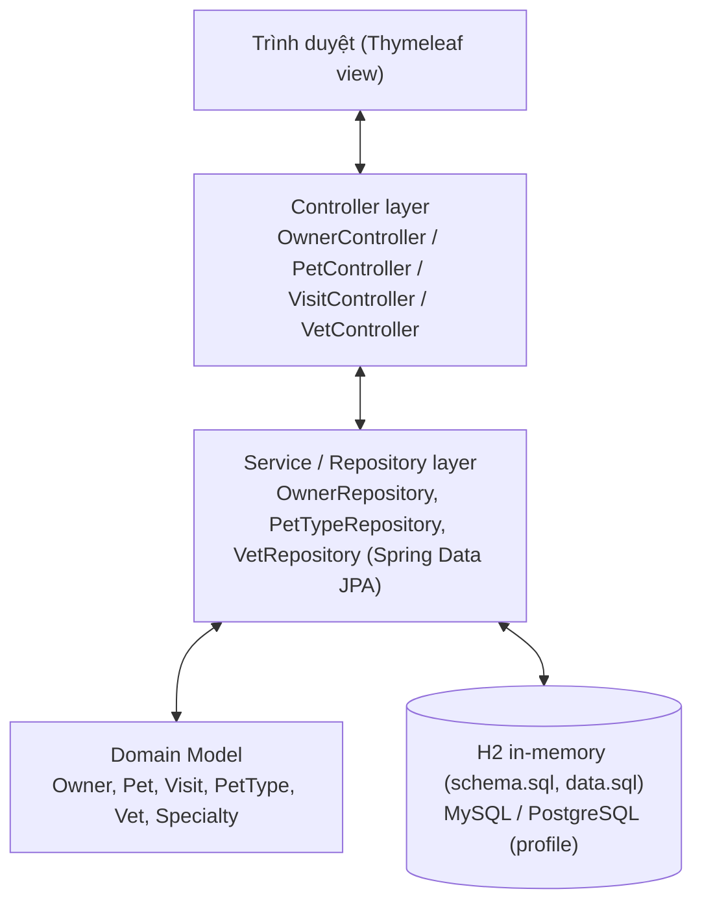
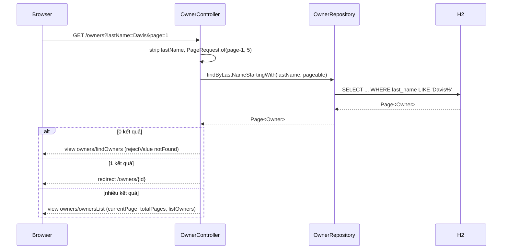
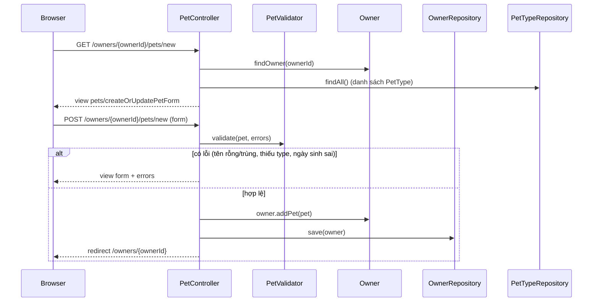
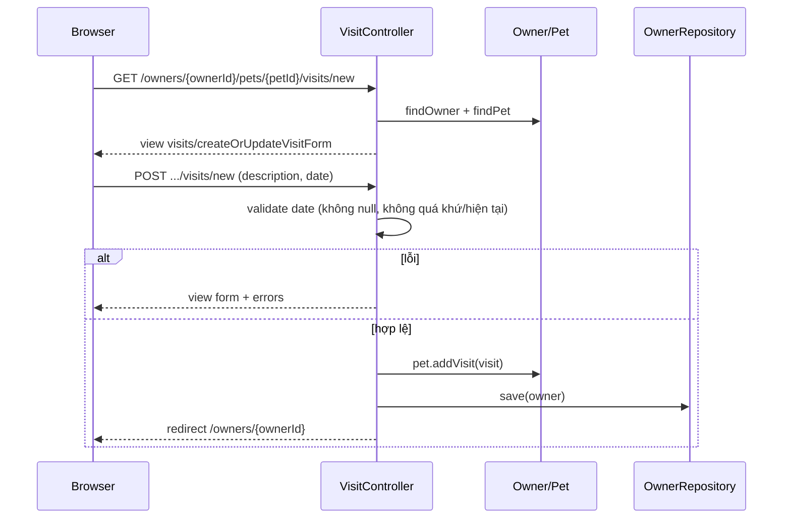

# Kiến trúc hệ thống Spring PetClinic (R01)
> Phạm vi: mô tả kiến trúc MVC, luồng dữ liệu của 3 nghiệp vụ trọng tâm và các module Owner/Pet/Visit/Vet.  

## 1. Tổng quan kiến trúc

Spring PetClinic là ứng dụng web Spring Boot theo mô hình **MVC phân tầng**, chạy trên **H2 in-memory** mặc định, render view bằng **Thymeleaf**.



### 1.1. Các tầng

| Tầng | Vai trò | Ví dụ trong repo |
|---|---|---|
| **View** | Thymeleaf templates render HTML | `src/main/resources/templates/owners/*`, `pets/*`, `visits/*`, `vets/*` |
| **Controller** | Nhận HTTP request, validate, điều phối, trả view/redirect | `OwnerController`, `PetController`, `VisitController`, `VetController`, `WelcomeController` |
| **Repository (DAO)** | Truy cập dữ liệu qua Spring Data JPA | `OwnerRepository`, `PetTypeRepository`, `VetRepository` |
| **Domain Model** | Entity + logic nghiệp vụ | `Owner`, `Pet`, `Visit`, `PetType`, `Vet`, `Specialty`, `BaseEntity`/`NamedEntity`/`Person` |
| **Database** | H2 mặc định; MySQL/PostgreSQL theo profile | `src/main/resources/db/{h2,mysql,postgres}/schema.sql` + `data.sql` |

### 1.2. Cấu hình & wiring

- Entry point: `PetClinicApplication` (Spring Boot).
- Web config: `WebConfiguration` (formatters, converters), `CacheConfiguration`.
- Spring Data JPA auto-config; `spring.jpa.hibernate.ddl-auto=none` → schema do `schema.sql` tạo.
- Seed data: `data.sql` (vets, specialties, pet types, owners, pets, visits).

## 2. Module và trách nhiệm

| Module | Lớp trung tâm | Vai trò nghiệp vụ |
|---|---|---|
| **Owner** | `Owner`, `OwnerController`, `OwnerRepository` | CRUD chủ nuôi, tìm kiếm theo họ, phân trang (page size 5), thêm pet/visit |
| **Pet** | `Pet`, `PetController`, `PetValidator`, `PetType`, `PetTypeFormatter`, `PetTypeRepository` | Thêm/sửa thú cưng, kiểm chuẩn tên–loại–ngày sinh, format `PetType` |
| **Visit** | `Visit`, `VisitController` | Đặt lịch khám trong tương lai, ghi mô tả bệnh án |
| **Vet** | `Vet`, `VetController`, `VetRepository`, `Specialty`, `Vets` | Danh sách bác sĩ thú y + chuyên khoa (ngoài phạm vi đột biến) |
| **System** | `WelcomeController`, `CrashController`, `WebConfiguration`, `CacheConfiguration` | Trang chủ, demo lỗi, cấu hình web/cache |

## 3. Luồng dữ liệu 3 nghiệp vụ trọng tâm

### 3.1. Luồng 1 — Tìm kiếm & phân trang chủ nuôi (Search & Paginate Owners)



**LƯU Ý**: page size cố định 5; redirect về page 1 nếu page ngoài biên; `lastName` rỗng → trả toàn bộ (broadest search).

### 3.2. Luồng 2 — Thêm thú cưng với validator (Create Pet with PetValidator)



**LƯU Ý**: `PetValidator` kiểm tra tên (không rỗng, không trùng trong cùng owner, ≤ 30 ký tự), `type` bắt buộc, `birthDate` hợp lệ; `Owner.addPet` chặn trùng cùng instance.

### 3.3. Luồng 3 — Đặt lịch khám & ghi bệnh án (Book Visit)



**LƯU Ý**: ngày khám phải ở tương lai (`LocalDate.now().plusDays(1)` trở đi); mô tả bệnh án bắt buộc.

## 4. Dependency & cấu hình chính

- **Build**: Maven wrapper `./mvnw`, Java 17, Spring Boot 4.1.0.
- **DB**: H2 in-memory mặc định (seed tự động); MySQL/PostgreSQL qua profile (cần Docker).
- **Test**: JUnit 6.0.3 (Jupiter), AssertJ, Mockito 5.23.0, MockMvc (`@WebMvcTest`).
- **Mutation**: `pitest-maven` 1.30.0 + `pitest-junit5-plugin` 1.2.3, mutator `STRONGER`, scope `owner.*`.

## 5. Cây thư mục (rút gọn)

```
src/
├── main/
│   ├── java/org/springframework/samples/petclinic/
│   │   ├── PetClinicApplication.java
│   │   ├── model/          # BaseEntity, NamedEntity, Person
│   │   ├── owner/          # Owner, Pet, Visit, PetType, *Controller, *Repository, PetValidator, PetTypeFormatter
│   │   ├── vet/            # Vet, Specialty, VetController, VetRepository
│   │   └── system/         # WebConfiguration, CacheConfiguration, WelcomeController, CrashController
│   └── resources/
│       ├── application*.properties
│       ├── db/{h2,mysql,postgres}/schema.sql + data.sql
│       ├── templates/      # Thymeleaf views
│       └── static/         # CSS, fonts, images
└── test/
    └── java/.../owner/     # 13 test files, 130 @Test (6 gốc + 7 mutation)
```

## 6. Ghi chú cho onboarding

- Entry point chạy: `./mvnw spring-boot:run` (port 8080 mặc định). Fallback port 8090: `./mvnw spring-boot:run -Dspring-boot.run.arguments=--server.port=8090`.
- Kiểm chứng 3 luồng: xem `docs/live-http-validation.md` (sau khi chạy).
- Chi tiết lệnh build/test/mutation: `README_TEST.md`.
